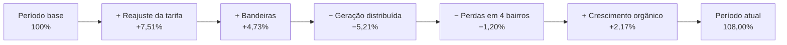
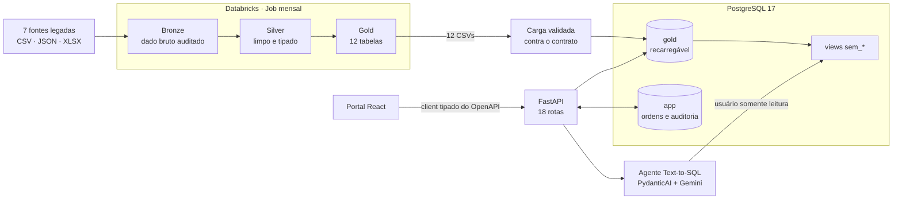

<p align="center">
  <picture>
    <source media="(prefers-color-scheme: dark)" srcset="docs/marca/ve360-lockup-dark-bg.svg">
    
  </picture>
</p>

<p align="center">
  <b>Por que a receita da V-Energy subiu só 8% se a tarifa residencial subiu 10,5%?</b><br>
  Pipeline de dados, portal e agente de IA construídos para responder a essa pergunta e às que vêm depois dela.
</p>

<p align="center">
  <a href="https://github.com/felipe-matias-dev/404-GhostNotFound/actions/workflows/ci.yml"></a>
  
  
  
  
  
</p>

<p align="center">Time 404-GhostNotFound · Rocket Lab 2026.2 · Visagio</p>

<p align="center">
  <a href="#a-resposta-em-30-segundos">Resposta</a> ·
  <a href="#para-quem-é">Para quem é</a> ·
  <a href="#arquitetura">Arquitetura</a> ·
  <a href="#por-que-confiar-nos-números">Confiabilidade</a> ·
  <a href="#o-agente-que-diz-não-sei">Agente de IA</a> ·
  <a href="#decisões-que-defendemos">Decisões</a> ·
  <a href="#como-executar">Como executar</a>
</p>

## A resposta em 30 segundos

Comparando o primeiro ano da base (jul/2022 a jun/2023) com os 12 meses mais recentes (jul/2025 a jun/2026), a receita de energia subiu **+8,00%** (R$ 117,83M → R$ 127,26M) enquanto a energia faturada caiu **−3,95%**. Quatro causas explicam a diferença:

1. **A geração distribuída explica toda a queda de volume.** As 3.510 unidades consumidoras que instalaram geração solar faturaram −11,2 GWh (−61,2%). Sem elas, o consumo do restante da base cresceu +1,07%.
2. **As bandeiras tarifárias esconderam a desaceleração.** O período atual teve 8 meses com bandeira acionada; o base, nenhum. Isso somou +R$ 5,57M. Sem bandeiras, a receita teria subido só +3,28%.
3. **A tarifa industrial freou o preço médio.** O subgrupo A4, com 40,2% do volume, teve cortes de −12,4% (mai/2025) e −5,2% (mai/2026) e terminou 1,1% abaixo de 2022, enquanto a residencial (B1) subiu +10,52%.
4. **A perda não técnica está concentrada e é recuperável.** Em 4 bairros de Recife e Jaboatão, o volume caiu −15,7%, contra +2,5% nos outros ~290. A recuperação estimada é de ~R$ 1,9M por ano em energia.

Ponte da receita de energia (% sobre o período base):



Hipóteses, método, tratamento das leituras negativas e recomendações: [diagnóstico da receita](docs/diagnostico-receita.md).

## Para quem é

Cada parte do sistema responde à pergunta de uma pessoa da V-Energy.

| Quem | Pergunta | Onde é respondida | Estado |
|---|---|---|---|
| **Henrique**, diretor comercial | Por que a receita não acompanhou a tarifa, e onde ela caiu? | Telas **Visão geral** (indicadores comercial, de rede e de atendimento) e **Receita** (ponte em cascata, mapa da Região Metropolitana do Recife, drill-down município → bairro → classe) | Pronto |
| **Rafael**, gerente de perdas | Quais unidades inspecionar primeiro, e em que pé está cada ordem? | Tela **Perdas**: ordens de inspeção em Kanban ou tabela, com gerar, enviar a campo, concluir e cancelar. Fila de suspeitas em `GET /fila-suspeitas` | Ordens prontas; fila pronta na API, tela em construção |
| **Camila**, atendimento | O que aconteceu com esta unidade consumidora, e por que a conta veio alta? | `GET /unidades-consumidoras/{cod_uc}/visao-360`: cadastro, consumo de 12 meses contra o ano anterior, faturas em aberto, medidor, interrupções, chamados e a regra da conta alta ([DEC-044](docs/decisoes.md#dec-044--visão-360-da-unidade-consumidora-rota-única-janela-da-gold-e-regra-da-conta-alta)) | API pronta, tela em construção |
| **Beatriz**, operação | Quais alimentadores e regiões têm o pior DEC e FEC? | `GET /continuidade/alimentadores/ranking`, `/mensal` e `/recortes` ([DEC-033](docs/decisoes.md#dec-033--dec-e-fec-por-período-e-recorte-e-a-fila-de-suspeitas-paginada)) | API pronta, tela em construção |
| **Patrícia**, diretora de TI | Os dados são confiáveis e seguros? Dá para perguntar em português? | Pipeline com travas de qualidade, agente Text-to-SQL em `POST /ai/ask` com auditoria e insight de IA em `GET /receita/insight` | Pipeline e API prontos; chat no portal em construção |

Na fila de perdas, o botão **Filtros** combina queda de consumo, motivo de medidor eletromecânico e percentual de leituras estimadas nas 12 últimas competências. Os filtros atuam na API antes da paginação. Percentuais são os inteiros já informados nos motivos da Gold, sem recálculo; ausência ou formato não reconhecido não vira zero e fica fora apenas da respectiva faixa ativa ([DEC-049](docs/decisoes.md#dec-049--filtro-de-queda-na-fila-de-suspeitas)).

<!-- Capturas do portal (João): docs/img/portal-visao-geral.png, docs/img/portal-receita.png, docs/img/portal-perdas.png -->

## Arquitetura



Três regras sustentam o desenho ([arquitetura e domínio](docs/arquitetura.md)):

- **Contrato antes de implementação.** Portal e agente trabalham contra o contrato da Gold ([`contracts/gold_schema.yaml`](contracts/gold_schema.yaml), v0.3.0) e uma amostra sintética desde o primeiro dia, sem esperar o dado real nem expor o dataset ([DEC-003](docs/decisoes.md#dec-003--walking-skeleton-com-amostra-sintética)). O frontend gera o client a partir de [`contracts/openapi.json`](contracts/openapi.json) e quebra na compilação se a API mudar ([DEC-005](docs/decisoes.md#dec-005--contrato-openapi-entre-api-e-frontend)).
- **A Gold é descartável; o trabalho do usuário, não.** A carga recria o schema `gold` a cada execução e nunca toca o `app`, onde ficam as ordens de inspeção e a auditoria do agente ([DEC-002](docs/decisoes.md#dec-002--banco-local-postgresql)).
- **Um número, uma fonte.** Cálculos de negócio (PVM, DEC/FEC, score de suspeita) ficam na Gold e no backend. O frontend só exibe, e o agente lê as métricas prontas em vez de recalculá-las.

| Camada | Tecnologia | Por que |
|---|---|---|
| Dados | Databricks (PySpark, compute serverless), Workflow em YAML | Bronze → Silver → Gold com travas entre as camadas e Job versionado no Git |
| Banco | PostgreSQL 17 em Docker | Usuário somente leitura nativo para o agente e schemas `gold`/`app` separados ([DEC-002](docs/decisoes.md#dec-002--banco-local-postgresql)) |
| API | FastAPI, SQLAlchemy 2.1, psycopg 3 | Mesma stack Pydantic do agente; energia e dinheiro em `numeric` ([DEC-010](docs/decisoes.md#dec-010--energia-e-dinheiro-como-numeric-número-na-api)) |
| Portal | React 19, TanStack Start (SPA), Tailwind 4, Base UI | Rotas, cache e tabelas do mesmo ecossistema; gráficos em SVG próprio ([DEC-037](docs/decisoes.md#dec-037--gráficos-do-portal-em-svg-próprio-com-d3-só-para-as-contas)) |
| Agente | PydanticAI, Gemini 3.1 Flash-Lite, sqlglot | Saída tipada e SQL validado por parser, não por regex ([spec do agente](ai-agent/docs/specs/2026-10-19-architecture-design.md)) |
| Qualidade | uv (workspace), ruff, Biome, pytest, Vitest, pre-commit, gitleaks, GitHub Actions | As mesmas checagens no commit e no CI ([DEC-007](docs/decisoes.md#dec-007--hooks-de-pre-commit-e-ci)) |

## Por que confiar nos números

- **O pipeline para antes de publicar dado errado.** Os notebooks conferem cada camada com travas como `exigir_sem_perda`, `exigir_chave_unica`, `exigir_sem_orfaos` e `exigir_mesma_contagem`. Na Gold, por exemplo: Gold + linhas excluídas = Silver, `efeito_preco = efeito_tarifa + efeito_bandeira` e nenhuma competência faltando. Uma falha interrompe o Job antes de exportar os CSVs ([DEC-039](docs/decisoes.md#dec-039--workflow-do-databricks-e-agendamento-mensal)).
- **Os problemas do dataset estão catalogados, não escondidos.** São 47 problemas em 8 fontes, mais 5 conferências cruzadas, cada um com a regra aplicada ([qualidade dos dados](docs/qualidade-dados.md)). Exemplo: as 8.016 leituras negativas são 6.299 trocas de medidor e 1.717 sinais invertidos, e as duas regras reproduzem o valor que a fatura cobrou.
- **O contrato da Gold é conferido no CI.** `backend/tests/test_contrato_gold.py` compara o YAML com os modelos e com a carga (nome, tipo, nulidade, chave). Se Dados mudar uma coluna, o CI aponta antes de a Gold real falhar na carga ([DEC-014](docs/decisoes.md#dec-014--o-backend-espelha-o-contrato-da-gold)).
- **A carga aguenta a Gold real.** São ~4 milhões de linhas em lotes de 10 mil, com pico de ~110 MB de memória. A primeira versão crescia ~1,9 KB por linha e derrubou um notebook de 8 GB. Uma rodada confere todos os arquivos antes de apagar a Gold anterior ([DEC-038](docs/decisoes.md#dec-038--carga-da-gold-em-lotes-com-uma-rodada-de-conferência-antes-de-gravar)).
- **Testes em todas as frentes.**

  | Frente | Testes | Onde rodam |
  |---|---|---|
  | Backend | 211 funções `pytest` | CI, contra um Postgres de verdade |
  | Agente de IA | 248 funções `pytest`, inclusive integração com o banco | CI, contra um Postgres de verdade |
  | Frontend | 46 casos Vitest e 24 stories no Storybook | CI, com checagem de tipos e build |

## O agente que diz "não sei"

Resposta inventada é pior do que nenhuma resposta. O agente gera um único `SELECT` sobre as views da camada semântica, executa e narra o resultado. Toda resposta volta com um status:

| Status | Quando |
|---|---|
| `answered` | Respondeu com dados, e todo número do texto saiu das linhas retornadas |
| `unknown` | Os dados não respondem à pergunta |
| `clarify` | A pergunta é ambígua (período, recorte); o agente pergunta de volta |
| `refused` | Pedido fora do escopo ou tentativa de manipulação |
| `failed` | Erro do banco ou do provedor; nunca vira exceção para o backend |

A segurança mora no banco e no validador, nunca no prompt:

1. **A pergunta tem no máximo 500 caracteres.** O conteúdo do usuário e do banco entra no prompt entre delimitadores com um rótulo aleatório a cada chamada: é dado, não instrução.
2. **O modelo só enxerga 9 views `sem_*`.** Nenhuma coluna sensível entra (titular e documento ficam fora), e a fila de suspeitas também fica fora, por decisão de produto ([DEC-022](docs/decisoes.md)).
3. **Todo SQL passa pelo `SqlglotValidator`.** Ele aceita um único `SELECT`, só views da allowlist e só funções que o parser conhece, e impõe um `LIMIT` de até 200 linhas.
4. **O banco executa em transação somente leitura.** A consulta tem `statement_timeout` de 10 s e roda com o usuário `venergy_agent`, que não tem acesso ao schema `app`.
5. **Os números do texto são conferidos com as linhas.** Se a narrativa citar um número que não está no resultado, a resposta volta a um texto determinístico com os valores ([spec §5.1](ai-agent/docs/specs/2026-10-19-architecture-design.md)).
6. **Toda resposta é auditada.** Fica gravada em `app.ai_auditoria` (pergunta, SQL, linhas, modelo, versão do prompt, latência) e pode ser lida em `GET /ai/audit/{id}` ([DEC-034](docs/decisoes.md#dec-034--auditoria-do-agente-de-ia-gravação-leitura-e-subida-sem-a-chave)).

**Avaliação.** Usamos um golden set de 93 perguntas e 17 ataques de red team. Toda mudança de prompt, modelo ou camada semântica só entra se o golden set não regredir ([DEC-016](docs/decisoes.md)). Última rodada (28/10/2026, [`eval/runs/2026-10-28T113557Z.json`](ai-agent/eval/runs/2026-10-28T113557Z.json)), sobre a amostra sintética:

| Métrica | Resultado |
|---|---|
| SQL com o resultado certo (execution accuracy) | 100% (48 de 48) |
| Status certo (respondeu, não sei, esclarecer, recusar) | 95,9% (71 de 74) |
| Red team: escritas aceitas, views alteradas, vazamentos de prompt | 0, 0, 0 |
| Latência p50 / p95 | 3,3 s / 15,3 s |

**Limitações conhecidas:**
- **Ainda não houve rodada sobre a Gold real.**
- **12 dos 93 itens do golden set têm revisão humana registrada.**
- **A fidelidade numérica do texto ficou em 68%, contra a meta de 100%.** Parte das falhas vem das suposições, que citam o período pedido e não um número das linhas ([spec §9.6](ai-agent/docs/specs/2026-10-19-architecture-design.md)).

### Atendimento: visão 360 da UC

Use **Consulta de UC** na sidebar ou Ctrl/Cmd + K para abrir a palette. Busque pelo código
exatamente como aparece na conta, preservando zeros iniciais, ou selecione uma consulta recente.
A sidebar separa **Análise** (Visão geral, Receita, Rede) de **Operação** (Consulta de UC, Perdas).
Somente os cinco códigos consultados com sucesso mais recentemente ficam salvos neste navegador,
sem titular ou valores; a ação **Limpar recentes** remove a lista.
O link `/uc?cod_uc=0001` continua abrindo a visão 360 diretamente. Sem código, `/uc` tem uma
entrada compacta para abrir a busca. A palette valida a consulta antes de navegar e a tela
reúne cadastro mascarado, consumo, contas pendentes, medidor/GD, interrupções e chamados em
uma única consulta: `GET /unidades-consumidoras/{cod_uc}/visao-360`. A rota antiga de cadastro
permanece disponível. O fluxo de entrada e os limites do histórico local estão na DEC-043.

O diagnóstico segue a DEC-044 e o `Uc360Schema` aprovado no PR #55: a referência é a última
competência **de toda a Gold**, não a última fatura da UC. A tendência vem do backend:
alta acima de +10%, queda abaixo de −10% e estabilidade na faixa inclusiva de ±10%.
Estabilidade pode incluir uma alta de 5%; a tela mostra os percentuais fornecidos pela API.
A variação de 12 meses considera somente pares com fatura e informa `meses_comparados`.
Lacunas são desconhecidas, não zero; base zero não tem percentual. Não há explicação causal
do valor da conta. Faturas pendentes não têm corte por período e os históricos são paginados
somente na apresentação. A Gold é histórica, não indica falta de energia em tempo real.
Diferenças da apresentação e limites em
[DEC-042](docs/decisoes.md#dec-042--visão-360-da-uc-e-comparação-sazonal-do-consumo).
A comparação monetária com o ano anterior, o tipo de leitura e a diferença absoluta em kWh
saíram da tela porque não estão no contrato aprovado; não são simulados por outras chamadas.

## Decisões que defendemos

O registro completo, com 38 decisões numeradas e as suposições, está em [`docs/decisoes.md`](docs/decisoes.md). Estas são as que mais mudam o produto.

**PostgreSQL com schemas `gold` e `app`** · [DEC-002](docs/decisoes.md#dec-002--banco-local-postgresql)
- **Problema:** o agente precisa de um usuário que só lê, e a recarga da Gold não pode apagar o trabalho de campo.
- **Decisão:** Postgres 17 em Docker, com o usuário `venergy_agent` limitado ao `SELECT` no schema `gold`.
- **Descartado:** SQLite, que dispensa instalação mas não tem usuários nem schemas.
- **Efeito:** o somente leitura do agente é garantido pelo banco, e as ordens de inspeção do Rafael sobrevivem a cada recarga.

**Ordens de inspeção como máquina de estados garantida no banco** · [DEC-009](docs/decisoes.md#dec-009--modelo-das-ordens-de-inspeção)
- **Decisão:** status `GERADA → EM_CAMPO → CONCLUIDA` ou `CANCELADA` (com volta de `EM_CAMPO` para `GERADA`, [DEC-048](docs/decisoes.md#dec-048--ordem-em-campo-pode-voltar-para-gerada)), histórico em `app.ordem_evento` e no máximo uma ordem ativa por unidade consumidora, garantida por índice único parcial.
- **Por que no banco:** uma checagem só no Python deixaria passar duas requisições simultâneas.
- **Sem FK para a Gold:** a carga apagaria as ordens ou falharia.
- **Descartado:** rotas por ação (`/concluir`, `/cancelar`), que espalham a validação.
- **Efeito:** cada visita fica no histórico, e o resultado registrado mede se a fila de suspeitas acerta.

**DEC e FEC calculados a partir dos componentes** · [DEC-033](docs/decisoes.md#dec-033--dec-e-fec-por-período-e-recorte-e-a-fila-de-suspeitas-paginada)
- **Problema:** DEC e FEC não se somam nem se tiram a média entre alimentadores ou bairros.
- **Decisão:** o indicador de um recorte sai da soma dos componentes dividida pela média mensal de unidades consumidoras, no backend.
- **Efeito:** a Beatriz vê o DEC de um bairro calculado do jeito certo, e não a média dos alimentadores.

**Decomposição gravada só para os mesmos meses em anos diferentes** · [DEC-028](docs/decisoes.md#dec-028--pares-de-períodos-da-decomposição-e-o-que-fica-para-o-backend)
- **Problema:** o efeito preço e o efeito mix não se somam mês a mês, então cada par de períodos precisa ser calculado inteiro.
- **Decisão:** gravar só os pares de mesmos meses em anos diferentes, cerca de 1 milhão de linhas.
- **Descartado:** gravar todas as combinações de intervalos, que passariam de 1 bilhão de linhas e misturariam a sazonalidade.

**Carga em lotes com conferência antes de gravar** · [DEC-038](docs/decisoes.md#dec-038--carga-da-gold-em-lotes-com-uma-rodada-de-conferência-antes-de-gravar)
- **Medição:** com 4 milhões de linhas, a memória caiu de ~7,8 GB (extrapolados) para 109 MB, em ~7 minutos.
- **Descartado:** `COPY` do Postgres, que exigiria converter listas, decimais e datas para o formato dele, e a validação linha a linha continuaria necessária.

**Agente só sobre views validadas por parser, e o LLM só narra** · [ADR-03 e ADR-04](docs/arquitetura.md#7-decisões-técnicas)
- **Descartado:** SQL livre e ferramentas parametrizadas.
- **Efeito:** mesmo com o prompt manipulado, o banco não aceita escrita. O insight das telas narra um JSON de métricas da Gold e é descartado se citar um número que não está nele.

**Workflow mensal e reprocessamento completo** · [DEC-039](docs/decisoes.md#dec-039--workflow-do-databricks-e-agendamento-mensal)
- **Agendamento:** dia 6, D+5 do fechamento do faturamento. Os detalhes estão em [Workflow no Databricks](#workflow-no-databricks).

## Como executar

Requer só o [Docker Desktop](https://www.docker.com/products/docker-desktop/) aberto. Na raiz:

```bash
# 1. Cria o .env com senhas e portas. Sem ele, o docker compose não sobe.
cp .env.example .env                       # no PowerShell: Copy-Item .env.example .env
mkdir -p data/gold                         # no PowerShell: mkdir data/gold

# 2. Sobe banco, API e frontend e espera ficarem prontos (a 1ª vez constrói as imagens)
docker compose up -d --wait

# 3. Gera a amostra sintética da Gold e carrega no banco
docker compose run --rm api python -m venergy_api.amostra
docker compose run --rm api python -m venergy_api.carga
```

| O quê | Onde |
|---|---|
| Portal | http://localhost:3000 |
| API e documentação interativa | http://127.0.0.1:8000/docs |
| Banco | `127.0.0.1:5433`, usuário `venergy` |

O agente de IA precisa de `GOOGLE_API_KEY` no `.env` (chave do Gemini, uma por pessoa). Sem ela,
tudo sobe, mas `POST /ai/ask` responde `503`. Cada resposta fica em `app.ai_auditoria` e se lê em
`GET /ai/audit/{id}` ([DEC-034](docs/decisoes.md)).

O código de `backend/src` e `frontend/src` é montado nos containers: API e portal
recarregam a cada mudança. Mudou dependência (`pyproject.toml`, `package.json`) ou
`vite.config.ts`? Rode `docker compose up -d --build`.

| Comando | Para quê |
|---|---|
| `docker compose logs -f api web` | Acompanhar os logs |
| `docker compose down` | Parar tudo (os dados do banco ficam) |
| `docker compose down -v` | Parar e apagar o banco (refaz o script de `infra/postgres/init`) |

O passo `mkdir` cria a pasta da Gold com o seu usuário. Sem ele, no Linux, o Docker a cria
como root e o gerador da amostra não consegue gravar.

### Atalhos com `make`

O `Makefile` da raiz só chama os comandos descritos neste README e no CI, para quem prefere um comando curto. Não é obrigatório: tudo continua funcionando com os comandos acima.

```bash
make           # lista os alvos
make setup     # copia os .env que faltam (nunca sobrescreve), instala dependências e hooks
make up        # sobe banco, API e portal
make test      # testes do backend e do agente (sobe o banco antes)
make ci        # roda local o mesmo que o CI: lint, testes e build do frontend
```

Funciona igual no macOS, no Linux e no Windows. As receitas usam só `uv`, `npm` e `docker`, sem comandos de shell específicos de um sistema.

<details>
<summary>Instalar o <code>make</code> no Windows</summary>

O `make` não vem instalado no Windows. Instale uma vez com **um** destes e rode `make` no PowerShell ou no terminal do VS Code:

```bash
winget install ezwinports.make
```

```bash
choco install make
```

```bash
scoop install make
```

</details>

### Sem Docker para API e frontend

Para rodar API e frontend direto na máquina, suba só o banco
(`docker compose up -d --wait db`) e siga [backend/README.md](backend/README.md) e
[frontend/README.md](frontend/README.md). É o caminho para rodar os testes do backend.

## Qualidade de código e CI

Hooks de pre-commit formatam e checam cada commit: ruff (Python), Biome (frontend),
segredos (gitleaks) e o contrato OpenAPI entre backend e frontend. Notebooks nunca são
modificados pelos hooks, para não conflitar com o Databricks.
Uma vez por clone, na raiz:

```bash
uv sync --all-packages && (cd frontend && npm ci)    # ferramentas usadas pelos hooks
uvx pre-commit install                               # requer uv
uvx pre-commit run --all-files                       # opcional: roda em tudo
```

Se um hook corrigir arquivos, o commit para: revise, rode `git add` e faça o commit de novo.

O CI ([`.github/workflows/ci.yml`](.github/workflows/ci.yml)) roda em todo PR e na `main`, em 5 jobs:

| Job | O que faz |
|---|---|
| `hooks` | Os mesmos hooks do pre-commit, mais o gitleaks no histórico inteiro |
| `backend` | `pytest` contra um Postgres de verdade |
| `ai-agent` | `pytest` do agente, inclusive os testes de integração com o banco |
| `frontend` | Checagem de tipos, Vitest e build |
| `docker` | Build das imagens do `docker compose` |

O contrato da API fica em [`contracts/openapi.json`](contracts/openapi.json), gerado
pelo FastAPI. O frontend gera dele um client tipado: ver
[frontend/README.md](frontend/README.md#client-da-api).

## Workflow no Databricks

O Job `v_energy_workflow` ([`data-engineering/workflow/v_energy_workflow.yaml`](data-engineering/workflow/v_energy_workflow.yaml))
roda `Landing_to_Bronze` → `Bronze_to_Silver` → `Silver_to_Gold` direto da branch `main` do GitHub, em compute serverless.
A última task grava a Gold e exporta os 12 CSVs para `/Volumes/v_energy/gold/csv`. O agendamento é mensal, no dia 6
(D+5 do fechamento do faturamento), e fica pausado porque o dataset do case é uma extração única
([DEC-039](docs/decisoes.md#dec-039--workflow-do-databricks-e-agendamento-mensal)).


**Para reexecutar:** em **Jobs & Pipelines → v_energy_workflow**, clique em **Run now** uma vez.

<details>
<summary>Estratégia de agendamento</summary>

| Decisão | Justificativa |
|---|---|
| **Mensal** | Os sistemas de origem fecham o faturamento uma vez por mês. Rodar todo dia gastaria compute sem dado novo. Rodar por evento exigiria um aviso de "faturamento fechado" vindo dos sistemas de origem; supomos que os sistemas legados não emitem esse aviso (o case não informa). |
| **Dia 6, às 03h** | D+5 do fechamento do ciclo de faturamento, de madrugada, fora do horário de uso do portal. O prazo de D+5 é suposição do time: o case não informa quando o faturamento fecha. |
| **Reprocessamento completo** | Cada run relê toda a landing e regrava Bronze, Silver e Gold. Com uma extração única e cerca de 15 minutos de execução, isso mantém o tudo ou nada de cada camada. Diverge da ADR-07, que previa carga incremental por competência: ela fica como evolução se o volume mensal crescer. |
| **Pausado** | O dataset do case é uma extração única; não há dado novo para buscar. |
| **Falha interrompe o pipeline** | As travas de cada notebook dão erro antes de publicar uma camada inconsistente, e o Job não segue para as camadas seguintes. O export dos CSVs só acontece com a Gold validada. |
| **Pronto para produção** | Basta despausar. A Bronze continua conferida contra a origem a cada run; a comparação com a gravação anterior (time travel, 7 dias de retenção) fica desligada no Job, porque com dado novo as gravações nunca são iguais. |

Detalhes e alternativas descartadas: [DEC-039](docs/decisoes.md#dec-039--workflow-do-databricks-e-agendamento-mensal).

</details>

## Estrutura do repositório

| Pasta | Conteúdo |
|---|---|
| [`data-engineering/`](data-engineering/) | Notebooks Bronze → Silver → Gold e o `.yaml` do Workflow |
| [`backend/`](backend/) | API do portal (FastAPI), carga da Gold e gerador da amostra sintética |
| [`frontend/`](frontend/) | Aplicação web (React + TypeScript + Vite) |
| [`ai-agent/`](ai-agent/) | Agente Text-to-SQL, camada semântica, insights de IA e suíte de avaliação |
| [`contracts/`](contracts/) | Contrato da Gold (`gold_schema.yaml`) e da API (`openapi.json`) |
| [`infra/`](infra/) | Script de criação dos schemas `gold` e `app` e do usuário somente leitura do agente |
| [`docs/`](docs/) | Diagnóstico da receita, arquitetura, dicionário de dados, qualidade dos dados e decisões |

## Documentação

| Documento | O que tem |
|---|---|
| [Diagnóstico da receita](docs/diagnostico-receita.md) | A resposta ao Henrique: hipóteses H1 a H8, ponte PVM e recomendações |
| [Arquitetura e domínio](docs/arquitetura.md) | Subdomínios, contextos, linguagem ubíqua, modelo da Gold e ADRs |
| [Decisões e suposições](docs/decisoes.md) | Cada decisão com motivo, alternativa descartada e autor |
| [Dicionário de dados](docs/dicionario-de-dados.md) | Definição de cada coluna e métrica da Gold |
| [Qualidade dos dados](docs/qualidade-dados.md) | Os 47 problemas do dataset e a regra aplicada a cada um |
| [Planejamento](docs/planejamento.md) e [backlog](docs/backlog.md) | Cronograma, hipóteses iniciais, épicos e histórias |
| [Spec do agente](ai-agent/docs/specs/2026-10-19-architecture-design.md) | Contrato, segurança e avaliação do agente de IA |

## Suposições

Toda suposição feita onde o case não é explícito está em [docs/decisoes.md](docs/decisoes.md), com data, motivo e autor.

## Time

| Frente | Integrantes |
|---|---|
| Engenharia de Dados | Arthur Oliveira, Alysson, Gabriel |
| Portal Web | Felipe Matias, João Euclides |
| Inteligência Artificial | Luis Felipe Perylo, Lucas Mendes |
