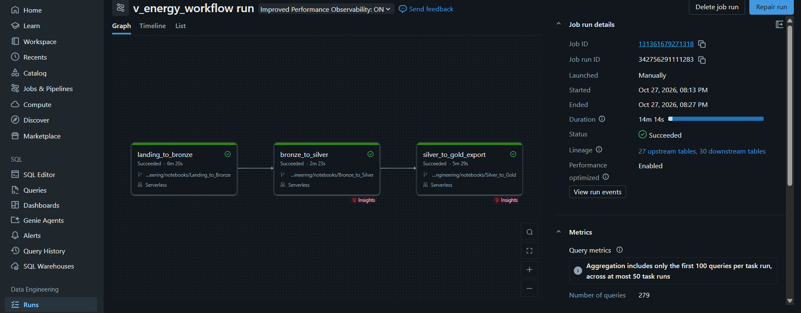

# V-Energy Grid 360 — Time 404-GhostNotFound

Plataforma de visão 360 da V-Energy (Rocket Lab 2026.2 · Visagio): pipeline de dados no Databricks, portal web e agente de IA, mais o diagnóstico da variação de receita.

## Estrutura

| Pasta | Conteúdo |
|---|---|
| [`data-engineering/`](data-engineering/) | Notebooks Bronze → Silver → Gold + `.yaml` do Workflow |
| [`backend/`](backend/) | API do portal (FastAPI) |
| [`frontend/`](frontend/) | Aplicação web (React + TypeScript + Vite) |
| [`ai-agent/`](ai-agent/) | Agente Text-to-SQL e insights de IA |
| [`docs/`](docs/) | Diagnóstico da receita, dicionário de dados e decisões |

## Time

| Frente | Integrantes |
|---|---|
| Engenharia de Dados | Arthur Oliveira, Alysson, Gabriel |
| Portal Web | Felipe Matias, João Euclides |
| Inteligência Artificial | Luis Felipe Perylo, Lucas Mendes |

## Visão geral e decisões de arquitetura

_TODO_

## Como executar localmente

_TODO: passo a passo dos módulos de dados e agente._

### Atalhos com `make`

O `Makefile` da raiz só chama os comandos descritos neste README e no CI, para quem prefere um comando curto. Não é obrigatório: tudo continua funcionando com os comandos das seções abaixo.

```bash
make           # lista os alvos
make setup     # copia os .env que faltam (nunca sobrescreve), instala dependências e hooks
make up        # sobe banco, API e portal
make test      # testes do backend e do agente (sobe o banco antes)
make ci        # roda local o mesmo que o CI: lint, testes e build do frontend
```

Funciona igual no macOS, no Linux e no Windows. As receitas usam só `uv`, `npm` e `docker`, sem comandos de shell específicos de um sistema. No Windows o `make` não vem instalado; instale uma vez com **um** destes e rode `make` no PowerShell ou no terminal do VS Code:

```bash
winget install ezwinports.make
```

```bash
choco install make
```

```bash
scoop install make
```

### Portal (banco, API e frontend) com Docker

Requer só o [Docker Desktop](https://www.docker.com/products/docker-desktop/) aberto. Na raiz:

```bash
# 1. Cria o .env com senhas e portas. Sem ele, o docker compose não sobe.
cp .env.example .env                       # no PowerShell: Copy-Item .env.example .env
mkdir -p data/gold                         # no PowerShell: mkdir data/gold

# 2. Sobe banco, API e frontend e espera ficarem prontos (a 1ª vez constrói as imagens)
docker compose up -d --wait

# 3. Gera a amostra sintética da Gold e carrega no banco
docker compose run --rm api python -m venergy_api.amostra
docker compose run --rm api python -m venergy_api.carga
```

| O quê | Onde |
|---|---|
| Portal | http://localhost:3000 |
| API e documentação interativa | http://127.0.0.1:8000/docs |
| Banco | `127.0.0.1:5433`, usuário `venergy` |

O agente de IA precisa de `GOOGLE_API_KEY` no `.env` (chave do Gemini, uma por pessoa). Sem ela
tudo sobe, mas `POST /ai/ask` responde `503`. Cada resposta fica em `app.ai_auditoria` e se lê em
`GET /ai/audit/{id}` ([DEC-034](docs/decisoes.md)).

O código de `backend/src` e `frontend/src` é montado nos containers: API e portal
recarregam a cada mudança. Mudou dependência (`pyproject.toml`, `package.json`) ou
`vite.config.ts`? `docker compose up -d --build`.

| Comando | Para quê |
|---|---|
| `docker compose logs -f api web` | Acompanhar os logs |
| `docker compose down` | Parar tudo (os dados do banco ficam) |
| `docker compose down -v` | Parar e apagar o banco (refaz o script de `infra/postgres/init`) |

O passo `mkdir` cria a pasta da Gold com o seu usuário; sem ele, no Linux, o Docker a cria
como root e o gerador da amostra não consegue gravar.

### Sem Docker para API e frontend

Para rodar API e frontend direto na máquina, suba só o banco
(`docker compose up -d --wait db`) e siga [backend/README.md](backend/README.md) e
[frontend/README.md](frontend/README.md). É o caminho para rodar os testes do backend.

## Qualidade de código

Hooks de pre-commit formatam e checam cada commit: ruff (Python), Biome (frontend),
segredos (gitleaks) e o contrato OpenAPI entre backend e frontend. Notebooks nunca são
modificados pelos hooks, para não conflitar com o Databricks.
Uma vez por clone, na raiz:

```bash
uv sync --all-packages && (cd frontend && npm ci)    # ferramentas usadas pelos hooks
uvx pre-commit install                               # requer uv
uvx pre-commit run --all-files                       # opcional: roda em tudo
```

Se um hook corrigir arquivos, o commit para: revise, `git add` e commite de novo. O CI
(`.github/workflows/ci.yml`) roda os mesmos hooks, os testes do backend, a checagem de
tipos e o build do frontend e o build das imagens Docker em todo PR.

O contrato da API fica em [`contracts/openapi.json`](contracts/openapi.json), gerado
pelo FastAPI. O frontend gera dele um client tipado: ver
[frontend/README.md](frontend/README.md#client-da-api).

## Execução do Workflow no Databricks

O Job `v_energy_workflow` ([`data-engineering/workflow/v_energy_workflow.yaml`](data-engineering/workflow/v_energy_workflow.yaml))
roda `Landing_to_Bronze` → `Bronze_to_Silver` → `Silver_to_Gold` direto da branch `main` do GitHub, em compute serverless.
A última task grava a Gold e exporta os 12 CSVs para `/Volumes/v_energy/gold/csv`. O agendamento é mensal, no dia 6
(D+5 do fechamento do faturamento), e fica pausado porque o dataset do case é uma extração única
([DEC-039](docs/decisoes.md#dec-039--workflow-do-databricks-e-agendamento-mensal)).



**Para reexecutar:** em **Jobs & Pipelines → v_energy_workflow**, clique em **Run now** uma vez.

### Estratégia de agendamento

| Decisão | Justificativa |
|---|---|
| **Mensal** | Os sistemas de origem fecham o faturamento uma vez por mês. Rodar todo dia gastaria compute sem dado novo. Rodar por evento exigiria um aviso de "faturamento fechado" vindo dos sistemas de origem; supomos que os sistemas legados não emitem esse aviso (o case não informa). |
| **Dia 6, às 03h** | D+5 do fechamento do ciclo de faturamento, de madrugada, fora do horário de uso do portal. O prazo de D+5 é suposição do time: o case não informa quando o faturamento fecha. |
| **Reprocessamento completo** | Cada run relê toda a landing e regrava Bronze, Silver e Gold. Com uma extração única e cerca de 15 minutos de execução, isso mantém o tudo ou nada de cada camada. Diverge da ADR-07, que previa carga incremental por competência: ela fica como evolução se o volume mensal crescer. |
| **Pausado** | O dataset do case é uma extração única; não há dado novo para buscar. |
| **Falha interrompe o pipeline** | As travas de cada notebook dão erro antes de publicar uma camada inconsistente, e o Job não segue para as camadas seguintes. O export dos CSVs só acontece com a Gold validada. |
| **Pronto para produção** | Basta despausar. A Bronze continua conferida contra a origem a cada run; a comparação com a gravação anterior (time travel, 7 dias de retenção) fica desligada no Job, porque com dado novo as gravações nunca são iguais. |

Detalhes e alternativas descartadas: [DEC-039](docs/decisoes.md#dec-039--workflow-do-databricks-e-agendamento-mensal).

## Dicionário de dados e diagnóstico da receita

- [Dicionário de dados](docs/dicionario-de-dados.md)
- [Diagnóstico da receita](docs/diagnostico-receita.md)

## Suposições

Ver [docs/decisoes.md](docs/decisoes.md).
