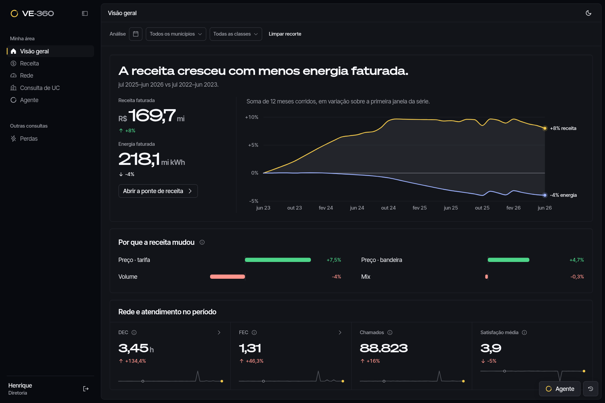
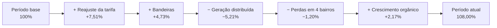
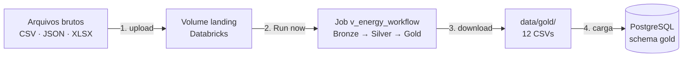
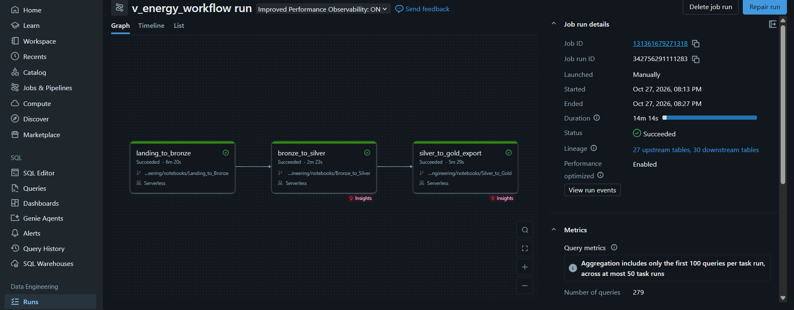

<div align="center">

<picture>
  <source media="(prefers-color-scheme: dark)" srcset="docs/marca/ve360-lockup-dark-bg.svg">
  
</picture>

**Por que a receita da V-Energy subiu só 8% se a tarifa residencial subiu 10,5%?**<br>
Pipeline de dados, portal e agente de IA construídos para responder a essa pergunta e às que vêm depois dela.

[Instalar](#instalação) • [Seus dados](#trazendo-os-arquivos-brutos) • [Documentação](docs/README.md) • [Diagnóstico](docs/diagnostico-receita.md) • [Decisões](docs/decisoes.md)

[](https://github.com/felipe-matias-dev/404-GhostNotFound/actions/workflows/ci.yml)


Time 404-GhostNotFound · Rocket Lab 2026.2 · Visagio



</div>

---

### Sumário

- [Introdução](#introdução)
- [A resposta em 30 segundos](#a-resposta-em-30-segundos)
- [Funcionalidades](#funcionalidades)
- [Arquitetura](#arquitetura)
- [Pré-requisitos](#pré-requisitos)
- [Instalação](#instalação)
- [Trazendo os arquivos brutos](#trazendo-os-arquivos-brutos)
- [Suposições](#suposições)
- [Documentação](#documentação)
- [Time](#time)

# Introdução

> A tarifa subiu, a receita não acompanhou, e ninguém sabia dizer por quê. Sete
> sistemas legados, cada um com a sua versão da verdade. Este é o projeto que
> junta as sete numa só.

O **V-Energy Grid 360** é a plataforma de dados da distribuidora V-Energy. Os
arquivos brutos dos sistemas legados entram num pipeline Bronze → Silver → Gold no
Databricks; a Gold chega a um PostgreSQL local; e um portal web e um agente de IA
respondem às perguntas da diretoria, de perdas, da operação, do atendimento e de TI
sobre o mesmo número.

O desenho segue quatro princípios:

+ **Um número, uma fonte.** DEC/FEC, efeito preço × volume e score de suspeita são
  calculados na Gold e no backend. O portal só exibe, e o agente lê as métricas
  prontas em vez de recalculá-las.
+ **Contrato antes de implementação.** Portal e agente trabalham contra o contrato da
  Gold e uma amostra sintética desde o primeiro dia. Se o contrato mudar, o CI quebra
  antes da carga.
+ **A Gold é descartável; o trabalho do usuário, não.** A carga recria a Gold a cada
  execução e nunca toca nas ordens de inspeção nem na auditoria do agente.
+ **"Não sei" é melhor do que inventado.** O agente responde com status (`answered`,
  `unknown`, `clarify`, `refused`, `failed`), e todo número do texto sai das linhas
  que o banco devolveu.

# A resposta em 30 segundos

Comparando o primeiro ano da base (jul/2022 a jun/2023) com os 12 meses mais recentes
(jul/2025 a jun/2026), a receita de energia subiu **+8,00%** (R$ 117,83M → R$ 127,26M)
enquanto a energia faturada caiu **−3,95%**. Quatro causas explicam a diferença:

1. **A geração distribuída explica toda a queda de volume.** As 3.510 UCs que instalaram
   geração solar faturaram −11,2 GWh (−61,2%). Sem elas, o consumo cresceu +1,07%.
2. **As bandeiras tarifárias esconderam a desaceleração.** Oito meses de bandeira
   acionada somaram +R$ 5,57M. Sem bandeiras, a receita teria subido só +3,28%.
3. **A tarifa industrial freou o preço médio.** O subgrupo A4, com 40,2% do volume,
   terminou 1,1% abaixo de 2022, enquanto a residencial (B1) subiu +10,52%.
4. **A perda não técnica está concentrada e é recuperável.** Em 4 bairros de Recife e
   Jaboatão o volume caiu −15,7%; a recuperação estimada é de ~R$ 1,9M por ano.



Hipóteses, método e recomendações: [diagnóstico da receita](docs/diagnostico-receita.md).

# Funcionalidades

- **Visão geral e Receita** para a diretoria: ponte em cascata da receita, mapa da
  Região Metropolitana do Recife e drill-down município → bairro → classe.
- **Rede** para a operação: DEC e FEC por alimentador e bairro contra o período base,
  quem piorou e "por que a luz cai", com mapa coroplético.
- **Perdas** para a equipe de inspeção: fila de suspeitas com mapa e acerto das inspeções,
  ordens em Kanban que se atualiza sozinho, prazos por etapa e planilha de campo de ida e volta.
- **Visão 360 da UC** para o atendimento: cadastro, consumo, faturas em aberto, medidor,
  interrupções, chamados e "por que a conta mudou", em reais.
- **Insights de IA nas cinco telas,** gerados sob pedido: a IA escolhe entre leituras que o
  backend calcula, e o texto é descartado se citar um número fora delas.
- **Agente Text-to-SQL** em português: um `SELECT` validado por parser, executado
  somente leitura, com auditoria de cada resposta. Como o agente e os insights
  funcionam, por que foram desenhados assim e o que descartamos:
  [README do agente de IA](ai-agent/README.md).
- **Pipeline Medalhão no Databricks** com travas entre as camadas: uma falha para o Job
  antes de publicar dado errado. 47 problemas do dataset catalogados, cada um com a
  sua regra.
- **Login por cargo** com cookie `HttpOnly`, permissão checada no backend e limite de
  tentativas.
- **Um comando para subir tudo:** banco, API e portal no Docker Compose, com
  recarga automática do código.

Tour completo por perfil: [guia do portal](docs/portal.md).

# Arquitetura

Os arquivos brutos passam por Bronze → Silver → Gold no Databricks; a Gold chega ao
PostgreSQL pela carga; a API serve o portal e chama o agente, que lê só as views da
camada semântica.

| Camada | Tecnologia | Por que |
|---|---|---|
| Dados | Databricks (PySpark, compute serverless), Workflow em YAML | Bronze → Silver → Gold com travas entre as camadas e Job versionado no Git |
| Banco | PostgreSQL 17 em Docker | Usuário somente leitura nativo para o agente, que só lê o schema `semantic`, e schemas `gold`/`app` separados ([DEC-002](docs/decisoes.md#dec-002--banco-local-postgresql), [DEC-056](docs/decisoes.md#dec-056--views-do-agente-no-schema-semantic-d1)) |
| API | FastAPI, SQLAlchemy 2.1, psycopg 3 | Mesma stack Pydantic do agente; energia e dinheiro em `numeric` ([DEC-010](docs/decisoes.md#dec-010--energia-e-dinheiro-como-numeric-número-na-api)) |
| Portal | React 19, TanStack Start (SPA), Tailwind 4, Base UI | Rotas, cache e tabelas do mesmo ecossistema; gráficos em SVG próprio ([DEC-037](docs/decisoes.md#dec-037--gráficos-do-portal-em-svg-próprio-com-d3-só-para-as-contas)) |
| Agente | PydanticAI, Gemini 3.1 Flash-Lite, sqlglot | Saída tipada e SQL validado por parser, não por regex ([spec do agente](ai-agent/docs/specs/2026-10-19-architecture-design.md)) |
| Qualidade | uv (workspace), ruff, Biome, pytest, Vitest, pre-commit, gitleaks, GitHub Actions | As mesmas checagens no commit e no CI ([DEC-007](docs/decisoes.md#dec-007--hooks-de-pre-commit-e-ci)) |

Diagramas, ADRs e domínio: [arquitetura](docs/arquitetura.md). Principais decisões
arquiteturais, travas do pipeline e testes: [confiabilidade](docs/confiabilidade.md).

# Pré-requisitos

O projeto é todo dockerizado: o único requisito para subir banco, API e portal é o
**Docker com o Compose v2** (Docker Engine no Linux, Docker Desktop no macOS ou no
Windows). Nada de Python, Node ou PostgreSQL na máquina.

Dois recursos dependem de serviços externos, e o resto funciona sem eles:

| Para | Você precisa de | Sem isso |
|---|---|---|
| Perguntar ao agente de IA e gerar insights | Uma chave do Gemini ([aistudio.google.com](https://aistudio.google.com)), uma por pessoa | Tudo sobe; o chat responde `503` e os insights mostram só a leitura automática do backend |
| Processar os arquivos brutos do case | Um workspace do Databricks com Unity Catalog | O portal roda com a amostra sintética |

Opcionais, para quem vai desenvolver:

- **`make`:** atalhos curtos para os comandos abaixo e para o CI (`make help` lista todos).
- **`uv` (Python 3.12) e Node 22:** só para rodar API, agente ou portal fora do Docker,
  rodar os testes e instalar os hooks de commit. Ver [contribuindo](docs/contribuindo.md).

# Instalação

Na raiz do repositório:

```bash
cp .env.example .env          # senhas, portas e, se tiver, a GOOGLE_API_KEY
mkdir -p data/gold            # pasta da Gold, criada com o seu usuário

docker compose up -d --wait   # banco, API e portal (a 1ª vez constrói as imagens)

docker compose run --rm api python -m venergy_api.amostra   # gera a Gold sintética
docker compose run --rm api python -m venergy_api.carga     # carrega no banco
docker compose run --rm api python -m venergy_api.usuarios  # cria os 5 logins de demonstração
```

Abra **http://localhost:3000** e entre com `henrique`, `camila`, `rafael`, `beatriz` ou
`patricia`, com a senha `SENHA_DEMO` do `.env`. A API documentada fica em
http://127.0.0.1:8000/docs.

Com `make` e `uv` instalados, depois do `mkdir`, o mesmo fica `make up sample load users`
(o `make` cria o `.env` se faltar). Para parar: `docker compose down` (o banco fica) ou
`docker compose down -v` (apaga o banco).

Logins e perfis, chave do Gemini, observabilidade, execução fora do Docker e problemas
comuns: [guia de instalação](docs/instalacao.md).

# Trazendo os arquivos brutos

A amostra sintética serve para conhecer o portal. Os números de verdade vêm dos arquivos
brutos do case, que **nunca vão para o Git** (`data/` está no `.gitignore`).



1. **Envie os brutos** (`unidades_consumidoras.csv`, `faturas.csv`, a pasta `leituras/`,
   `medidores.csv`, `ocorrencias_rede.csv`, `geracao_distribuida.csv`,
   `atendimentos.json` e `inspecoes.xlsx`) para o volume
   `/Volumes/v_energy/default/landing/`.
2. **Rode o Job** `v_energy_workflow` em **Jobs & Pipelines → Run now**. Ele lê os
   notebooks direto da `main` e exporta a Gold para `/Volumes/v_energy/gold/csv`.
3. **Baixe os 12 CSVs** desse volume para `data/gold/`, substituindo a amostra.
4. **Carregue:** `docker compose run --rm api python -m venergy_api.carga`.



A carga confere cada linha contra o contrato antes de gravar: um arquivo fora do
contrato cancela tudo e o banco continua como estava. As ordens de inspeção e a
auditoria do agente nunca são apagadas.

Criação do catálogo, comandos da CLI do Databricks, Gold em outra pasta e o que fazer
quando a carga falha: [dos arquivos brutos ao portal](docs/dados-brutos.md).

# Suposições

As principais suposições feitas onde o case não é explícito. A lista completa, com data,
motivo e autor, está nas [decisões](docs/decisoes.md).

- **O faturamento fecha uma vez por mês, e o Job roda no dia 6 (D+5):** o case não diz
  quando o faturamento fecha ([DEC-039](docs/decisoes.md#dec-039--workflow-do-databricks-e-agendamento-mensal)).
- **DEC e FEC seguem a definição simplificada do case:** cada ocorrência é uma UC
  interrompida, e o denominador é o de UCs faturadas do alimentador; os valores comparam
  alimentadores e períodos, não os limites da ANEEL
  ([DEC-030](docs/decisoes.md#dec-030--regras-aplicadas-na-gold-ucs-ocorrências-gd-e-fila-de-suspeitas)).
  DEC e FEC de um período saem da soma dos componentes
  ([DEC-033](docs/decisoes.md#dec-033--dec-e-fec-por-período-e-recorte-e-a-fila-de-suspeitas-paginada)).
- **"Receita" sem qualificador é a receita faturada (com tributos)**
  ([DEC-022](docs/decisoes.md#dec-022--regras-do-agente-sobre-a-gold-e-decisões-da-daily-de-2110));
  a decomposição preço × volume × mix usa a receita de energia, sem tributos
  ([DEC-073](docs/decisoes.md#dec-073--receita_energia-confirmada-como-base-do-pvm-e-da-tarifa-média)).
- **A bandeira é um acréscimo fixo por kWh, igual em todas as classes,** como aparece no
  dado ([DEC-029](docs/decisoes.md#dec-029--método-do-efeito-bandeira)).
- **Os períodos comparados são os mesmos meses em anos diferentes** (ex.: jul/2022 a
  jun/2023 contra jul/2025 a jun/2026)
  ([DEC-028](docs/decisoes.md#dec-028--pares-de-períodos-da-decomposição-e-o-que-fica-para-o-backend)).
- **As UCs com prefixo `TESTE` são cadastro de teste do sistema de origem,** e não receita
  a recuperar ([DEC-067](docs/decisoes.md#dec-067--ucs-de-teste-do-cadastro-ficam-na-gold-documentadas)).
- **Uma ordem de inspeção está atrasada** com mais de 5 dias gerada ou mais de 10 em campo;
  os prazos são do time, não do case
  ([DEC-064](docs/decisoes.md#dec-064--tempo-das-ordens-no-status-e-por-etapa)).
- **Cinco perfis de acesso, um por liderança do case,** com a escrita nas ordens só para
  perdas ([DEC-049](docs/decisoes.md#dec-049--login-com-cookie-httponly-e-perfis-por-cargo)).

# Documentação

| Para | Leia |
|---|---|
| Entender a resposta ao case | [Diagnóstico da receita](docs/diagnostico-receita.md) |
| Instalar e operar o ambiente | [Instalação](docs/instalacao.md) · [Dos arquivos brutos ao portal](docs/dados-brutos.md) |
| Usar o portal | [Guia do portal](docs/portal.md) |
| Usar e avaliar o agente | [Agente de IA](docs/agente-ia.md) · [Como o agente e os insights funcionam](ai-agent/README.md) |
| Saber por que confiar | [Confiabilidade e decisões em destaque](docs/confiabilidade.md) |
| Ir a fundo | [Arquitetura](docs/arquitetura.md) · [Dicionário de dados](docs/dicionario-de-dados.md) · [Qualidade dos dados](docs/qualidade-dados.md) · [Decisões](docs/decisoes.md) |
| Contribuir | [Contribuindo](docs/contribuindo.md) |

Índice completo: [`docs/`](docs/README.md).

# Time

| Frente | Integrantes |
|---|---|
| Engenharia de Dados | Arthur Oliveira, Alisson Ramos, Gabriel Marinho |
| Portal Web | Felipe Matias, João Euclides |
| Inteligência Artificial | Luis Felipe Perylo, Lucas Mendes |
