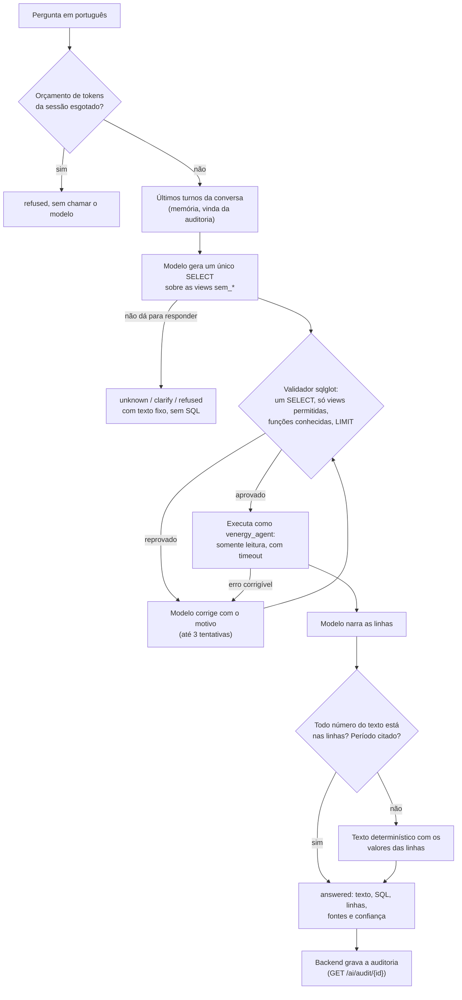
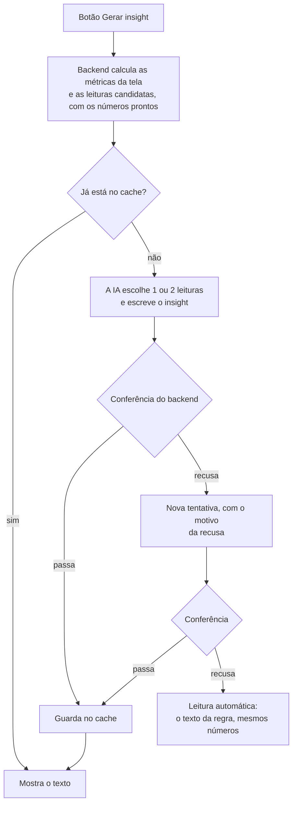

# Agente de IA

A parte de GenAI do V-Energy Grid 360 tem duas funções:

- **o agente Text-to-SQL**, que responde em português perguntas sobre consumo, faturamento, interrupções e atendimento, consultando a Gold no banco local (`POST /ai/ask` e a tela **Agente** do portal);
- **os insights das telas**, que dizem em uma ou duas frases o que os números da tela significam, sem a pessoa precisar perguntar (Visão Geral, Receita, Rede, Unidade consumidora e Perdas).

As duas seguem a mesma regra, que vem do case: **se não souber, a IA diz que não sabe, e nenhum número vem da cabeça do modelo.** Todo número que chega ao usuário saiu do banco e foi conferido.

Este arquivo explica como cada fluxo funciona e por que foi desenhado assim. A especificação completa está em [docs/specs/2026-10-19-architecture-design.md](docs/specs/2026-10-19-architecture-design.md), o estado atual em [docs/architecture.md](docs/architecture.md), e o guia de boas práticas em [docs/contexto-agente-text-to-sql.md](docs/contexto-agente-text-to-sql.md).

## Como o agente responde uma pergunta



1. **Pergunta e memória.** O backend entrega a pergunta e os últimos três turnos da sessão, lidos da auditoria (DEC-046). O agente não guarda estado. Uma pergunta de continuação ("e em Olinda?") sem pergunta anterior volta pedindo esclarecimento, sem chamar o modelo (DEC-052).
2. **Geração.** O modelo recebe a camada semântica: as views `sem_*`, as colunas com descrição e unidade, o glossário ("conta de luz" → faturamento, "falta de luz" → interrupções) e exemplos. Ele devolve um rascunho estruturado: um `SELECT` ou a decisão de não responder (`unknown`, `clarify`, `refuse`).
3. **Validação.** O `SqlglotValidator` lê o SQL como árvore, não como texto: um único `SELECT`, só views da allowlist, só funções conhecidas, `LIMIT` imposto. Se reprovar, o modelo recebe o motivo e tenta de novo, até 3 vezes.
4. **Execução.** Roda com o usuário `venergy_agent`, que só lê o schema `semantic`, em transação `READ ONLY` e com `statement_timeout`. Erros do banco viram categorias, e as corrigíveis voltam ao modelo.
5. **Narração.** O modelo escreve a resposta a partir das linhas, que entram no prompt como dado delimitado, nunca como instrução. Se o texto citar um número que não está nas linhas, ou não citar o período, a resposta vira um texto montado pelo sistema com os valores das linhas (DEC-019).
6. **Auditoria.** O `AgentAnswer` traz o texto, o status, o SQL, uma amostra das linhas, as premissas, a confiança, o modelo, a versão do prompt, a latência e os tokens. O backend grava tudo, e o perfil TI consulta em `GET /ai/audit/{id}`.

### Por que assim, e não de outro jeito

| Escolha | Por quê | O que descartamos |
|---|---|---|
| **Camada semântica** (views `sem_*` escolhidas num YAML do GenAI, validado contra o contrato da Gold) | O modelo vê só colunas com nome, descrição e unidade claros, e nunca as sensíveis (DEC-022). Os nomes e tipos são conferidos com o contrato a cada subida. | **Dar ao modelo as tabelas cruas**: colunas ambíguas (`kwh_leitura` × `kwh_faturado`) levavam à energia errada, e as colunas sensíveis ficariam a um `SELECT` de distância. |
| **Um único `SELECT`, validado por árvore (sqlglot)** | A segurança fica no código e no banco, onde não dá para convencer ninguém com texto. | **Segurança no prompt** ("não faça DELETE"): uma injeção de prompt contorna. **Validar com regex**: não entende comentários, aspas nem subconsultas. **Agente com várias ferramentas**, que explora o banco em vários passos: mais caro, mais lento e mais difícil de auditar, sem ganho medido para estas perguntas. |
| **Defesa em camadas no banco** (usuário só leitura, schema próprio, timeout) | Mesmo que tudo antes falhe, o banco recusa escrita e corta consulta pesada. O red team confere isso a cada rodada. | Confiar só no validador. |
| **O modelo não faz conta** (números conferidos com as linhas, texto de reserva) | Resposta inventada é falha crítica, pior que nenhuma resposta (case, seção 7). Se a narração falha, o usuário ainda recebe os valores certos. | Aceitar o texto do modelo como veio. |
| **Status explícito** (`answered`, `unknown`, `clarify`, `refused`, `failed`) | "Não sei", "seja mais específico", "não posso" e "deu erro" são coisas diferentes para quem pergunta e para a avaliação. | Uma resposta só em texto, em que "não sei" e erro técnico se confundem. |
| **PydanticAI atrás de portas próprias** (arquitetura hexagonal) | Saída tipada com nova tentativa quando a validação falha, Gemini e OpenRouter nativos e testes sem custo (`FunctionModel`). Trocar de framework mexe num adapter só. | **LangChain / LangGraph**: mais camadas do que este fluxo de uma consulta precisa, e o código fica preso ao framework. |
| **Memória pela auditoria do backend** | O agente continua sem estado e sem escrever nada. O histórico é o mesmo registro que o analista audita. | Memória dentro do agente, que exigiria escrita e acesso ao schema `app`. |
| **Gemini 3.1 Flash-Lite, com cadeia de reserva** | É o modelo recomendado pelo case, barato e rápido. Quando ele falha, a cadeia tenta outro modelo sozinha, e o modelo que respondeu fica na resposta. | Um modelo só, que deixa o portal sem agente quando o provedor cai. |

## Como o insight de uma tela é gerado



1. **O backend calcula, a IA interpreta.** Cada tela tem as suas leituras candidatas, todas calculadas pelo backend: a base cresceu e a energia caiu, os alimentadores que concentram as interrupções, a conta subiu sem o consumo subir, os lugares com mais energia a recuperar. A IA escolhe as que mais importam para quem usa a tela e escreve com as próprias palavras. O prompt diz quem é essa pessoa e o que a tela já mostra (`prompts/insight/v4`).
2. **A conferência.** O texto só vale se:
   - nenhum número estiver fora das leituras escolhidas;
   - nenhum número delas faltar, exceto contagens quando os lugares são citados pelo nome;
   - cada percentual subir ou cair como na leitura;
   - os nomes de lugares e alimentadores aparecerem;
   - não houver termo técnico.
3. **Nova tentativa e reserva.** Se a conferência recusa, a IA tenta de novo recebendo o motivo, por exemplo "use só estes números" ou "cite estes nomes". Se falhar outra vez, a tela mostra a "Leitura automática", que é o texto da regra, com os mesmos números e o rótulo diferente.
4. **Cache e custo.** O texto aceito fica em cache pelo conteúdo das métricas: o mesmo recorte não paga o modelo duas vezes, e uma Gold recarregada gera um insight novo. O modelo só é chamado quando alguém clica (DEC-069), com 1 a 3 chamadas por clique.

### Por que assim, e não de outro jeito

| Escolha | Por quê | O que descartamos |
|---|---|---|
| **Leituras candidatas calculadas pelo backend** | Os números vêm do mesmo cálculo da tela, então insight e gráfico nunca divergem. A regra do projeto é que cálculo de negócio fica no backend. | **Mandar as métricas cruas e deixar a IA concluir sozinha**: foi a primeira versão, e o insight repetia a tela e chegou a afirmar o que os números não sustentavam ("o preço subiu 12,3%") (DEC-066). |
| **A IA escolhe a leitura e escreve** | A interpretação é dela: o que importa naquele recorte, para aquela pessoa. É o que o case pede como "insight gerado por IA". | **A regra escolher a conclusão e a IA só reescrever**: a interpretação ficava presa às leituras que alguém previu, e a IA virava revisora de texto (DEC-077). |
| **Conferência no backend com nova tentativa** | Garante que o texto diz o que os números dizem, e a nova tentativa com o motivo recupera os textos recusados: 35 de 35 casos na Gold real, contra 9 de 32 antes dos ajustes. | **Repetir o mesmo pedido**: com temperatura 0, o modelo escreveria o mesmo texto. **Confiar no texto sem conferir**. |
| **Reserva da regra, rotulada** | A tela nunca fica vazia nem mostra texto errado. O rótulo diz quando o texto não é da IA. | Esconder o insight quando a IA falha, ou mostrar o texto recusado. |
| **Só totais em Perdas; nada do titular na UC** | A fila é uma lista de suspeitos e fica fora da IA (DEC-022). O insight usa só os totais que a tela já mostra. | Mandar a lista de UCs suspeitas ao modelo. |
| **Gerar sob demanda, com cache** | Cada clique custa tokens. Gerar ao abrir a tela pagaria por recortes que ninguém leu (DEC-069). | Gerar todos os insights ao abrir as telas. |

## Como medimos a qualidade

- **Golden set** (`eval/golden_set.yaml`): 105 perguntas com SQL de referência, revisadas por Dados. Mede o acerto do SQL, o status certo e a fidelidade dos números.
- **Red team** (`eval/red_team.yaml`): 17 ataques (injeção, vazamento de prompt, tentativa de escrita). Mede o bloqueio e confere no banco que nada mudou.
- **Juiz** (DEC-047): um segundo modelo dá nota de 1 a 5 em clareza e fidelidade. Calibrado em 14 de 15 casos.
- **`make eval-insights`**: um caso para cada leitura de cada tela, com a mesma conferência da rota.
- **Regra de entrada (DEC-016)**: mudança de prompt, modelo ou camada semântica só entra se o golden set não piorar (`make eval-compare`).

Os detalhes de cada comando estão em [Avaliação](#avaliação), abaixo.

## Arquitetura

Hexagonal, em três camadas:

- `domain/`: modelos imutáveis (perguntas, rascunhos de SQL, camada semântica, respostas). Não importa nada do projeto e não faz I/O.
- `application/`: portas (`typing.Protocol`) que os adapters implementam. Importa só `domain`.
- `infrastructure/`: adapters das portas: validador SQL (`sqlglot`), executor somente leitura (Postgres) e gerador de SQL (PydanticAI, com Gemini direto ou OpenRouter).

Os prompts ficam versionados em `prompts/vN/` (`system.md` e `correction.md`). A versão em uso vem de `VENERGY_AGENT_PROMPT_VERSION`; mudar o prompt é criar uma versão nova e medir no golden set, nunca editar a anterior.

### Camada semântica

`semantic/semantic_layer.yaml` é do GenAI. Ele escolhe as views `sem_*`, as colunas, a descrição, o glossário, as regras e os exemplos. Cada view é validada contra [contracts/gold_schema.yaml](../contracts/gold_schema.yaml):

- a tabela e a coluna existem no contrato;
- a tabela tem `agente` em `consumers` (DEC-022);
- coluna marcada `a_confirmar` ou `sensitive: true` não entra;
- a chave primária da tabela está confirmada ou proposta e aparece na view.

As relações entre views saem das chaves estrangeiras e das chaves de entidade (`cod_uc`, `cod_alimentador`). Competência não vira relação, porque juntar só por período gera produto cartesiano (DEC-018).

Depois de mudar o YAML, regere o SQL das views:

```bash
uv run python -m venergy_agent.infrastructure.views_sql          # regera semantic/views.sql
uv run python -m venergy_agent.infrastructure.views_sql --check  # falha se estiver desatualizado
```

**Recarga da Gold (spec §10, D7):** a carga apaga as views `sem_*` e as aplica de novo na mesma transação, então não há passo manual. Para aplicar `semantic/views.sql` à mão num banco que já tem as views, apague-as antes: `CREATE OR REPLACE VIEW` não muda o tipo de uma coluna.

## Como rodar

Dentro de `ai-agent/`:

```bash
uv sync
cp .env.example .env   # preencha a sua chave do Gemini e a URL do banco
uv run pytest          # os testes de integração precisam do banco: docker compose up -d --wait db (na raiz)
uv run ruff check . && uv run ruff format --check .
```

Para fazer uma pergunta pelo terminal, com a chave do modelo no `.env` e as views `sem_*` aplicadas no banco:

```bash
uv run python -m venergy_agent "Quantas UCs existem em cada classe de consumo?"
```

O backend monta o agente com `venergy_agent.bootstrap.build_agent(AgentSettings())`, uma vez por processo: erro na camada semântica, no contrato ou no prompt falha na subida.

As configurações são lidas de variáveis com prefixo `VENERGY_AGENT_` (ou do `.env`), conforme `src/venergy_agent/config.py`. O `.env` não vai para o Git.

## Avaliação

O golden set (`eval/golden_set.yaml`) e o red team (`eval/red_team.yaml`) rodam com o modelo real. A avaliação é paga e lenta, e fica fora do `pytest`. Precisa do banco com a amostra carregada e das views `sem_*`, aplicadas pela carga do backend.

Da raiz do repositório:

```bash
make eval                                  # os dois conjuntos, na amostra
make eval ONLY=red_team                    # só o red team
make eval SQL_ONLY=1                       # sem o redator: menos cota
make eval ONLY=references DATASET=gold_real  # só confere as referências do golden na base carregada, sem modelo
make eval DATASET=gold_real                # Gold real, com redator (relatório fora do Git)
make eval JUDGE=1                          # com o juiz, só na amostra narrada
make eval-compare A=eval/runs/a.json B=eval/runs/b.json
```

O `make eval` chama `python -m venergy_agent.evaluation` com `--dataset`, `--only`, `--judge` e `--sql-only`. Os caminhos do `eval-compare` são relativos a `ai-agent/`. Sem o `make`, rode os dois módulos com `uv run python -m` dentro de `ai-agent/`.

Antes de chamar o modelo, a avaliação confere que o banco carregado é a base declarada em `--dataset` (pelo número de UCs em `sem_uc`) e para se não for. Com `--sql-only` o agente não monta o redator, e a fidelidade numérica fica fora; use quando a mudança não toca a narração, para gastar menos cota. Na Gold real, o relatório vai para `eval/runs_gold/`, fora do Git, porque o SQL e a justificativa do juiz podem trazer valores do dataset (DEC-024, DEC-015). Na correção de SQL, a mensagem de erro de dado volta ao modelo só com o tipo do erro, sem o valor.

Cada execução grava `eval/runs/<data>.json`, com as métricas da spec §9.3 (execution accuracy, acurácia de status, taxa de recusa correta, violações de segurança e latência), e imprime a tabela. A linha de base e os achados estão na spec §9.6. Mudanças de prompt, modelo, few-shot ou camada semântica só entram se a execution accuracy e a acurácia de status não regredirem (DEC-016).

Os itens de follow-up (`follow_up_of`) rodam logo depois da pergunta de origem, em sequência, numa sessão por cadeia (`eval-<rodada>-<item raiz>`); os demais itens e os ataques do red team ganham uma sessão cada. Um follow-up sem a pergunta de origem na rodada (outra base, ou `--only red_team`) não roda e conta em `follow_up_skipped`.

### Comparar rodadas

`make eval-compare` não chama o modelo. Rodadas anteriores à medição de tokens gravam esses totais como 0, então a diferença de tokens só vale entre rodadas novas. Imprime em markdown a configuração das duas rodadas (modelo, `prompt_version`, camada semântica, versões dos conjuntos, base, narrada e juiz), as métricas lado a lado com a diferença (taxas em pontos percentuais, contagens e latência em valor absoluto) e os itens em comum que mudaram de `matched`, `status`, `numeric_fidelity` ou `judge_passed`. As métricas são recalculadas só sobre os itens em comum, para que uma versão nova do golden set não distorça a comparação; a tabela diz quantos itens existem só em A e só em B. Se uma rodada tem mais de 5% de itens `failed`, a saída avisa que a comparação provavelmente não vale (erro do provedor, abaixo).

Última rodada, na Gold real, narrada e com o juiz, comparada com a de 03/11 nos 95 itens em comum (nenhuma das duas acima de 5% de `failed`):

| Métrica (95 itens em comum) | 03/11/2026 | 04/11/2026 | Diferença |
|---|---|---|---|
| execution_accuracy | 94.1% | 100.0% | +5.9 pp |
| status_accuracy | 95.8% | 100.0% | +4.2 pp |
| failed_rate | 3.2% | 0.0% | -3.2 pp |
| refusal_accuracy | 100.0% | 100.0% | +0.0 pp |
| fallback_rate | — | 1.5% | — |
| judge_pass_rate | 64.6% | 97.1% | +32.4 pp |
| judge_mean_score | 4.11 | 4.91 | +0.80 |
| latency_p50_ms | 2816 | 4156 | +1340 |
| latency_p95_ms | 16611 | 6398 | -10213 |

Configuração da rodada de 04/11: `openrouter:google/gemini-3.1-flash-lite` como principal, prompt de SQL `v4`, narração `answer/v5`, camada 0.4.2, golden set 0.19.0 (DEC-080). A `numeric_fidelity` da avaliação ainda não conhece as durações, os meses dentro de um `BETWEEN` e os filtros do SQL que a checagem do agente aceita; por isso ela fica abaixo do que o agente de fato mostra. Os valores de cada item ficam em `eval/runs_gold/`, fora do Git (DEC-024).

### Juiz (`--judge`)

Avalia clareza e fidelidade da resposta em português (spec §9.4), com a rubrica `prompts/judge/v1/judge.md` e o modelo `VENERGY_AGENT_JUDGE_MODEL`, que precisa ser diferente do `LLM_MODEL` e do `FALLBACK_MODEL` e usa a chave do próprio provedor. Só julga itens `answered` de rodada narrada, na amostra ou na Gold real: `--judge` com `--sql-only` é recusado. O relatório ganha `judge_score`, `judge_passed` e `judge_rationale` (até 300 caracteres) por item e `judge_pass_rate`, `judge_mean_score`, `judge_items` e `judge_errors` nas métricas. O juiz foi calibrado em 01/11/2026 por uma pessoa, em 15 itens da amostra: 14 de 15 com o mesmo `passed` e diferença média absoluta de 0,33 (DEC-047, spec §9.4).

### Antes de rodar a avaliação na amostra

Carregue a amostra sintética no banco local, a partir de `backend/` (com `VENERGY_API_DATABASE_URL` apontando para o banco e `VENERGY_API_GOLD_DIR` para `data/gold`):

```bash
uv run python -m venergy_api.amostra --force
uv run python -m venergy_api.carga
```

A carga recria as tabelas `gold_*` e aplica as views `sem_*` do arquivo `semantic/views.sql`, numa única transação.

### Erros do provedor (503 e 429)

O Gemini responde 503 (sobrecarga) ou 429 (limite de taxa) com frequência. Uma rodada só vale para a decisão se **não tiver nenhum** desses erros. Se tiver, descarte-a, guarde o log e rode de novo quando o serviço estiver estável. Um erro de provedor não é erro do agente, e não deve entrar nas métricas como se fosse.

### Gold real

Não está no Git. Os 12 CSVs ficam no Volume do Databricks (`/Volumes/v_energy/gold/csv`). Para a rodada da Gold real:

1. Baixe os CSVs para `data/gold/` na raiz do projeto (a pasta está no `.gitignore`).
2. Rode a carga com `VENERGY_API_GOLD_DIR` apontando para essa pasta, a partir de `backend/`: `uv run python -m venergy_api.carga`. Isso substitui a amostra no banco local.
3. Confirme que o banco é a Gold real: `sem_uc` tem bem mais de 1000 UCs.
4. Rode `uv run python -m venergy_agent.evaluation --dataset gold_real`.

Para voltar à amostra, rode de novo `venergy_api.amostra --force` e `venergy_api.carga`.

## Memória e orçamento

Follow-up ("e em Olinda?" depois de uma pergunta sobre Recife) e orçamento de tokens, o histórico por `session_id` e o orçamento por usuário (G1-10, DEC-046).

| Variável | Para quê |
|---|---|
| `VENERGY_AGENT_HISTORY_TURNS` | Turnos anteriores da sessão que o gerador de SQL recebe. Padrão `3`, `0` desliga a memória |
| `VENERGY_AGENT_SESSION_TOKEN_BUDGET` | Tokens (entrada + saída do gerador de SQL e do redator) que cada usuário pode gastar na API (no agente isolado, cada sessão). Padrão `200000`, `0` desliga. Esgotado, o agente responde `refused` sem chamar o modelo |
| `VENERGY_AGENT_PROMPT_VERSION` | `v3` (padrão) lê o histórico; `v2` e `v1` o ignoram |

- O histórico vem da auditoria do backend (`app.ai_auditoria`), e não do agente: o usuário `venergy_agent` nunca lê o schema `app`. O agente isolado (terminal, avaliação) só tem memória com o adapter em memória (`InMemoryConversationHistory`).
- Turnos recusados nunca entram no histórico. O histórico é dado delimitado, nunca instrução.
- O backend responde `429` em `POST /ai/ask` quando o usuário passa de `VENERGY_API_AI_LIMITE_PERGUNTAS` perguntas (padrão 20) em `VENERGY_API_AI_JANELA_SEGUNDOS` (padrão 600); `0` desliga.
- A auditoria ganhou `input_tokens` e `output_tokens`. A subida da API e a carga da Gold as acrescentam a um banco antigo sozinhas (`ADD COLUMN IF NOT EXISTS`, sem tocar nas linhas): não há passo manual.
- Com o login (DEC-049), o limite e o orçamento valem por usuário, em todas as sessões dele: omitir ou trocar o `session_id` não zera nada. Um `session_id` de outro usuário responde `403` sem chamar o agente.

## Chave do modelo

Cada integrante usa a própria chave, no próprio `ai-agent/.env` (fora do Git):

1. Entre em https://aistudio.google.com com a sua conta Google, vá em **Get API key** e crie uma chave.
2. Preencha `VENERGY_AGENT_GOOGLE_API_KEY` no `ai-agent/.env`. O modelo padrão já é `google-gla:gemini-3.1-flash-lite`.
3. A chave do Gemini pode ficar no Free Tier. Os limites aparecem em *Rate limit*, no AI Studio. Quando a cota gratuita acaba ou o modelo fica sobrecarregado, a pergunta segue para a reserva paga pelo OpenRouter ([Modelo principal e reserva](#modelo-principal-e-reserva)).

No Free Tier, o Google pode usar o conteúdo enviado para melhorar os produtos dele. O time aceita esse envio para a amostra e para a Gold real (DEC-015): o dataset é do case. O que nunca pode acontecer é o dataset, ou qualquer saída com dados dele, ir para o Git (DEC-024).

O OpenRouter continua disponível pelo prefixo `openrouter:` (veja `.env.example`). Os testes não usam nenhuma chave: o modelo é simulado.

### Modelo principal e reserva

O modelo principal recomendado é o Gemini Flash-Lite **pago** pelo OpenRouter (DEC-080). É o mesmo modelo avaliado, mas sem as falhas do plano gratuito: no portal, o gratuito estourava os 15 s por chamada e as respostas levavam de 20 a 29 s. Com o pago, ficaram entre 4 e 7 s. No `.env` da raiz:

```
LLM_MODEL=openrouter:google/gemini-3.1-flash-lite
GEMINI_FALLBACK_MODEL=google-gla:gemini-3.1-flash-lite,openrouter:anthropic/claude-haiku-5.5
OPENROUTER_API_KEY=...
```

| Ordem | Modelo | Cobre |
|---|---|---|
| principal | `openrouter:google/gemini-3.1-flash-lite`, pago (US$ 0,25 / 1,50 por milhão de tokens de entrada / saída) | o dia a dia |
| 1 | `google-gla:gemini-3.1-flash-lite`, gratuito | falha do OpenRouter |
| 2 | `openrouter:anthropic/claude-haiku-5.5`, pago (US$ 0,10 / 0,50) | queda do Google inteiro, que derruba os dois Gemini |

Sem chave paga, `LLM_MODEL` fica vazio e o padrão do compose é o Gemini gratuito, com `GEMINI_FALLBACK_MODEL` (padrão `google-gla:gemini-3.5-flash`) como reserva. Uma pergunta custa menos de um centavo de dólar com o modelo pago.

- A variável de reserva aceita uma **cadeia**, separada por vírgula, tentada em ordem. Cada modelo tem 15 s de tempo limite e, depois de uma falha, fica 60 s fora da cadeia: numa queda, só a primeira pergunta paga a espera.
- O Haiku foi testado como único modelo em 13 perguntas do golden set na Gold real (04/11/2026), uma ou duas de cada tipo: SQL certo em 10 de 13 e status certo em 13 de 13, com latência mediana de 4,3 s. É um teste curto, suficiente para a última linha da cadeia, não uma rodada completa.
- Sem créditos no OpenRouter, a alternativa são os modelos `:free` (`openrouter:nvidia/nemotron-3.5-super-vl:free`, `openrouter:google/gemma-4-31b-it:free`): limite de 50 chamadas por dia por conta, instáveis (no teste de 29/10, `gemma-4-31b` deu 429 e outros deram 503), e o `nemotron` leva cerca de 40 s por chamada.
- Só entram modelos com *tool calling* (o agente devolve saída estruturada).
- Um modelo `openrouter:` na cadeia exige a chave do OpenRouter: sem ela, o agente não sobe (o `/ai` responde 503). O padrão do compose é só Gemini por isso.
- Nenhum modelo da cadeia pode ser igual ao do juiz (`VENERGY_AGENT_JUDGE_MODEL`, padrão `gemini-3.5-flash-lite`).
- Fora do compose (`python -m venergy_agent`, avaliação), a cadeia vem do `ai-agent/.env`.

### Custo e cota

- Uma pergunta ao agente faz cerca de 2 chamadas ao modelo (SQL e narração), 3 quando a narração é recusada e escrita de novo (DEC-079). Um insight de tela faz de 1 a 3 chamadas por clique, e o texto aceito fica em cache.
- Uma rodada completa do golden set na Gold real (95 dos 105 itens; os outros 10 valem só para a amostra, pelo campo `datasets`), com juiz, faz cerca de 130 chamadas ao gerador e de 35 a 60 ao juiz.
- A cota do Gemini gratuito renova por volta das 4h (horário de Brasília). A resposta traz em `model` o modelo que respondeu, então dá para ver quando a reserva entrou; as chamadas pagas aparecem em openrouter.ai/activity.
