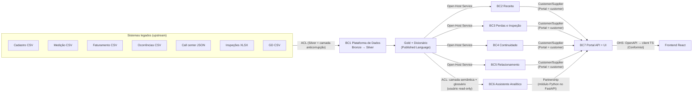

# Arquitetura e domínio

Referência do modelo de domínio do V-Energy Grid 360: subdomínios, contextos delimitados, contratos entre eles, linguagem ubíqua e modelo da camada Gold. Consulte este documento antes de nomear tabelas, colunas, endpoints ou componentes.

Documentos relacionados:

- [Planejamento](planejamento.md): time, cronograma, processo e riscos.
- [Backlog](backlog.md): épicos e histórias com critérios de aceite.
- [Decisões e suposições](decisoes.md): registro das decisões tomadas (`DEC-NNN`).
- [Dicionário de dados](dicionario-de-dados.md): definição de cada coluna e métrica da Gold.

## 1. Princípios

O case define o objetivo: "A plataforma é o meio. A resposta é o que o cliente está comprando." (§1). Daí vêm quatro regras:

1. **O diagnóstico de receita é o produto principal.** Recuperação de perdas vem logo depois. Pipeline, portal e agente existem para sustentar esses dois.
2. **Dado confiável antes de funcionalidade.** Um portal simples com dado limpo vale mais do que muitas telas com dado sujo (case, §7).
3. **O agente responde "não sei" quando não sabe.** Resposta inventada é pior do que nenhuma (case, §4, Módulo 3, e §7).
4. **Contrato antes de implementação.** Portal e IA trabalham contra um contrato de schema versionado e dados mock desde o primeiro dia, sem esperar a Gold real.

## 2. Subdomínios

| Subdomínio | Tipo | Escopo | Stakeholder (persona do case) |
|---|---|---|---|
| Diagnóstico de Receita | Core | Decomposição preço × volume × mix; drill-down por município, bairro e classe | Henrique (Dir. Comercial) |
| Recuperação de Perdas | Core | Score de suspeita, fila priorizada, energia recuperável | Rafael (Perdas) |
| Visão 360 da UC | Supporting | Cadastro, consumo, faturas, medidor, GD, interrupções e chamados de uma UC | Camila (Atendimento) |
| Continuidade do Serviço | Supporting | DEC/FEC por alimentador (PRODIST Módulo 8, definição simplificada do case) | Beatriz (Operação) |
| Ordens de Inspeção | Supporting | Gerar, atualizar status, registrar resultado e cancelar OIs; único modelo de escrita do sistema | Rafael (Perdas) |
| Consulta em Linguagem Natural e Insights | Supporting | Text-to-SQL e insights embutidos nas telas | Patrícia (Dir. TI) |
| Ingestão e Qualidade de Dados | Generic | Arquitetura Medalhão (Bronze/Silver/Gold) | Patrícia (Dir. TI) |
| Identidade e Acesso | Generic | Perfis por cargo | — |

Esforço de modelagem e validação vai para os subdomínios Core. Nos Generic, usa-se a solução mais simples que atenda.

## 3. Contextos delimitados

| ID | Contexto | Subdomínios | Responsável | Apoio | Artefatos |
|---|---|---|---|---|---|
| BC1 | Plataforma de Dados | Ingestão e Qualidade | D1 | D2 | Notebooks Bronze/Silver, YAML do Workflow, testes de qualidade |
| BC2 | Receita | Diagnóstico de Receita | D3 | D1, G2 | Golds de receita e PVM, [`diagnostico-receita.md`](diagnostico-receita.md) |
| BC3 | Perdas e Inspeção | Recuperação de Perdas, Ordens de Inspeção | D3 (score), V1 (ordens: backend e telas) | G2 | `gold_fila_suspeitas`, schema `app.ordem_inspecao`, telas de Perdas e OIs |
| BC4 | Continuidade da Rede | Continuidade do Serviço | D2 | V2 | `gold_continuidade_alimentador_mensal`, tela DEC/FEC |
| BC5 | Relacionamento | Visão 360 da UC | D2 (dados), V2 (tela) | V1 | `gold_dim_uc`, `gold_*_uc`, tela UC 360 |
| BC6 | Assistente Analítico | Linguagem Natural e Insights | G1 (agente), G2 (insights) | V2 (widget) | `ai-agent/`, camada semântica, suíte de avaliação |
| BC7 | Portal | Experiência, Identidade e Acesso | V1 (backend), V2 (frontend, integração e DevOps) | G1 | `backend/`, `frontend/`, `contracts/openapi.json`, `docker-compose.yml`, CI |

Os códigos de responsável (D1–D3, V1–V2, G1–G2) estão descritos em [Planejamento §1](planejamento.md#1-time).

## 4. Mapa de contextos

### 4.1 Contratos entre contextos

| Relação | Padrão DDD | Contrato | Aprovação de mudanças |
|---|---|---|---|
| Legado → Plataforma de Dados | Anticorruption Layer | A Bronze preserva o dado bruto; a Silver traduz para a linguagem ubíqua (tipos, chaves, códigos) | D1 |
| Plataforma de Dados → contextos Gold | Published Language + Open Host Service | [`dicionario-de-dados.md`](dicionario-de-dados.md) + `contracts/gold_schema.yaml`, versionado em semver | D3 e o consumidor afetado |
| Gold → Portal | Customer/Supplier | O Portal solicita colunas e agregações por issue; Dados entrega no incremento seguinte | D3 e V1 |
| Gold → Assistente | Anticorruption Layer (camada semântica) | Views `sem_*` com descrições e sinônimos ("conta de luz" → fatura; "falta de luz" → ocorrência) | G1 |
| Assistente ↔ Portal | Partnership | Interface Python `ask(question, session_id) -> AgentAnswer{answer, sql, rows, confidence, sources, refused_reason}` | G1 e V1 |
| Portal API → Frontend | Open Host Service + Conformist | OpenAPI gerado pelo FastAPI (`contracts/openapi.json`) → client TypeScript gerado | V1 (API) e V2 (integração) |
| Chaves compartilhadas | Shared Kernel | `cod_uc`, `competencia` (`YYYY-MM`), `classe` (B1, B2, B3, A4) e `classe_cadastro` (Residencial, Comercial, Industrial, Rural, Poder Público), `cod_alimentador`, `municipio`, `bairro` normalizados | Todos: PR com um revisor de cada frente |

Toda mudança em `contracts/` exige PR, aviso no grupo geral e incremento de versão.

### 4.2 Separação entre Gold e dados da aplicação

A Gold é somente leitura e recriada a cada execução do pipeline. As ordens de inspeção ficam no schema `app.*`, que o loader da Gold nunca altera. Sem essa separação, cada reexecução do pipeline apagaria o trabalho registrado pelo gerente de perdas.

## 5. Linguagem ubíqua

Estes termos são usados com o mesmo significado no código, no banco, no portal, no prompt do agente e na apresentação.

| Termo | Definição | Nome técnico |
|---|---|---|
| Unidade Consumidora (UC) | Ponto com medidor; entidade central do modelo | `cod_uc` |
| Cliente | Titular; pode ter várias UCs | `cod_cliente` |
| Competência | Mês de referência do consumo e da fatura (não o mês de pagamento) | `competencia` (`YYYY-MM`) |
| Classe de consumo | B1 residencial, B2 rural, B3 comercial/poder público, A4 industrial MT; a classe do cadastro (Residencial, Comercial, Industrial, Rural, Poder Público) separa o comercial do poder público | `classe`, `classe_cadastro` |
| Alimentador | Circuito de média tensão que atende um conjunto de UCs | `cod_alimentador` |
| Bandeira | Acréscimo tarifário mensal (verde, amarela, vermelha P1, vermelha P2) | `bandeira` |
| Energia faturada | kWh cobrados na fatura, já líquidos de GD | `kwh_faturado` |
| Receita faturada | Valor em R$ emitido na fatura da competência | `receita_faturada` |
| Receita arrecadada | Valor em R$ efetivamente pago | `receita_arrecadada` |
| Tarifa média | Receita faturada ÷ energia faturada | `tarifa_media` |
| Efeito preço / volume / mix | Decomposição da variação de receita entre dois períodos | `efeito_preco`, `efeito_volume`, `efeito_mix` |
| Período base / atual | Faixas de meses comparadas; qualquer par de períodos serve (ex.: jul/2022 a jun/2023 contra jul/2025 a jun/2026, ou os mesmos meses em anos diferentes) | `periodo_base`, `periodo_atual` |
| Perda não técnica | Energia entregue e não faturada (furto, fraude, erro) | — |
| Score de suspeita | Prioridade de irregularidade de uma UC | `score_suspeita` |
| Motivo da suspeita | Regra ou feature que mais contribui para o score, em texto legível | `motivos[]` |
| Energia recuperável | kWh/mês estimados a recuperar se a irregularidade for confirmada | `kwh_recuperavel_est` |
| Ordem de Inspeção (OI) | Pedido de vistoria em campo para uma UC | `ordem_inspecao` |
| Status da OI | `GERADA → EM_CAMPO → CONCLUIDA`, ou `CANCELADA` | `status` |
| Resultado da OI | `IRREGULAR_CONFIRMADA`, `REGULAR` ou `NAO_REALIZADA` | `resultado` |
| DEC / FEC | Duração e frequência equivalentes de interrupção por UC (definição simplificada do case) | `dec`, `fec` |
| GD | UC com geração própria (solar); a potência é a de pico, em kWp | `possui_gd`, `potencia_kwp` |

## 6. Modelo da camada Gold

Proposta v0 que serve de base para `contracts/gold_schema.yaml`. O contrato é a fonte de verdade sobre colunas e tipos; o [dicionário de dados](dicionario-de-dados.md), sobre definições e fórmulas.

| Tabela | Grão | Contexto | Consumidores |
|---|---|---|---|
| `gold_dim_uc` | 1 linha por UC | Relacionamento | UC 360, agente, filtros |
| `gold_fato_faturamento_mensal` | UC × competência | Receita | KPIs, Receita, UC 360, agente |
| `gold_receita_decomposicao` | par de períodos × município × bairro × classe × GD | Receita | Tela Receita, insight, diagnóstico, agente |
| `gold_kpis_mensais` | competência | Receita, Rede, Atendimento | Dashboard executivo (total da empresa) |
| `gold_kpis_segmento_mensal` | competência × município × bairro × classe × GD | Receita, Rede, Atendimento | Filtros da diretoria, portal, agente |
| `gold_reconciliacao_faturamento` | competência | Receita | Diagnóstico, tela Receita, agente (ponte do faturamento e da energia) |
| `gold_continuidade_alimentador_mensal` | alimentador × competência | Continuidade | Tela DEC/FEC, agente |
| `gold_interrupcoes_uc` | UC × ocorrência | Continuidade | UC 360 |
| `gold_atendimentos_uc` | UC × chamado | Relacionamento | UC 360, agente |
| `gold_medidor_uc` | UC × medidor vigente | Relacionamento | UC 360, score |
| `gold_fila_suspeitas` | 1 linha por UC suspeita | Perdas | Tela Perdas, OIs |
| `app.ordem_inspecao` / `app.ordem_evento` | OI / transição de status | Perdas (modelo de escrita, fora da Gold) | Tela Perdas |

## 7. Decisões técnicas

Decisões estruturais do projeto. Cada uma, ao ser fechada, ganha uma entrada `DEC-NNN` em [`decisoes.md`](decisoes.md), que passa a ser a referência.

| ID | Tema | Opções avaliadas | Escolha | Justificativa | Status |
|---|---|---|---|---|---|
| ADR-01 | Banco local | SQLite, PostgreSQL | PostgreSQL (Docker) | Role somente leitura nativa para o agente, concorrência nas OIs, schemas `gold`/`app` separados | Adotada ([DEC-002](decisoes.md)) |
| ADR-02 | Framework do agente | PydanticAI, LangGraph, LangChain | PydanticAI | Saída tipada (`AgentAnswer`), mesma stack Pydantic do FastAPI, comportamento auditável | Adotada ([spec do agente](../ai-agent/docs/specs/2026-10-19-architecture-design.md)) |
| ADR-03 | Estratégia do agente | SQL livre, SQL sobre views semânticas, ferramentas parametrizadas | SQL apenas sobre views `sem_*`, validado por parser (um único `SELECT`, `LIMIT` obrigatório, allowlist de views), executado com role somente leitura | Defesa em profundidade: mesmo com o prompt manipulado, o banco não aceita escrita | Adotada ([spec do agente](../ai-agent/docs/specs/2026-10-19-architecture-design.md)) |
| ADR-04 | Insights embutidos | LLM calcula, LLM só narra números prontos | LLM só narra um JSON de métricas da Gold e cita os números | Fidelidade ao dado verificável; nenhuma aritmética no LLM | Adotada ([spec do agente](../ai-agent/docs/specs/2026-10-19-architecture-design.md)) |
| ADR-05 | Score de suspeita | Regras, ML supervisionado, híbrido | Híbrido: regras explicáveis (queda brusca de consumo, consumo zero com medidor ativo, desvio em relação a vizinhos/classe, histórico de irregularidade) + modelo simples treinado nas ~1,4 mil inspeções; o resultado é a posição da UC no ranking (1 = mais suspeita), e não uma nota | Motivo legível e precisão mensurável (backtest: acerto do top-200 vs ~50% atual) | Proposta; posição no ranking decidida na daily de 21/10 |
| ADR-06 | Decomposição de receita | Preço/volume (2 fatores), PVM com mix de classe | PVM com efeito mix por classe e drill-down por município/bairro; o efeito preço se divide em `efeito_tarifa` e `efeito_bandeira`, e `possui_gd` entra no grão para isolar o efeito GD | Separa reajuste e bandeira (preço), queda de kWh (volume, com a GD à parte) e mudança de perfil (mix) | Proposta; colunas decididas (DEC-023), método do efeito bandeira a validar |
| ADR-07 | Agendamento do Workflow | Diário, mensal, por evento | Mensal, após o fechamento do ciclo de faturamento (ex.: D+5), com ingestão incremental por competência | A origem muda mensalmente; execução diária gastaria compute sem dado novo | Proposta |
| ADR-08 | Leitura do XLSX no Databricks | `openpyxl` + pandas → Spark, `spark-excel` | Leitor nativo `format("excel")` do Databricks, conferido célula a célula contra o XML da planilha | O `openpyxl` não existe no Databricks Serverless e não se instala nada; a conferência garante que nenhum valor muda | Adotada ([DEC-008](decisoes.md)) |
