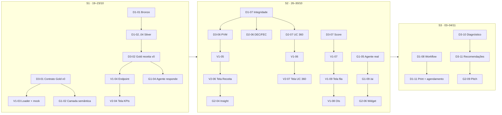

# Backlog

Épicos e histórias do V-Energy Grid 360, com responsável, sprint, prioridade, estimativa e critério de aceite. O contexto de cada história (contextos delimitados, linguagem ubíqua, modelo Gold) está em [Arquitetura](arquitetura.md); sprints, papéis e processo, em [Planejamento](planejamento.md).

## Convenções

- **ID da história:** `<código>-<nn>` (ex.: `D1-03`). Os códigos de responsável estão em [Planejamento §1.1](planejamento.md#11-códigos-de-responsável); `X-nn` são histórias transversais.
- **Issue:** cada história corresponde a uma issue no GitHub Projects com as labels `bc:*`, a prioridade (`must`, `should`, `could`) e a sprint (`sprint:S1`, `sprint:S2`, `sprint:S3`).
- **Estimativa:** pontos em Fibonacci, recalibrados no planning poker.
- **Sprints:** S1 = 19–23/10 · S2 = 26–30/10 · S3 = 03–04/11 (02/11 é feriado) · Apresentação = 05–10/11.
- **Capacidade de referência:** ~13 pts por pessoa em S1 e S2; ~5 pts em S3.
- **Requisitos do case:** referenciados pela seção do enunciado (ex.: 5.1, 5.2, §6).

## 1. Épicos

| Épico | Nome | BC | Subdomínio | Dono | Requisitos do case cobertos |
|---|---|---|---|---|---|
| **EP01** | Fundação do repositório e ambiente | BC7 Portal | Generic | V2 | §6 Repositório |
| **EP02** | Ingestão Bronze | BC1 Plataforma de Dados | Generic | D1 | 5.1 Bronze |
| **EP03** | Silver e qualidade de dados | BC1 Plataforma de Dados | Generic | D1 / D2 | 5.1 Silver, testes de qualidade (dif.) |
| **EP04** | Integridade referencial e Shared Kernel | BC1 Plataforma de Dados | Generic | D1 | 5.1 Integridade |
| **EP05** | Contrato Gold, export e loader (Published Language) | BC1 → todos | Generic | D3 / V1 | 5.1 Gold, export para banco local |
| **EP06** | Orquestração do pipeline (Workflow) | BC1 Plataforma de Dados | Generic | D1 | 5.1 Workflow + agendamento |
| **EP07** | Receita e decomposição PVM | BC2 Receita | Core | D3 | 5.1 Gold, 5.2 KPIs + variação de receita |
| **EP08** | Perdas: score e fila de suspeitas | BC3 Perdas & Inspeção | Core | D3 | 5.2 Fila priorizada |
| **EP09** | Ordens de inspeção (write model) | BC3 Perdas & Inspeção | Supporting | V1 | 5.2 OIs, export da fila (dif.) |
| **EP10** | Continuidade (DEC/FEC) | BC4 Continuidade | Supporting | D2 / V2 | 5.1 DEC/FEC, 5.2 tela DEC/FEC |
| **EP11** | Visão 360 da UC | BC5 Relacionamento | Supporting | D2 / V2 | 5.2 UC 360 |
| **EP12** | Portal: experiência, design system e filtros | BC7 Portal | Supporting | V2 | 5.2 KPIs, filtros |
| **EP13** | API do Portal (BFF) | BC7 Portal | Supporting | V1 | 5.2 (todas), testes backend (dif.), perfis (dif.) |
| **EP14** | Agente Text-to-SQL | BC6 Assistente | Supporting | G1 | 5.3 perguntas em PT, termos, auditoria |
| **EP15** | Insights embutidos e chat no portal | BC6 Assistente | Supporting | G2 | 5.3 insights, agente dentro da plataforma |
| **EP16** | Segurança e avaliação da IA | BC6 Assistente | Supporting | G1 / G2 | 5.3 segurança, follow-up (dif.), avaliação (dif.) |
| **EP17** | Documentação (README, dicionário, decisões) | Transversal | — | Todos | §6 README, 5.1 dicionário |
| **EP18** | Diagnóstico da receita | BC2 Receita | Core | D3 (PO) | 5.4 |
| **EP19** | Pitch e banca | Transversal | — | G2 | §6 Apresentação final |

---

## 2. Histórias por responsável

### 2.1 D1 · Dados: Plataforma de Dados (guardião da qualidade)

#### D1-01 · Ingestão Bronze dos 8 arquivos
- **Épico** EP02 · **Sprint** S1 · **Must** · **3 pts**
- **História:** Como engenheiro de dados, quero ingerir os 8 arquivos do dataset como tabelas Delta na Bronze, sem transformar o conteúdo, para garantir a rastreabilidade dos dados brutos.
- **Aceite:**
  - 8 tabelas `bronze.*` criadas; leituras unificadas a partir dos 5 arquivos particionados por ano.
  - Todas as colunas como string + metadados `_source_file`, `_ingested_at`.
  - Contagem de linhas por tabela = contagem do arquivo de origem (registrada no log de qualidade).
- **Entrega para:** D1-02..04, D2-02..05

#### D1-02 · Silver de unidades consumidoras
- **Épico** EP03 · **Sprint** S1 · **Must** · **3 pts**
- **História:** Como engenheiro de dados, quero um cadastro de UCs deduplicado e padronizado, para que toda análise parta de uma única versão de cada UC.
- **Aceite:**
  - 1 linha por `cod_uc` (regra de desempate documentada).
  - `municipio`, `bairro`, `classe`, `subgrupo` e `cod_alimentador` normalizados conforme o Shared Kernel.
  - Cada decisão de limpeza registrada no log de qualidade.

#### D1-03 · Silver de leituras
- **Épico** EP03 · **Sprint** S1 · **Must** · **3 pts**
- **História:** Como engenheiro de dados, quero leituras mensais confiáveis, para que o consumo apurado sustente receita, UC 360 e score de perdas.
- **Aceite:**
  - `competencia` em `YYYY-MM`; duplicatas UC × competência resolvidas.
  - Consistência `leitura_atual − leitura_anterior` vs consumo apurado verificada, com divergências sinalizadas (flag, sem apagar).
  - Consumos negativos/nulos tratados com regra documentada.

#### D1-04 · Silver de faturas
- **Épico** EP03 · **Sprint** S1 · **Must** · **3 pts**
- **História:** Como engenheiro de dados, quero faturas padronizadas, para que receita faturada, arrecadada e bandeira sejam calculáveis sem ambiguidade.
- **Aceite:**
  - CSV com `;` e decimal com vírgula convertidos; datas tipadas.
  - `bandeira` normalizada (verde / amarela / vermelha P1 / vermelha P2).
  - Status de pagamento derivado (pago, em aberto, em atraso) com regra documentada.

#### D1-05 · Log de qualidade de dados
- **Épico** EP03 · **Sprint** S1 · **Must** · **1 pt**
- **História:** Como guardião da qualidade, quero um log único de problemas e decisões de limpeza, para alimentar o dicionário de dados e as respostas à banca.
- **Aceite:**
  - `docs/qualidade-dados.md` com as colunas: tabela · problema · volume afetado · decisão · justificativa.
  - D2 e G2 conseguem adicionar entradas.

#### D1-06 · Job esqueleto com amostra
- **Épico** EP06 · **Sprint** S1 · **Must** · **2 pts**
- **História:** Como engenheiro de dados, quero rodar um Workflow mínimo (Bronze → Silver) já na S1, para descobrir cedo os limites do workspace Databricks.
- **Aceite:**
  - Job com 2 tasks encadeadas roda com sucesso sobre uma amostra.
  - Limites encontrados (cluster, tempo, bibliotecas) registrados no grupo e no log.

#### D1-07 · Integridade referencial
- **Épico** EP04 · **Sprint** S2 · **Must** · **5 pts**
- **História:** Como engenheiro de dados, quero garantir a integridade referencial entre medição, faturamento e cadastro, para que nenhuma análise dependa de registros órfãos.
- **Aceite:**
  - Checagens leitura × UC, fatura × UC, medidor × UC, ocorrência × alimentador e atendimento × UC.
  - Órfãos movidos para tabelas `silver.quarentena_*` com motivo; contagens no log.
  - 0 órfãos nas tabelas Silver consumidas pela Gold.
- **Depende de:** D1-02..04, D2-02..05

#### D1-08 · Workflow ponta a ponta
- **Épico** EP06 · **Sprint** S2 · **Must** · **5 pts**
- **História:** Como engenheiro de dados, quero orquestrar Bronze → Silver → Gold → export num Databricks Workflow, para que o pipeline seja reprodutível de ponta a ponta.
- **Aceite:**
  - Job reexecutável sem intervenção manual (notebooks idempotentes).
  - YAML do Job exportado em `data-engineering/`.
  - Execução completa com sucesso sobre o dataset inteiro.
- **Depende de:** D3-06, D3-08, D2-06, D2-07

#### D1-09 · Ajustes da Silver a partir do feedback dos consumidores
- **Épico** EP03 · **Sprint** S2 · **Must** · **2 pts**
- **História:** Como fornecedor da Gold, quero incorporar o que Dev, IA e o diagnóstico encontrarem nos dados reais, para fechar a S2 com números consistentes.
- **Aceite:** issues `bc:dados` abertas na S2 resolvidas ou registradas como decisão consciente no log.

#### D1-10 · Testes de qualidade automatizados no pipeline
- **Épico** EP03 · **Sprint** S3 · **Should (diferencial)** · **3 pts**
- **História:** Como engenheiro de dados, quero testes de qualidade automatizados no Job, para que uma falha nos dados seja detectada antes de chegar ao portal.
- **Aceite:**
  - Task de validação no Workflow: unicidade de chaves, não-nulos críticos, domínio de `classe`/`bandeira`, 0 órfãos e faixas plausíveis de DEC/FEC.
  - O Job falha (não publica o export) se algum teste crítico falhar.

#### D1-11 · Evidência do Job e estratégia de agendamento
- **Épico** EP06 / EP17 · **Sprint** S3 · **Must** · **1 pt**
- **História:** Como avaliador, quero ver o print da execução e a justificativa do agendamento, para validar a orquestração.
- **Aceite:**
  - Print no README.
  - Entrada `DEC-NNN` em [`decisoes.md`](decisoes.md) com a estratégia de agendamento (ADR-07: mensal após o fechamento do ciclo, incremental por competência). Atendido pela DEC-039: mensal, com reprocessamento completo no lugar do incremental, e o motivo da divergência.

#### D1-12 · Dicionário de dados: Receita e Perdas
- **Épico** EP17 · **Sprint** S3 · **Must** · **2 pts**
- **História:** Como engenheiro de dados, quero publicar a definição de cada métrica das Golds de Receita e Perdas e as decisões de limpeza que as afetam, para que os indicadores possam ser auditados.
- **Aceite:** cada coluna de `gold_fato_faturamento_mensal`, `gold_receita_decomposicao`, `gold_kpis_mensais` e `gold_fila_suspeitas` com definição, fórmula e link para a entrada do log de qualidade.
- **Insumo de:** D3 (validação das fórmulas)

---

### 2.2 D2 · Dados: Continuidade e Relacionamento

#### D2-01 · Profiling das fontes secundárias
- **Épico** EP03 · **Sprint** S1 · **Must** · **2 pts**
- **História:** Como engenheiro de dados, quero perfilar ocorrências, atendimentos, inspeções, medidores e GD, para priorizar os problemas de qualidade mais graves.
- **Aceite:** para cada fonte, % de nulos, duplicatas, domínios e formatos inválidos registrados no log de qualidade.

#### D2-02 · Silver de ocorrências de rede
- **Épico** EP03 · **Sprint** S1 · **Must** · **3 pts**
- **História:** Como engenheiro de dados, quero ocorrências padronizadas, para calcular DEC/FEC e mostrar as interrupções na UC 360.
- **Aceite:**
  - Duração em horas (numérica); início/fim tipados; `causa` normalizada.
  - Registros com duração impossível sinalizados.
  - Chave `cod_uc` e `cod_alimentador` conforme o Shared Kernel.

#### D2-03 · Silver de atendimentos (JSON aninhado)
- **Épico** EP03 · **Sprint** S1 · **Must** · **5 pts**
- **História:** Como engenheiro de dados, quero achatar o JSON do call center, para que chamados e tratativas sejam consultáveis.
- **Aceite:**
  - `silver.atendimento` (1 linha por chamado) + `silver.atendimento_tratativa` (explode do histórico).
  - Nota de satisfação numérica; motivo do chamado normalizado.

#### D2-04 · Silver de inspeções (XLSX com 3 abas)
- **Épico** EP03 · **Sprint** S1 · **Must** · **3 pts**
- **História:** Como engenheiro de dados, quero as inspeções de campo padronizadas, para servirem de rótulo ao score de perdas e de histórico na UC 360.
- **Aceite:**
  - As 3 abas lidas (ADR-08: pandas/openpyxl → Spark) e consolidadas com o relacionamento documentado.
  - Resultado normalizado para `IRREGULAR_CONFIRMADA` / `REGULAR` / `NAO_REALIZADA`.

#### D2-05 · Silver de medidores e GD
- **Épico** EP03 · **Sprint** S1 · **Must** · **2 pts**
- **História:** Como engenheiro de dados, quero o parque de medidores e a GD padronizados, para saber o medidor vigente e se a UC gera energia própria.
- **Aceite:**
  - Medidor vigente por UC derivado (instalação/retirada); idade do medidor calculada.
  - GD com `potencia_kwp` numérica (potência de pico, como vem da origem) e data de conexão.

#### D2-06 · DEC e FEC por alimentador
- **Épico** EP10 · **Sprint** S2 · **Must** · **5 pts**
- **História:** Como engenheiro de dados, quero calcular DEC e FEC por alimentador e competência conforme a definição do case, para que a operação acompanhe a continuidade do serviço.
- **Aceite:**
  - `gold_continuidade_alimentador_mensal` (alimentador × competência: `dec`, `fec`, `n_uc`, `n_interrupcoes`, `horas_interrompidas`).
  - Fórmula documentada (soma de duração ÷ UCs atendidas; contagem ÷ UCs atendidas).
  - Validação manual de 1 alimentador × 1 mês registrada.

#### D2-07 · Golds da Visão 360
- **Épico** EP11 · **Sprint** S2 · **Must** · **5 pts**
- **História:** Como engenheiro de dados, quero tabelas Gold que respondam a tudo o que o atendente precisa sobre uma UC, para que a tela 360 carregue numa única consulta por bloco.
- **Aceite:** `gold_dim_uc`, `gold_medidor_uc`, `gold_interrupcoes_uc` e `gold_atendimentos_uc` conforme o contrato, com chave `cod_uc`.

#### D2-08 · KPIs de rede e atendimento
- **Épico** EP12 · **Sprint** S2 · **Must** · **2 pts**
- **História:** Como diretor, quero indicadores de continuidade e atendimento ao lado dos comerciais, para avaliar o negócio numa tela só.
- **Aceite:** colunas de DEC/FEC, volume de chamados e satisfação média incluídas em `gold_kpis_mensais`.

#### D2-09 · Dicionário de dados: Rede e Relacionamento
- **Épico** EP17 · **Sprint** S3 · **Must** · **3 pts**
- **História:** Como engenheiro de dados, quero documentar as Golds de Continuidade e Relacionamento, para que sejam auditáveis.
- **Aceite:** cada coluna com definição, fórmula e decisões de limpeza que a afetam.

#### D2-10 · Reconciliação tela × Gold
- **Épico** EP17 · **Sprint** S3 · **Must** · **2 pts**
- **História:** Como time, quero conferir que os números exibidos no portal e respondidos pelo agente batem com a Gold, para não chegar à banca com divergências.
- **Aceite:** checklist com 10 números-chave (tela × Gold × agente) conferidos; divergências viram bug.

---

### 2.3 D3 · Dados: Receita, Perdas e Product Owner

#### D3-01 · Contrato Gold v0
- **Épico** EP05 · **Sprint** S1 (até ter 20/10) · **Must** · **3 pts**
- **História:** Como fornecedor da Gold, quero publicar um contrato de schema versionado, para que Dev e IA trabalhem desde o dia 1 sem esperar os dados.
- **Aceite:**
  - `contracts/gold_schema.yaml` com tabelas, colunas, tipos, grão e chaves ([Arquitetura §6](arquitetura.md#6-modelo-da-camada-gold)).
  - Revisado por V1 e G1; versão `0.1.0`.
- **Situação:** feito. A v0.1.0 foi mergeada (PR #10) e a v0.2.0 está em andamento (DEC-022 e DEC-023).

#### D3-02 · Gold de receita mensal (walking skeleton)
- **Épico** EP07 · **Sprint** S1 · **Must** · **2 pts**
- **História:** Como time, quero a primeira tabela Gold real publicada ainda na S1, para provar o fluxo Databricks → banco → API → tela → agente.
- **Aceite:** `gold_kpis_mensais` v0 (receita e kWh por competência) exportada em CSV e carregada por V1-03.

#### D3-03 · EDA de receita: reproduzir os números do Henrique
- **Épico** EP18 · **Sprint** S1 · **Must** · **3 pts**
- **História:** Como dono do diagnóstico, quero reproduzir os números citados pela diretoria, para validar as definições antes de explicá-los.
- **Aceite:**
  - Variação de volume (~−4%) e de receita (~+8%), últimos 12 meses vs primeiro ano, reproduzida ou divergência explicada.
  - Definição de "período base" proposta e registrada em [`decisoes.md`](decisoes.md).

#### D3-04 · Quadro de hipóteses
- **Épico** EP18 · **Sprint** S1 · **Must** · **2 pts**
- **História:** Como PO, quero um quadro das hipóteses H1–H7 com a métrica que confirma ou refuta cada uma, para direcionar as análises.
- **Aceite:** `docs/hipoteses.md` com hipótese · métrica · fonte · responsável · status (ponto de partida: [Planejamento §3](planejamento.md#3-diagnóstico-da-receita-método-e-hipóteses)).

#### D3-05 · Backlog e Definition of Ready
- **Épico** EP17 · **Sprint** S1 · **Must** · **2 pts**
- **História:** Como PO, quero o board montado com as histórias deste documento, para que a S1 comece com dono e critério de aceite.
- **Aceite:** issues criadas no GitHub Projects com labels; S1 em `Ready` até seg 19/10 às 12h.

#### D3-06 · Decomposição PVM da receita
- **Épico** EP07 · **Sprint** S2 · **Must** · **8 pts**
- **História:** Como diretor comercial, quero a variação de receita separada em efeito-preço, efeito-volume e efeito-mix, por município, bairro e classe, para encontrar onde está a queda.
- **Aceite:**
  - `gold_fato_faturamento_mensal` (UC × competência) e `gold_receita_decomposicao` (período × município × bairro × classe).
  - Preço + volume + mix = Δ receita total (diferença de arredondamento < 0,1%).
  - Fórmulas escritas para o dicionário (D1-12).

#### D3-07 · Score de suspeita e fila v1
- **Épico** EP08 · **Sprint** S2 · **Must** · **5 pts**
- **História:** Como gerente de perdas, quero as UCs suspeitas ordenadas por prioridade, com o motivo e a energia estimada a recuperar, para não desperdiçar inspeções.
- **Aceite:**
  - `gold_fila_suspeitas` com `score_suspeita`, `motivos[]` legíveis e `kwh_recuperavel_est`.
  - Abordagem híbrida (ADR-05): regras + modelo simples treinado nas inspeções.
  - Backtest: taxa de acerto do top-200 vs ~50% atual, reportada.
- **Observação:** pode ser transferida para G2, que absorve G2-07 (ver [Planejamento §6](planejamento.md#6-pendências)).

#### D3-08 · Export da Gold para CSV
- **Épico** EP05 · **Sprint** S2 · **Must** · **2 pts**
- **História:** Como engenheiro de dados, quero exportar todas as tabelas Gold em CSV como último passo do pipeline, para popular o banco local.
- **Aceite:** 1 CSV por tabela Gold com cabeçalho igual ao contrato; publicado num local acessível ao loader (V1-03).

#### D3-09 · Status report intermediário
- **Épico** EP18 · **Sprint** S2 · **Must** · **3 pts**
- **História:** Como time de consultoria, quero apresentar o andamento e as primeiras hipóteses à "diretoria", para validar o caminho antes da reta final.
- **Aceite:** 5–8 slides: progresso por módulo, 3–5 hipóteses com evidência e próximos passos; ensaio feito no standup anterior.

#### D3-10 · Diagnóstico da receita
- **Épico** EP18 · **Sprint** S2→S3 (começa qui 29/10) · **Must** · **5 pts**
- **História:** Como diretor comercial, quero um diagnóstico fundamentado da variação de receita, para decidir com base em dados.
- **Aceite:**
  - [`docs/diagnostico-receita.md`](diagnostico-receita.md) com ponte (waterfall) período base → atual e causas ranqueadas por R$.
  - Cada causa com evidência (tabela/gráfico) e link para a Gold.

#### D3-11 · Recomendações com impacto
- **Épico** EP18 · **Sprint** S3 · **Must** · **3 pts**
- **História:** Como diretor comercial, quero recomendações acionáveis com ordem de grandeza do impacto, para priorizar ações.
- **Aceite:** 3–5 recomendações, cada uma com impacto estimado (MWh e R$/ano) e premissas explícitas.

---

### 2.4 V1 · Dev: Backend e Ordens de Inspeção

#### V1-01 · Esqueleto do FastAPI
- **Épico** EP13 · **Sprint** S1 · **Must** · **2 pts**
- **História:** Como desenvolvedor, quero uma API base com configuração e healthcheck, para os endpoints de cada BC entrarem em módulos separados.
- **Aceite:** routers por BC (`receita`, `perdas`, `rede`, `uc`, `ai`), `/health`, OpenAPI em `/docs`.

#### V1-02 · Schemas `gold`/`app` e role read-only
- **Épico** EP13 / EP16 · **Sprint** S1 · **Must** · **2 pts**
- **História:** Como responsável por segurança, quero o agente conectado com uma role sem permissão de escrita, para que a IA nunca altere dados.
- **Aceite:**
  - Schemas `gold` (recarregável) e `app` (OIs, persistente).
  - Role `venergy_agent` só com `SELECT` em `gold.*`/`sem_*`; teste manual de `INSERT` negado.

#### V1-03 · Loader idempotente e gerador de mock
- **Épico** EP05 · **Sprint** S1 · **Must** · **3 pts**
- **História:** Como desenvolvedor, quero carregar os CSVs Gold (reais ou mock) no banco com um comando, para trabalhar sem depender do Databricks.
- **Aceite:**
  - `make load` (ou script) recria só `gold.*`; nunca toca em `app.*`.
  - Gerador de mock a partir de `contracts/gold_schema.yaml`.
  - Rodar duas vezes dá o mesmo resultado.

#### V1-04 · Endpoint do walking skeleton
- **Épico** EP13 · **Sprint** S1 · **Must** · **1 pt**
- **História:** Como time, quero `GET /receita/mensal` servindo `gold_kpis_mensais`, para fechar o fluxo ponta a ponta na review da S1.
- **Aceite:** endpoint retorna os dados reais de D3-02.

#### V1-05 · Endpoints de KPIs e Receita
- **Épico** EP13 · **Sprint** S2 · **Must** · **3 pts**
- **História:** Como diretor comercial, quero APIs de KPIs comparativos e de decomposição de receita com drill-down, para alimentar as telas executiva e de Receita.
- **Aceite:** filtros `periodo`, `municipio`, `bairro`, `classe`; comparação entre 2 períodos; resposta < 1 s.

#### V1-06 · Endpoint da UC 360
- **Épico** EP13 · **Sprint** S2 · **Must** · **3 pts**
- **História:** Como atendente, quero buscar uma UC pelo número e receber tudo de uma vez, para responder ao cliente na linha.
- **Aceite:**
  - `GET /uc/{cod_uc}`: cadastro, consumo 12m vs mesmo período do ano anterior, faturas em aberto, medidor, GD, interrupções e chamados.
  - 404 claro quando a UC não existe.

#### V1-07 · Endpoints de DEC/FEC e da fila de suspeitas
- **Épico** EP13 · **Sprint** S2 · **Must** · **2 pts**
- **História:** Como gerente de operação e de perdas, quero APIs de continuidade e da fila, para as telas DEC/FEC e Perdas.
- **Aceite:** série DEC/FEC por alimentador, ranking dos piores e fila paginada e ordenada por score.

#### V1-08 · Backend das ordens de inspeção
- **Épico** EP09 · **Sprint** S2 · **Must** · **5 pts**
- **História:** Como gerente de perdas, quero gerar OIs a partir da fila, atualizar o status, registrar o resultado e cancelar, para controlar a operação de campo.
- **Aceite:**
  - `app.ordem_inspecao` + `app.ordem_evento` (histórico).
  - Máquina de estados `GERADA → EM_CAMPO → CONCLUIDA | CANCELADA`, com volta de `EM_CAMPO` para `GERADA` (DEC-048); transição inválida retorna 409.
  - Resultado obrigatório ao concluir.
  - Sobrevive a um reload da Gold.

#### V1-09 · Tela da fila de perdas
- **Épico** EP09 · **Sprint** S2 · **Must** · **3 pts**
- **História:** Como gerente de perdas, quero ver a fila priorizada com motivo e energia recuperável e selecionar UCs, para gerar as ordens.
- **Aceite:** tabela ordenada por score, motivo legível, kWh recuperável, seleção múltipla → "gerar OIs".

#### V1-10 · Tela das ordens de inspeção
- **Épico** EP09 · **Sprint** S3 · **Must** · **3 pts**
- **História:** Como gerente de perdas, quero acompanhar e atualizar as OIs no portal, para registrar o resultado de campo ali mesmo.
- **Aceite:** listar por status, mudar status, registrar resultado e cancelar; fluxo completo ao vivo em < 1 min.

#### V1-11 · Exportar a fila de inspeção
- **Épico** EP09 · **Sprint** S3 · **Should (diferencial)** · **1 pt**
- **História:** Como gerente de perdas, quero exportar a fila para enviar à equipe de campo.
- **Aceite:** botão "Exportar CSV" com as colunas visíveis e os filtros aplicados.
- **Situação:** backend feito com outro desenho, junto do V1-14: `GET /ordens-inspecao/planilha` exporta as ordens em campo em XLSX, no formato que o upload lê ([DEC-053](decisoes.md#dec-053--planilha-de-campo-exportar-as-ordens-em-campo-e-subir-o-resultado)); botão na tela pendente.

#### V1-12 · Testes automatizados do backend
- **Épico** EP13 · **Sprint** S3 · **Should (diferencial)** · **3 pts**
- **História:** Como desenvolvedor, quero testes automatizados no backend, para que novas mudanças não quebrem o que já funciona.
- **Aceite:** pytest cobrindo a máquina de estados das OIs, UC 360 (existe/não existe) e filtros de receita; roda no CI.

#### V1-13 · Login com perfil por cargo
- **Épico** EP13 · **Sprint** S3 (stretch) · **Could (diferencial)** · **3 pts**
- **História:** Como usuário, quero entrar com meu perfil e ver as telas do meu cargo, para focar no meu trabalho.
- **Aceite:** 5 perfis (diretoria, atendimento, perdas, operação e TI) com menu filtrado e permissão checada no backend ([DEC-049](decisoes.md#dec-049--login-com-cookie-httponly-e-perfis-por-cargo)). **Só entra se todos os Must estiverem em Done.**

#### V1-14 · Upload da planilha de campo
- **Épico** EP09 · **Could (diferencial)** · **3 pts** · backend feito ([DEC-053](decisoes.md#dec-053--planilha-de-campo-exportar-as-ordens-em-campo-e-subir-o-resultado)); tela pendente
- **História:** Como gerente de perdas, quero subir pelo portal a planilha preenchida em campo, para registrar resultados sem digitação.
- **Aceite:** upload XLSX no formato de `inspecoes.xlsx` → atualiza as OIs correspondentes, com relatório de linhas rejeitadas.

---

### 2.5 V2 · Dev: Frontend, Integração e DevOps

#### V2-01 · Setup do frontend
- **Épico** EP12 · **Sprint** S1 · **Must** · **2 pts**
- **História:** Como desenvolvedor, quero o frontend (TanStack Start em modo SPA, React + TypeScript) com rotas e layout, para as telas serem adicionadas de forma consistente.
- **Aceite:** navegação lateral com rotas `/`, `/receita`, `/uc`, `/perdas`, `/rede`; layout responsivo para desktop.

#### V2-02 · Design system mínimo
- **Épico** EP12 · **Sprint** S1 · **Must** · **5 pts**
- **História:** Como desenvolvedor, quero componentes reutilizáveis, para construir 5 telas sem duplicar código.
- **Aceite:** `KpiCard` (valor + variação vs período), `DataTable` (ordenação/paginação), `SeriesChart`, `WaterfallChart`, `FilterBar`, estados de loading/erro/vazio.

#### V2-03 · Client TypeScript gerado do OpenAPI
- **Épico** EP12 · **Sprint** S1 · **Must** · **1 pt**
- **História:** Como desenvolvedor, quero o client da API gerado a partir do OpenAPI, para que o front quebre na compilação quando o contrato mudar.
- **Aceite:** script `npm run gen:api` documentado; tipos usados nas telas.

#### V2-04 · Tela de KPIs (walking skeleton)
- **Épico** EP12 · **Sprint** S1 · **Must** · **3 pts**
- **História:** Como diretor, quero ver os principais indicadores do negócio, para saber rapidamente se estamos indo bem ou mal.
- **Aceite:** receita e kWh mensais com dados reais (D3-02 via V1-04) na review da S1.

#### V2-05 · Comparação de períodos no dashboard
- **Épico** EP12 · **Sprint** S2 · **Must** · **2 pts**
- **História:** Como diretor, quero comparar os indicadores entre dois períodos, para ver a tendência.
- **Aceite:** seletor de período base vs atual; `KpiCard` com variação % e cor; inclui KPIs de rede e atendimento (D2-08).

#### V2-06 · Tela de Receita (PVM + drill-down)
- **Épico** EP07 · **Sprint** S2 · **Must** · **5 pts**
- **História:** Como diretor comercial, quero ver a ponte de receita entre períodos e descer por município → bairro → classe, para encontrar onde está a queda.
- **Aceite:** waterfall preço/volume/mix; drill-down em 3 níveis com breadcrumb; ranking dos maiores contribuintes da queda.

#### V2-07 · Tela UC 360
- **Épico** EP11 · **Sprint** S2 · **Must** · **5 pts**
- **História:** Como atendente, quero digitar o número da UC e ver tudo numa tela só, para responder ao cliente na hora, inclusive quando ele reclama de conta alta.
- **Aceite:**
  - Busca por `cod_uc`.
  - Blocos: cliente, consumo 12m vs ano anterior (gráfico), faturas em aberto, medidor, GD, interrupções, chamados.
  - Indicação explícita de "o consumo subiu/não subiu".

#### V2-08 · Tela DEC/FEC
- **Épico** EP10 · **Sprint** S2 · **Must** · **3 pts**
- **História:** Como gerente de operação, quero acompanhar DEC e FEC por alimentador ao longo do tempo e identificar os piores, para direcionar a manutenção preventiva.
- **Aceite:** série temporal por alimentador; ranking dos N piores; agregação por região/município.

#### V2-09 · Filtros globais
- **Épico** EP12 · **Sprint** S3 · **Must** · **3 pts**
- **História:** Como usuário do portal, quero filtrar por período, município, bairro e classe, para chegar rápido ao que procuro.
- **Aceite:** filtros persistem entre telas analíticas (estado na URL); funcionam em KPIs, Receita e DEC/FEC.

#### V2-10 · Polimento e estados de erro
- **Épico** EP12 · **Sprint** S3 · **Must** · **2 pts**
- **História:** Como usuário, quero um portal sem telas quebradas, para confiar no que vejo.
- **Aceite:** toda tela com loading/erro/vazio; formatação pt-BR (R$, kWh, datas); revisão na review da S2.

#### V2-11 · Repositório, CI e qualidade de código
- **Épico** EP01 · **Sprint** S1 · **Must** · **2 pts**
- **História:** Como time, quero um repositório público com a estrutura do case, para que tudo seja versionado desde o dia 1.
- **Aceite:**
  - Pastas `data-engineering/`, `backend/`, `frontend/`, `ai-agent/`, `docs/`, `contracts/`.
  - README esqueleto com as seções obrigatórias.
  - Template de PR com checklist da Definition of Done; CI com lint (ruff no Python, Biome no frontend), testes do backend e build do frontend.
  - Hooks de pre-commit com as mesmas checagens do CI.

#### V2-12 · Ambiente com docker-compose
- **Épico** EP01 · **Sprint** S1 · **Must** · **3 pts**
- **História:** Como desenvolvedor, quero subir banco, backend e frontend com um comando, para que tudo rode na máquina de todos.
- **Aceite:** `docker compose up` sobe Postgres + FastAPI + Vite; `.env.example` documentado.

---

### 2.6 G1 · GenAI: Agente Text-to-SQL (guardião de segurança da IA)

#### G1-01 · PoC do agente (ADR-02)
- **Épico** EP14 · **Sprint** S1 · **Must** · **2 pts**
- **História:** Como desenvolvedor de IA, quero um agente PydanticAI respondendo sobre o banco mock, para validar framework e modelo cedo.
- **Aceite:** modelo `openrouter:google/gemini-3.1-flash-lite` configurável por variável de ambiente, com fallback configurável; decisão registrada na [spec do agente](../ai-agent/docs/specs/2026-10-19-architecture-design.md).

#### G1-02 · Camada semântica
- **Épico** EP14 · **Sprint** S1 · **Must** · **3 pts**
- **História:** Como agente, quero views `sem_*` com nomes de negócio e descrições, para gerar SQL correto sem conhecer o schema físico.
- **Aceite:** views sobre as Golds do contrato; catálogo (descrição de tabela/coluna + exemplos) injetado no prompt.

#### G1-03 · Guardrails de SQL
- **Épico** EP16 · **Sprint** S1 · **Must** · **3 pts**
- **História:** Como responsável por Segurança da Informação, quero que o agente não consiga alterar dados nem consultar fora do escopo, para que ele não seja manipulado.
- **Aceite:**
  - Parser (ex.: sqlglot) aceita só um `SELECT` por vez, de tabelas na allowlist `sem_*`.
  - `LIMIT` imposto; timeout de execução; conexão com a role `venergy_agent` (V1-02).
  - Testes com DML/DDL e múltiplos statements rejeitados.

#### G1-04 · Contrato `AgentAnswer`
- **Épico** EP14 · **Sprint** S1 · **Must** · **2 pts**
- **História:** Como integrador, quero uma interface Python estável `ask(question, session_id) -> AgentAnswer`, para o backend e o widget não dependerem de detalhes internos.
- **Aceite:** `AgentAnswer{answer, sql, rows, confidence, sources, refused_reason}`; responde à pergunta do walking skeleton.

#### G1-05 · Agente sobre os dados reais
- **Épico** EP14 · **Sprint** S2 · **Must** · **3 pts**
- **História:** Como usuário não técnico, quero perguntar em português sobre consumo, faturamento, interrupções e atendimento e receber respostas claras.
- **Aceite:** ≥ 80% de acerto no golden set (G2-01) sobre a Gold real; respostas citam os números e o período.

#### G1-06 · Trilha de auditoria
- **Épico** EP14 · **Sprint** S2 · **Must** · **3 pts**
- **História:** Como analista, quero auditar como a IA chegou a cada resposta, para confiar no que ela apresenta.
- **Aceite:** cada resposta registra pergunta, SQL, linhas retornadas, modelo, latência e timestamp; consultável via API e exibida no widget.

#### G1-07 · "Não sei" e tratamento de erros
- **Épico** EP14 · **Sprint** S2 · **Must** · **3 pts**
- **História:** Como diretora de TI, quero que o agente diga que não sabe quando não sabe, porque dado inventado é pior do que nenhum.
- **Aceite:**
  - Fora de escopo, ambígua (pede esclarecimento), SQL vazio ou com erro → recusa explícita com motivo.
  - 100% das perguntas "sem resposta" do golden set recusadas.

#### G1-08 · Termos do dia a dia
- **Épico** EP14 · **Sprint** S2 · **Must** · **2 pts**
- **História:** Como usuário, quero que o agente entenda "conta de luz", "falta de luz", "gato" etc., para não precisar saber os nomes técnicos.
- **Aceite:** glossário de G2-02 incorporado à camada semântica/prompt; perguntas com sinônimos no golden set passam.

#### G1-09 · Endpoint `/ai` no FastAPI
- **Épico** EP15 · **Sprint** S2 · **Must** · **2 pts**
- **História:** Como usuário do portal, quero o agente exposto pela API do portal, para usá-lo sem trocar de ferramenta.
- **Aceite:** `POST /ai/ask` e `GET /ai/audit/{id}` no router `ai` (V1-01), seguindo o padrão do backend; revisado por V1.

#### G1-10 · Follow-up com memória
- **Épico** EP16 · **Sprint** S3 · **Should (diferencial)** · **3 pts**
- **História:** Como analista, quero fazer perguntas de follow-up sem repetir o contexto, para investigar em sequência.
- **Aceite:** histórico por `session_id`; "e em Olinda?" após uma pergunta sobre Recife responde certo; 5 casos de follow-up no golden set.

#### G1-11 · Hardening contra prompt injection
- **Épico** EP16 · **Sprint** S3 · **Must** · **2 pts**
- **História:** Como responsável por Segurança da Informação, quero o agente resistente a tentativas de manipulação, para que ele não aja fora do seu papel.
- **Aceite:** conjunto red team (≥ 15 ataques: ignorar instruções, vazar prompt, DROP via texto, pedir dados fora do escopo) → 0 violações.

---

### 2.7 G2 · GenAI: Insights, Avaliação e Pitch

#### G2-01 · Golden set do agente
- **Épico** EP16 · **Sprint** S1 · **Must** · **5 pts**
- **História:** Como responsável pela plataforma, quero um conjunto de perguntas com resposta esperada, para medir o agente desde o primeiro dia.
- **Aceite:**
  - ≥ 40 perguntas em `ai-agent/eval/golden_set.yaml`: as falas do case (Patrícia, Henrique), perguntas por BC, ≥ 8 sem resposta e ≥ 5 de injection.
  - SQL/valor esperado preenchido quando a Gold real chegar.

#### G2-02 · Glossário de sinônimos
- **Épico** EP14 · **Sprint** S1 · **Must** · **2 pts**
- **História:** Como agente, quero um mapeamento de termos do dia a dia para termos da linguagem ubíqua, para entender o usuário leigo.
- **Aceite:** ≥ 30 sinônimos ("conta de luz" → fatura, "falta de luz" → ocorrência, "gato" → perda não técnica, "placa solar" → GD...) alinhados com a linguagem ubíqua.

#### G2-03 · EDA local de apoio a Dados
- **Épico** EP03 · **Sprint** S1 · **Must** · **3 pts**
- **História:** Como apoio ao gargalo da S1, quero explorar os arquivos brutos localmente (pandas), para antecipar problemas de qualidade para D1/D2.
- **Aceite:** problemas encontrados registrados no log de qualidade (D1-05), com exemplos.

#### G2-04 · Insight embutido na tela de Receita
- **Épico** EP15 · **Sprint** S2 · **Must** · **5 pts**
- **História:** Como diretor comercial, quero um insight gerado por IA na tela de Receita, para interpretar a variação sem precisar perguntar.
- **Aceite:**
  - O backend monta um JSON com as métricas da Gold do recorte atual; o LLM só narra (ADR-04).
  - Todo número citado no texto existe no JSON (verificação automática; se falhar, o insight não é exibido).
  - Respeita os filtros da tela.

#### G2-05 · Insight "conta alta" na UC 360
- **Épico** EP15 · **Sprint** S2 · **Should** · **3 pts**
- **História:** Como atendente, quero uma explicação automática de por que a conta da UC subiu ou não, para responder ao cliente na hora.
- **Aceite:** mesma técnica do G2-04, sobre consumo vs ano anterior, bandeira e dias de faturamento; mesma verificação de números.

#### G2-06 · Widget de chat no portal
- **Épico** EP15 · **Sprint** S2 · **Must** · **3 pts**
- **História:** Como usuário do portal, quero acessar o agente dentro da plataforma, para perguntar sem trocar de ferramenta.
- **Aceite:** painel lateral em todas as telas; mostra a resposta, a tabela de resultados e "ver SQL" (auditoria); componentes do design system (V2-02).

#### G2-07 · Apoio às features do score de perdas
- **Épico** EP08 · **Sprint** S2 · **Should** · **2 pts**
- **História:** Como apoio a D3, quero propor e testar features do modelo de suspeita, para aumentar a taxa de acerto da fila.
- **Aceite:** ≥ 3 features avaliadas no backtest de D3-07. Se D3-07 for transferida para G2, esta história é absorvida por ela.

#### G2-08 · Avaliação automatizada do agente
- **Épico** EP16 · **Sprint** S3 · **Should (diferencial)** · **3 pts**
- **História:** Como responsável pela plataforma, quero medir de forma automatizada a qualidade das respostas, para acompanhar a evolução.
- **Aceite:** `make eval` roda o golden set e reporta acurácia de execução, taxa de recusa correta, violações de segurança e latência; resultado no README.

#### G2-09 · Roteiro do pitch e slides
- **Épico** EP19 · **Sprint** S3 · **Must** · **3 pts**
- **História:** Como time, quero um roteiro de 15 min que conte a resposta para a diretoria e mostre a plataforma ao vivo, para convencer a banca.
- **Aceite:** roteiro (problema → diagnóstico → plataforma ao vivo → recomendações) com tempo por bloco e dono de cada fala; plano B (vídeo gravado) para a demo.

#### G2-10 · Ensaios e banco de perguntas
- **Épico** EP19 · **Pitch (05–09/11)** · **Must** · **3 pts**
- **História:** Como time, quero ensaiar e simular as perguntas da banca, para que qualquer membro responda sobre qualquer módulo.
- **Aceite:** 2 ensaios cronometrados; ≥ 30 perguntas prováveis com respondente e resposta curta; feedback da prévia (05/11) incorporado.

---

### 2.8 Transversais (todos)

| ID | História | Sprint | Aceite |
|---|---|---|---|
| **X-01** | Como avaliador, quero um README por pasta, para executar cada módulo sozinho | S3 | Cada lead escreve o README do seu diretório; V2 consolida o README raiz |
| **X-02** | Como time, quero cada decisão registrada, para justificá-las na banca | Contínuo | Entrada `DEC-NNN` em [`decisoes.md`](decisoes.md) em até 24h após a decisão |
| **X-03** | Como time, quero demo rotativa nas reviews, para todos dominarem todos os BCs | S1–S3 | Na review, quem demonstra uma história não foi quem a construiu |
| **X-04** | Como time, quero documentar as suposições feitas, para cumprir o README obrigatório | S3 | Seção "Suposições" no README com ≥ 1 item por BC |

---

## 3. Carga e dependências

### 3.1 Carga por pessoa (pontos)

"Acima" indica carga maior que a capacidade de referência.

| Pessoa | S1 | S2 | S3 | Observação |
|---|---|---|---|---|
| D1 | 15 | 12 | 6 | S1 acima da referência: Bronze + 3 Silvers grandes |
| D2 | 15 | 12 | 5 | S1 acima: JSON aninhado e XLSX |
| D3 | 12 | 18 (acima) | 8 (acima) | Com D3-07 → G2: S2 = 13 |
| V1 | 8 | 16 (acima) | 7 (+3 opcional) | Folga na S1: adiantar V1-05, V1-06 e o modelo das OIs (V1-08). Com V1-07 → G1: S2 = 14 |
| V2 | 16 (acima) | 15 (acima) | 5 | S1 acima só no papel: V2-11 e V2-12 implementados em 19/10 |
| G1 | 10 | 13 | 5 | Com V1-07: S2 = 15 |
| G2 | 10 | 13 | 6 (+3 na apresentação) | Com D3-07: S2 = 16, acima (G2-07 é absorvida) |

### 3.2 Dependências entre histórias

### 3.3 Opções de rebalanceamento

Aplicáveis se a carga real confirmar a estimativa. As duas primeiras estão em [Planejamento §6](planejamento.md#6-pendências).

1. **D3-07 (score) → G2**, com D3 revisando o backtest. D3 fica dedicado a Receita e Diagnóstico.
2. **V1-07 (endpoints DEC/FEC e fila) → G1**, que já implementa o router `/ai` (G1-09) no mesmo FastAPI. V1 cai para 14 pts e G1 sobe para 15.
3. **V1 na S1:** sem repositório e `docker-compose`, V1 tem folga (8 pts) para adiantar V1-05, V1-06 e o modelo das OIs (V1-08), aliviando a própria S2.
4. **V2 na S2:** se houver atraso, V2-05 (comparação de períodos, 2 pts) passa para a S3.
5. **D1/D2 na S1:** G2-03 (EDA local) reduz a carga de descoberta dos dois. Se Bronze/Silver atrasarem, D2-05 (Silver de medidores e GD) passa para a S2.

---

## 4. Rastreabilidade: requisito do case → histórias

| Requisito do case | Histórias |
|---|---|
| **5.1** Ingerir na Bronze preservando o original | D1-01 |
| **5.1** Silver confiável, problemas tratados | D1-02, D1-03, D1-04, D1-05, D1-09, D2-01..05, G2-03 |
| **5.1** Integridade referencial | D1-07 |
| **5.1** Gold modelada pelas perguntas de negócio | D3-01, D3-02, D3-06, D3-07, D2-06, D2-07, D2-08 |
| **5.1** DEC/FEC por alimentador | D2-06 |
| **5.1** Exportar Gold para banco local | D3-08, V1-03 |
| **5.1** Workflow reprodutível + agendamento | D1-06, D1-08, D1-11 |
| **5.1** Dicionário de dados Gold | D1-12, D2-09 |
| **5.1** *(dif.)* Testes de qualidade no pipeline | D1-10 |
| **5.2** Indicadores comparados entre períodos | D3-02, D2-08, V1-04, V1-05, V2-04, V2-05 |
| **5.2** Variação de receita preço/volume + drill-down | D3-06, V1-05, V2-06 |
| **5.2** UC 360 (inclusive conta alta) | D2-07, V1-06, V2-07, G2-05 |
| **5.2** Fila priorizada com motivo e energia recuperável | D3-07, G2-07, V1-07, V1-09 |
| **5.2** Gerar/atualizar/registrar/cancelar OIs | V1-08, V1-10 |
| **5.2** DEC/FEC ao longo do tempo + piores | D2-06, V1-07, V2-08 |
| **5.2** Filtrar e recortar | V2-02, V2-09 |
| **5.2** *(dif.)* Exportar fila | V1-11 |
| **5.2** *(dif.)* Upload da planilha de campo | V1-14 (backlog) |
| **5.2** *(dif.)* Perfil por cargo | V1-13 |
| **5.2** *(dif.)* Testes no backend | V1-12 |
| **5.3** Perguntas em português sem SQL | G1-01, G1-02, G1-04, G1-05, G2-01 |
| **5.3** Termos do dia a dia | G2-02, G1-08 |
| **5.3** Auditar como a IA chegou à resposta | G1-06, G2-06 |
| **5.3** Insights embutidos nas telas | G2-04, G2-05 |
| **5.3** Agente dentro da plataforma | G1-09, G2-06 |
| **5.3** IA não altera dados nem é manipulada | V1-02, G1-03, G1-07, G1-11 |
| **5.3** *(dif.)* Follow-up sem repetir contexto | G1-10 |
| **5.3** *(dif.)* Avaliação automatizada | G2-01, G2-08 |
| **5.4** Diagnóstico + recomendações + impacto | D3-03, D3-04, D3-09, D3-10, D3-11 |
| **§6** Repositório + README completo | V2-11, D1-11, X-01, X-02, X-04 |
| **§6** Status report e apresentação final | D3-09, G2-09, G2-10, X-03 |
