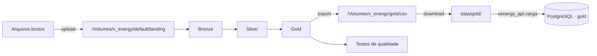
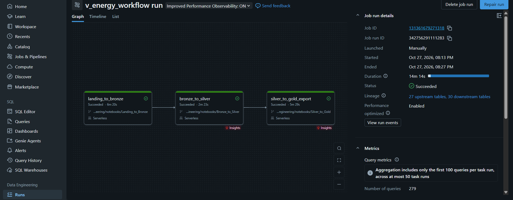
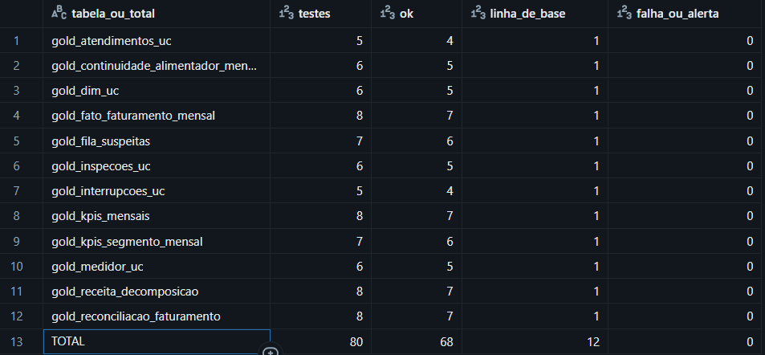

# Dos arquivos brutos ao portal

Os arquivos brutos do case passam pelo pipeline Medalhão no Databricks, viram 12 CSVs da Gold
e chegam ao PostgreSQL local pela carga. Amostra sintética e Gold real percorrem o mesmo
caminho a partir de `data/gold/`, então trocar uma pela outra não muda código
([DEC-004](decisoes.md#dec-004--entrega-da-gold-em-datagold)).



> [!IMPORTANT]
> O dataset é confidencial. Nem os brutos nem os CSVs da Gold vão para o Git: `data/` está
> no `.gitignore`, e nada de `*.csv`, `*.xlsx` ou `*.zip` é versionado
> ([DEC-024](decisoes.md#dec-024--o-que-pode-subir-ao-repositório-público)).

## 1. Os arquivos brutos

| Na landing | Conteúdo |
|---|---|
| `unidades_consumidoras.csv` | Cadastro das UCs |
| `faturas.csv` | Faturamento mensal (separado por `;`) |
| `leituras/` | Leituras dos medidores: uma pasta com os 5 CSVs anuais |
| `medidores.csv` | Medidores instalados em cada UC |
| `ocorrencias_rede.csv` | Interrupções de energia |
| `geracao_distribuida.csv` | UCs com geração distribuída |
| `atendimentos.json` | Chamados do call center |
| `inspecoes.xlsx` | Resultado das inspeções de campo (três abas) |

Os nomes são os que o notebook `Landing_to_Bronze` procura; a pasta `leituras/` precisa ter
exatamente 5 CSVs. Os 47 problemas conhecidos dessas fontes e a regra aplicada a cada um estão
em [qualidade dos dados](qualidade-dados.md).

## 2. Preparar o Databricks (uma vez por workspace)

Requer um workspace com Unity Catalog e compute serverless (o Job usa o ambiente serverless
versão 6). Os arquivos ficam num volume fora da Bronze, para que recriar as camadas nunca
apague os originais ([DEC-001](decisoes.md#dec-001--localização-dos-arquivos-de-origem-landing)).
O `Landing_to_Bronze` não cria o catálogo nem a landing: no SQL Editor, ou numa célula `%sql`:

```sql
CREATE CATALOG IF NOT EXISTS v_energy;
CREATE SCHEMA IF NOT EXISTS v_energy.default;
CREATE SCHEMA IF NOT EXISTS v_energy.bronze;
CREATE VOLUME IF NOT EXISTS v_energy.default.landing;
```

Os schemas `silver`, `gold` e `qualidade` e o volume dos CSVs (`v_energy.gold.csv`) são
criados pelos próprios notebooks.

**O Job.** Em **Jobs & Pipelines → Create → Job**, abra a edição do Job em YAML e cole o
conteúdo de [`v_energy_workflow.yaml`](../data-engineering/workflow/v_energy_workflow.yaml),
que foi exportado dessa mesma tela. Os notebooks são lidos direto da branch `main` do GitHub,
então não é preciso copiá-los para o workspace. Sem a edição em YAML, crie as 4 tasks na
interface, com a origem **Git** (este repositório, branch `main`) e compute serverless:

| Task | Notebook | Depende de | Parâmetros |
|---|---|---|---|
| `landing_to_bronze` | `data-engineering/notebooks/Landing_to_Bronze` | — | `gravar = sim`, `landing_path = /Volumes/v_energy/default/landing`, `exigir_idempotencia = nao` |
| `bronze_to_silver` | `data-engineering/notebooks/Bronze_to_Silver` | `landing_to_bronze` | `gravar = sim` |
| `silver_to_gold_export` | `data-engineering/notebooks/Silver_to_Gold` | `bronze_to_silver` | `gravar = sim`, `exportar_csv = sim`, `schema_gold = gold` |
| `testes_qualidade` | `data-engineering/notebooks/Testes_Qualidade_Gold` | `silver_to_gold_export` | — |

O agendamento (mensal, dia 6, pausado) e o tempo máximo de 2 horas estão no YAML.

## 3. Enviar os brutos

O dataset chega em `.zip` na plataforma do case: descompacte no computador antes de enviar.

**Pela interface:** **Catalog → v_energy → default → Volumes → landing → Upload to this
volume**, com os sete arquivos; crie a pasta `leituras` (**Create directory**) e envie os 5
CSVs anuais para dentro dela. O resultado:

```text
/Volumes/v_energy/default/landing/
├── unidades_consumidoras.csv
├── faturas.csv
├── medidores.csv
├── ocorrencias_rede.csv
├── geracao_distribuida.csv
├── atendimentos.json
├── inspecoes.xlsx
└── leituras/            (os 5 CSVs, um por ano, e nada além deles)
```

O `Landing_to_Bronze` para com erro se um arquivo faltar ou estiver vazio, ou se `leituras/`
não tiver exatamente 5 CSVs.

**Pela [CLI do Databricks](https://docs.databricks.com/aws/en/dev-tools/cli/):**

```bash
databricks fs cp -r ./brutos dbfs:/Volumes/v_energy/default/landing --overwrite
```

O pipeline nunca escreve nem apaga nada na landing.

## 4. Rodar o pipeline

Em **Jobs & Pipelines → v_energy_workflow**, clique em **Run now** uma vez. O Job roda
`Landing_to_Bronze` → `Bronze_to_Silver` → `Silver_to_Gold` → `Testes_Qualidade_Gold` em
compute serverless, em cerca de 15 minutos, e as 4 tasks devem terminar em verde. Na primeira
execução, os testes de variação de linhas só gravam a linha de base, porque não há execução
anterior para comparar.

Os três primeiros notebooks também rodam sozinhos, com **Run all**: com `gravar = nao` (o
padrão dos widgets), eles leem e validam tudo sem gravar nada. O `Testes_Qualidade_Gold` não
tem esse widget: só lê a Gold e os CSVs, mas toda execução grava o resultado em
`v_energy.qualidade.resultados_testes` (criando o schema se faltar), e a contagem gravada passa
a ser a base da variação de linhas na execução seguinte.

- Cada notebook confere a camada antes de gravar. Uma trava que falha para o Job ali: nenhuma
  camada seguinte é gravada e os CSVs não são exportados.
- A terceira task grava a Gold e exporta os 12 CSVs para `/Volumes/v_energy/gold/csv`.
- A quarta confere os CSVs contra a Gold e as reconciliações entre tabelas, somente leitura.

> [!WARNING]
> Com o Job vermelho, ninguém baixa os CSVs. Os testes da quarta task rodam depois do export,
> então detectam um CSV ruim, mas não impedem que ele seja gravado no volume
> ([DEC-074](decisoes.md#dec-074--testes-de-qualidade-do-export-e-da-gold)).



Travas de cada camada e os testes de qualidade:
[`data-engineering/README.md`](../data-engineering/README.md#testes-de-qualidade).

## 5. Baixar a Gold

Os 12 arquivos vão para `data/gold/`, na raiz do repositório, com o nome da tabela
(`gold_dim_uc.csv`, `gold_fato_faturamento_mensal.csv` e os demais).

**Pela interface:** **Catalog → v_energy → gold → Volumes → csv**, selecione os 12 arquivos
`gold_*.csv` e **Download**. Eles substituem os arquivos da amostra.

**Pela CLI:**

```bash
databricks fs cp -r dbfs:/Volumes/v_energy/gold/csv ./data/gold --overwrite
```

## 6. Carregar no banco

Com o ambiente no ar ([instalação](instalacao.md)):

```bash
docker compose run --rm api python -m venergy_api.carga      # ou: make load
```

- **Tudo ou nada.** Uma primeira rodada confere todas as linhas de todos os arquivos contra o
  contrato ([`contracts/gold_schema.yaml`](../contracts/gold_schema.yaml)) sem gravar nada. Só
  então a Gold anterior é substituída, numa única transação. Qualquer falha termina com
  `Carga cancelada, banco não foi alterado.` e o motivo.
- **O trabalho do usuário fica.** A carga recria só o schema `gold`. As ordens de inspeção e a
  auditoria do agente, no schema `app`, nunca são apagadas
  ([DEC-050](decisoes.md#dec-050--autoria-nos-eventos-das-ordens-de-inspeção)).
- **As views do agente voltam no fim.** A carga reaplica `ai-agent/semantic/views.sql`; se
  uma view não bater com a Gold nova, a carga falha e desfaz tudo.
- **Aguenta a Gold real.** São ~4 milhões de linhas em lotes de 10 mil, com pico de ~110 MB de
  memória, em ~7 minutos ([DEC-038](decisoes.md#dec-038--carga-da-gold-em-lotes-com-uma-rodada-de-conferência-antes-de-gravar)).

### Voltar à amostra

Gere a amostra por cima dos CSVs reais e rode a carga:

```bash
docker compose run --rm api python -m venergy_api.amostra --force
docker compose run --rm api python -m venergy_api.carga
```

Sem o `--force`, o gerador para, porque a pasta já tem CSVs que podem ser a Gold real. Com
ele, os CSVs reais de `data/gold/` são sobrescritos: para voltar à Gold real, é preciso
baixá-los de novo do volume. Para não baixar de novo, mantenha as duas lado a lado.

### Manter a amostra e a Gold real lado a lado

`data/` inteira é montada em `/data` no container da API. Guarde a Gold real numa pasta
própria e aponte a carga para ela:

```bash
docker compose run --rm -e VENERGY_API_GOLD_DIR=/data/gold-real api python -m venergy_api.carga
```

Para voltar à amostra, rode a carga sem a variável.

### Quando a carga falha

| Mensagem | O que fazer |
|---|---|
| `arquivo não encontrado: /data/gold/...` | Falta um dos 12 CSVs: baixe a pasta inteira de novo |
| erro de validação numa coluna | O CSV saiu de uma versão diferente do contrato: confira se o Job rodou a `main` atual |
| `as views do agente não batem com a Gold` | A Gold mudou e o `views.sql` do agente ainda não foi regerado: avise o time de IA |
| `o arquivo mudou durante a carga` | Alguém trocou um CSV no meio: rode de novo |

## Resultado das inspeções de campo

Depois da carga, o resultado das visitas de campo não precisa passar pelo Databricks: a tela
de **Perdas** exporta as ordens em campo numa planilha no formato de `inspecoes.xlsx` e aceita
a mesma planilha preenchida de volta ([guia do portal](portal.md#perdas-rafael)).

## Agendamento do Workflow

O agendamento é mensal, no dia 6 às 03h (D+5 do fechamento do faturamento), e fica pausado
porque o dataset do case é uma extração única
([DEC-039](decisoes.md#dec-039--workflow-do-databricks-e-agendamento-mensal)).

| Decisão | Justificativa |
|---|---|
| **Mensal** | Os sistemas de origem fecham o faturamento uma vez por mês. Rodar todo dia gastaria compute sem dado novo. Rodar por evento exigiria um aviso de "faturamento fechado" vindo dos sistemas de origem; supomos que os sistemas legados não emitem esse aviso (o case não informa). |
| **Dia 6, às 03h** | D+5 do fechamento do ciclo de faturamento, de madrugada, fora do horário de uso do portal. O prazo de D+5 é suposição do time: o case não informa quando o faturamento fecha. |
| **Reprocessamento completo** | Cada run relê toda a landing e regrava Bronze, Silver e Gold. Com uma extração única e cerca de 15 minutos de execução, isso mantém o tudo ou nada de cada camada. Diverge da ADR-07, que previa carga incremental por competência: ela fica como evolução se o volume mensal crescer. |
| **Pausado** | O dataset do case é uma extração única; não há dado novo para buscar. |
| **Falha interrompe o pipeline** | As travas de cada notebook dão erro antes de publicar uma camada inconsistente, e o Job não segue para as camadas seguintes. O export dos CSVs só acontece com a Gold validada. |
| **Pronto para produção** | Basta despausar. A Bronze continua conferida contra a origem a cada run; a comparação com a gravação anterior (time travel, 7 dias de retenção) fica desligada no Job, porque com dado novo as gravações nunca são iguais. |

A task de testes foi adicionada depois da última execução completa do Job e validada
isoladamente contra a Gold atual; a próxima execução completa roda as quatro tasks.



*Resumo por tabela da execução isolada dos testes: 80 testes, 68 críticos OK e 12 de variação
de linhas gravados como linha de base. O resultado completo de cada execução fica em
`v_energy.qualidade.resultados_testes`.*
