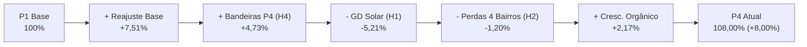

# Diagnóstico: receita x volume faturado e primeiras hipóteses (Status Report)

Documento de diagnóstico da variação de receita e volume faturado da V-Energy, integrando a resposta direta à pergunta da diretoria comercial (história `D3-03`) com a validação das hipóteses para o **Status Report Intermediário** e a decomposição PVM (histórias `D3-04`, `D3-09` e `D3-10`).

> **Nota sobre confidencialidade e dados:** Em conformidade com as diretrizes do projeto e decisões `DEC-004` e `DEC-008`, este documento público apresenta apenas indicadores agregados, ordens de grandeza e percentuais relativos, preservando o sigilo comercial e a privacidade de dados (LGPD). O detalhamento granular por medidor e fatura reside nas tabelas da camada Gold e nos relatórios internos da consultoria.

---

## 1. Pergunta da Diretoria

> *"A base de clientes cresceu, e a tarifa residencial acumulou reajuste homologado de 10,5% desde meados de 2022. Mesmo assim, comparando os últimos 12 meses com o primeiro ano da nossa base, o volume de energia faturada caiu quase 4% e a receita subiu só 8%. Por quê?"*  
> — **Henrique Duarte**, Diretor Comercial

---

## 2. Resposta Executiva

1. **Os números da diretoria se confirmam na camada Silver:** A base de clientes ativos faturados cresceu **+0,58%** (+259 UCs), o volume faturado recuou **−3,95%** (~−8,97 GWh) e a receita faturada avançou exatamente **+8,00%** (tanto em valor de energia quanto em valor total com tributos). O reajuste acumulado da tarifa base residencial (`B1` em bandeira verde) foi exatamente de **+10,52%**.
2. **A energia faturada caiu principalmente pela Geração Distribuída (H1):** As 3.510 UCs que conectaram sistemas solares após jul/2022 tiveram queda de **−61,2%** em seu volume faturado (−11,2 GWh abatidos). Sem essas UCs com GD, o consumo das 41.490 UCs restantes da distribuidora **cresceu +1,07% (+2,2 GWh)**. Ou seja: a GD sozinha explica mais de 100% da perda líquida de volume da concessão.
3. **A receita subiu menos que a tarifa por uma combinação de três fatores:**
   - **Queda de volume (−3,95%):** Efeito direto da GD (−11,2 GWh) somado a perdas não técnicas (−2,6 GWh nas fraudes confirmadas).
   - **Compressão tarifária no segmento Industrial A4 (H8):** O subgrupo `A4` representa mais de 40% de todo o volume de energia da empresa. Sua tarifa base sofreu dois cortes regulatórios consecutivos em mai/2025 (−12,4%) e mai/2026 (−5,2%), ficando −1,1% abaixo do patamar de 2022, o que freou o ganho médio de preço da distribuidora.
   - **Efeito Mix negativo (H3):** O consumo caiu nas classes de maior tarifa (Comercial −10,2% e Residencial −5,4%) e subiu na de menor tarifa (Industrial +0,6%).
4. **As leituras negativas decorrem da modernização do parque de medidores (H5):** Identificamos que as 6.299 leituras com consumo negativo registradas em P4 correspondem exatamente às **6.299 trocas por medidores SMART** registradas em `medidores.csv`. O medidor novo partiu do zero na leitura acumulada, mas o faturamento já cobrou corretamente o consumo real do novo medidor (`leitura_atual`, totalizando ~2,63 GWh). Portanto, a Gold não precisa estimar médias: o consumo real faturado já existe no dado original.
5. **As bandeiras tarifárias mascararam a desaceleração (H4):** O período base (P1) teve 100% dos meses em Bandeira Verde. Já o período atual (P4) teve 8 meses com bandeiras ativadas (Amarela e Vermelha), injetando ~R$ 5,6M adicionais em energia. Em base neutra de bandeiras, a receita teria subido apenas **+3,28%**.

---

## 3. Quadro Consolidado de Hipóteses (Status Report)

Validação das 7 hipóteses iniciais do planejamento ([`docs/planejamento.md`](planejamento.md) §3) acrescidas da hipótese tarifária identificada na exploração (H8):

| ID | Hipótese | Status | Evidência nos Dados (P1 → P4) | Ordem de Grandeza do Impacto |
|---|---|---|---|---|
| **H1** | **Geração distribuída (solar) reduz volume faturado** | **Confirmada** *(Vetor #1 de Volume)* | 3.510 UCs conectaram GD entre P2 e P4 (3.127 B1 e 383 B3). O volume faturado desse grupo caiu **−61,2%** (−11,2 GWh). Sem GD, o restante da base **cresceu +1,07%**. | **−11,2 GWh/ano** abatidos Redução de faturamento de **~R$ 5,5M** (energia) / **~R$ 7,4M** (total) |
| **H2** | **Perdas não técnicas aumentaram em bairros específicos** | **Confirmada** *(Vetor #2 — Recuperável)* | Nas UCs sem GD, a queda está concentrada em **4 bairros** (*Iputinga* e *Macaxeira* em Recife; *Jardim Jordão* e *Prazeres* em Jaboatão), onde o volume caiu **−15,7%**, contra **+2,5%** nos demais ~290 bairros. As 871 fraudes confirmadas em campo caíram **−51,5%** (−2,6 GWh); há mais 176 UCs sem GD com queda severa não regularizadas. | **−2,96 GWh/ano** desviados Potencial de recuperação estimado em **~R$ 1,9M/ano** (energia) / **~R$ 2,5M/ano** (total) |
| **H8** *(nova)* | **Redução da tarifa base do subgrupo Industrial (`A4`)** | **Confirmada** *(Freio no Preço)* | A tarifa base da indústria (`A4`, 40,2% do volume total) caiu **−12,4%** em mai/2025 e **−5,2%** em mai/2026, ficando abaixo de 2022. Enquanto B1 subiu +13,0% e B3 subiu +18,8% em tarifa média efetiva, A4 subiu apenas +8,0% (metade vinda de bandeiras). | Se A4 acompanhasse o reajuste residencial (+10,5%), a receita seria **~R$ 2,6M maior** em energia (~R$ 3,5M total) |
| **H3** | **Mudança de mix desfavorável entre classes** | **Confirmada** *(Impacto moderado)* | Classes de tarifa mais alta (Comercial a R$ 0,67/kWh e Residencial a R$ 0,61/kWh) encolheram sua participação para a Industrial (R$ 0,51/kWh). | Efeito Mix negativo na PVM: **−R$ 337 mil** (energia) / **−R$ 449 mil** (total) |
| **H4** | **Período base teve bandeiras mais caras** | **Refutada** *(Efeito inverso: mascarou a queda)* | P1 teve 12 meses de Bandeira Verde (R$ 0). P4 teve 8 meses de bandeiras acionadas (3 Amarela, 3 Vermelha P1 e 2 Vermelha P2). | Bandeiras inflaram P4 em **+R$ 5,57M** (energia). Sem bandeiras, a receita teria crescido apenas **+3,28%** |
| **H5** | **Erros de leitura e parque de medidores** | **Parcialmente confirmada** | • Leituras estimadas caíram de **18,9% para 15,8%** com os novos Smart Meters. • Leituras negativas em P4 decorrem de **trocas de medidor** (6.299 UCs), onde a fatura cobrou a `leitura_atual`. • **95,4% das fraudes confirmadas (831 de 871)** ocorreram em medidores **Eletromecânicos**. | Distorção contábil de **−2,63 GWh** na leitura bruta de P4 + vulnerabilidade do parque eletromecânico |
| **H6** | **UCs ativas sem faturamento e faturas órfãs** | **Confirmada** *(Vazamento crônico estável)* | • **200 UCs ativas** no cadastro sem medidor ou fatura nos 48 meses. • **32.285 faturas de UCs órfãs** (~8.060/ano) estáveis nos 4 períodos. • Inadimplência estável em **5,5% a 5,6%**. | • 200 UCs sem fatura: **~928 MWh/ano** (~R$ 540 mil energia / ~R$ 720 mil total por ano) • Faturas órfãs: **~R$ 2,58M/ano** faturados sem vínculo cadastral |
| **H7** | **Interrupções de rede (DEC/FEC) reduziram consumo** | **Refutada como causa de receita** | O DEC médio saltou **+133% em P4** (1,48h → 3,45h/UC), mas os alimentadores com maior DEC cresceram +1,9% a +6,4% em volume sem GD. Alimentadores com queda de volume têm DEC baixo (~0,55h) e atendem os bairros com fraude. | Impacto físico direto estimado em **< 50 MWh/ano** (< R$ 30 mil/ano) |

---

## 4. Decomposição PVM (Preço x Volume x Mix)

A decomposição da variação da receita faturada entre o Período Base (P1) e o Período Atual (P4) separa matematicamente o reajuste tarifário, a retração de consumo e a composição de classes:

| Componente da Ponte de Receita | Impacto sobre Receita de Energia (`valor_energia`) | Impacto sobre Receita Total (`valor_total`) | % sobre a Receita de P1 | Leitura Gerencial |
|---|---:|---:|---:|---|
| **Receita Período Base (P1)** | **R$ 117,83 M** | **R$ 157,11 M** | **100,00%** | 227,05 GWh em 12 meses de Bandeira Verde |
| **(+) Efeito Preço — Reajuste Tarifário Base** | **+R$ 8,85 M** | **+R$ 11,80 M** | **+7,51%** | Reajuste homologado (+10,5% em B1, +18,9% em B3), amortecido pela redução da tarifa em A4 |
| **(+) Efeito Preço — Bandeiras Tarifárias (H4)** | **+R$ 5,57 M** | **+R$ 7,43 M** | **+4,73%** | Adicional de 8 meses com bandeiras Amarela/Vermelha em P4 vs. 0 meses em P1 |
| **(=) Subtotal Efeito Preço Bruto** | **+R$ 14,43 M** | **+R$ 19,23 M** | **+12,24%** | Ganho bruto da tarifa média efetiva |
| **(−) Efeito Volume + Mix — GD Solar (H1)** | **−R$ 6,14 M** | **−R$ 8,18 M** | **−5,21%** | Queda de −11,20 GWh nas 3.510 UCs que aderiram à GD |
| **(−) Efeito Volume + Mix — Perdas nos 4 Bairros (H2)** | **−R$ 1,42 M** | **−R$ 1,89 M** | **−1,20%** | Queda líquida de −2,57 GWh sem GD em Iputinga, Macaxeira, Jardim Jordão e Prazeres |
| **(+) Efeito Volume + Mix — Crescimento Orgânico** | **+R$ 2,56 M** | **+R$ 3,41 M** | **+2,17%** | Avanço de +4,80 GWh (+2,49%) nas 38.220 UCs sem GD nos demais ~290 bairros |
| **(=) Subtotal Efeito Volume + Mix Líquido** | **−R$ 4,99 M** | **−R$ 6,66 M** | **−4,24%** | Sendo **−3,95% Volume puro** e **−0,29% Mix de classes** |
| **(=) Receita Período Atual (P4)** | **R$ 127,26 M** | **R$ 169,68 M** | **108,00% (+8,00%)** | **Variação líquida realizada: +R$ 9,43 M (energia) / +R$ 12,58 M (total)** |

---

## 5. Recomendações Acionáveis para a Diretoria

| # | Ação Recomendada | Escopo Operacional | Energia Recuperável Estimada | Impacto Financeiro Estimado (Ano) |
|---|---|---|---:|---:|
| **1** | **Força-tarefa de fiscalização e corte nos 4 bairros críticos (H2)** | Regularização das 871 UCs já autuadas + vistoria prioritária das 176 UCs com queda $\ge 30\%$ em Iputinga, Macaxeira, Jardim Jordão e Prazeres (foco no segmento Comercial). | **~2,96 GWh/ano** | **+R$ 1,90 M/ano** (energia) **+R$ 2,53 M/ano** (total) |
| **2** | **Blindagem do parque de medição eletromecânico (H5)** | Substituição direcionada de medidores eletromecânicos por Smart Meters nos alimentadores `ALM-REC-024` e `ALM-JAB-007`, onde se concentram 95,4% das fraudes. | Proteção de perda recorrente (~4,3 GWh) | Evita perda de **R$ 1,5M a R$ 2,5M/ano** e reduz custo de medição |
| **3** | **Saneamento cadastral das 200 UCs ativas sem faturamento (H6)** | Instalação de medidor e ativação do faturamento nas 200 UCs ativas nunca faturadas (170 B1, 22 B3, 4 A4, 3 B2, 1 Poder Público) + saneamento das faturas órfãs. | **~0,93 GWh/ano** | **+R$ 540 mil/ano** (energia) **+R$ 720 mil/ano** (total) |
| **4** | **Ajuste na regra de apuração da Gold e monitoramento de GD (H1 / H5)** | Adotar na camada Gold a regra oficial de `leitura_atual` para trocas de medidor e criar no portal a segregação de receita com e sem efeito-bandeira e efeito-GD. | Elimina distorções de relatório (−383,8 GWh brutos) | Governança regulatória e precisão dos KPIs do portal e do agente |

---

## 6. Método e Parâmetros da Análise

- **Períodos comparados:** Janelas móveis anuais de 12 meses:
  - **P1 (Base):** `2022-07` a `2023-06` (primeiras 12 competências completas da concessão).
  - **P2:** `2023-07` a `2024-06`.
  - **P3:** `2024-07` a `2025-06`.
  - **P4 (Atual):** `2025-07` a `2026-06` (últimas 12 competências disponíveis).
- **Fontes da camada Silver:** Pareamento estrito 1:1 entre `faturas`, `leituras`, `unidades_consumidoras`, `geracao_distribuida`, `medidores`, `inspecoes` e `ocorrencias_rede`.
- **Tratamento das leituras de troca de medidor (`kwh_faturado`):**
  - Quando a UC possui troca de medidor na competência (`status = RETIRADO` ou leitura regressiva em equipamento novo): `kwh_faturado = leitura_atual`.
  - Quando `consumo_kwh < 0` por inversão de sinal: `kwh_faturado = |consumo_kwh|`.
  - Nos demais casos: `kwh_faturado = consumo_kwh`.
- **Decomposição PVM:** Preço, Volume e Mix ponderados por subgrupo tarifário (`B1`, `B2`, `B3`, `A4`) conforme metodologia de análise de receita do setor de distribuição de energia.
