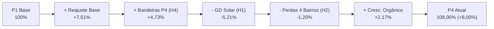

# Diagnóstico: variação da receita, volume faturado e recomendações

Documento de diagnóstico da variação de receita e volume faturado da V-Energy, integrando a resposta direta à pergunta da diretoria comercial (história `D3-03`), a validação das hipóteses com dados (`D3-04` e `D3-09`), a decomposição PVM (`D3-06` e `D3-10`) e as recomendações acionáveis com ordem de grandeza do impacto (`D3-11`).

> **Nota sobre confidencialidade e governança de dados (`DEC-024`):** Em conformidade com a regra estabelecida na `DEC-024`, este documento mantém os resultados agregados necessários para sustentar ou refutar hipóteses e embasar recomendações executivas (contagens, percentuais, volumes em GWh/MWh, valores em R$, tarifas médias e grandes agregados geográficos/operacionais). Qualquer identificação de pessoa ou de unidade consumidora individual e qualquer dado protegido pela LGPD (nome e documento do titular, endereço, CEP, coordenadas geográficas, código de UC ou de cliente e protocolo) permanecem mascarados/excluídos, sem exposição de registros linha a linha ou recortes que apontem para um cliente individual.

---

## 1. Pergunta da Diretoria

> *"A base de clientes cresceu, e a tarifa residencial acumulou reajuste homologado de 10,5% desde meados de 2022. Mesmo assim, comparando os últimos 12 meses com o primeiro ano da nossa base, o volume de energia faturada caiu quase 4% e a receita subiu só 8%. Por quê?"*  
> — **Henrique Duarte**, Diretor Comercial

---

## 2. Resposta Executiva

1. **Os números da diretoria se confirmam nos dados:** A variação da base de clientes ativos faturados (**+0,58%**, +259 UCs), do volume faturado (**−3,95%**, ~−8,97 GWh) e da receita faturada (**+8,00%**, tanto em valor de energia quanto em valor total com tributos) se confirma nas camadas Silver e Gold ([`DEC-029`](decisoes.md#dec-029--método-do-efeito-bandeira)), enquanto o reajuste homologado acumulado da tarifa base residencial (`B1` em bandeira verde, **+10,52%**) é apurado na camada Silver ([`DEC-041`](decisoes.md#dec-041--redesign-da-tela-da-diretoria-a-tesoura-primeiro-e-indicadores-por-período-no-backend), visto que a Gold armazena a tarifa efetiva realizada por competência, e não tabela de tarifas homologadas).
2. **A energia faturada caiu principalmente pela Geração Distribuída (H1):** As 3.510 UCs que conectaram sistemas solares após jul/2022 tiveram queda de **−61,2%** em seu volume faturado (−11,2 GWh abatidos). Sem essas UCs com GD, o consumo das 41.490 UCs restantes da distribuidora **cresceu +1,07% (+2,2 GWh)**. Ou seja: a GD sozinha explica mais de 100% da perda líquida de volume da concessão.
3. **A receita subiu menos que a tarifa por uma combinação de três fatores:**
   - **Queda de volume (−3,95%):** Efeito direto da GD (−11,2 GWh) somado a perdas não técnicas (−2,6 GWh nas irregularidades confirmadas em campo).
   - **Compressão tarifária no segmento Industrial A4 (H8):** O subgrupo `A4` representa mais de 40% de todo o volume de energia da empresa. Sua tarifa base sofreu dois cortes regulatórios consecutivos em mai/2025 (−12,4%) e mai/2026 (−5,2%), ficando −1,1% abaixo do patamar de 2022, o que freou o ganho médio de preço da distribuidora.
   - **Efeito Mix negativo no volume faturado (H3):** Embora a quantidade de UCs cadastradas tenha crescido de forma homogênea em todas as classes (+0,2% a +1,1%), o **volume faturado (kWh)** recuou nas classes de maior tarifa (Comercial −10,15% e Residencial −5,36%, puxadas por GD e perdas não técnicas) e avançou na de menor tarifa (Industrial +0,59%), gerando perda de mix de −0,29% (−R$ 337 mil em energia).
4. **As 8.016 leituras negativas (`LEI-05`) dividem-se em dois grupos mutuamente exclusivos que já estão corretamente faturados (H5):**
   - **Grupo 1 — 6.299 trocas de medidor em P4:** Correspondem às UCs que tiveram medidor substituído por equipamento SMART (`status = RETIRADO` em `medidores.csv`). O medidor novo partiu do zero na leitura acumulada (gerando diferença bruta negativa contra a leitura acumulada histórica do medidor antigo), mas a fatura já cobrou exatamente a `leitura_atual` do medidor novo (**2,64 GWh**).
   - **Grupo 2 — 1.717 leituras com sinal invertido (P1 a P4):** Ocorrem de forma estável (~408 a 458 casos/ano, sem troca de medidor) onde `leitura_atual > leitura_anterior`, mas `consumo_kwh` foi gravado com sinal negativo (`-(leitura_atual - leitura_anterior)`). Nesses casos, a fatura já cobrou exatamente o valor absoluto `|consumo_kwh|` (**0,18 GWh** em P1 e **0,17 GWh** em P4). Portanto, a camada Gold não precisa estimar médias para nenhum dos dois grupos.
5. **As bandeiras tarifárias mascararam a desaceleração (H4):** O período base (P1) teve 100% dos meses em Bandeira Verde. Já o período atual (P4) teve 8 meses com bandeiras ativadas (Amarela e Vermelha), injetando ~R$ 5,6M adicionais em energia. Em base neutra de bandeiras, a receita teria subido apenas **+3,28%**.

---

## 3. Quadro Consolidado de Hipóteses

Validação das 7 hipóteses iniciais do planejamento ([`docs/planejamento.md`](planejamento.md) §3) acrescidas da hipótese tarifária identificada na exploração (H8):

| ID | Hipótese | Status | Evidência nos Dados (P1 → P4) | Ordem de Grandeza do Impacto |
|---|---|---|---|---|
| **H1** | **Geração distribuída (solar) reduz volume faturado** | **Confirmada** *(Vetor #1 de Volume)* | 3.510 UCs conectaram GD entre P2 e P4 (3.127 B1 e 383 B3). O volume faturado desse grupo caiu **−61,2%** (−11,2 GWh). Sem GD, o restante da base **cresceu +1,07%**. | **−11,2 GWh/ano** abatidos Variação líquida de faturamento dessas UCs: **−R$ 5,52M** (energia) / **−R$ 7,36M** (total); na ponte PVM, o efeito Volume + Mix puro da retração é **−R$ 6,14M** / **−R$ 8,18M** |
| **H2** | **Perdas não técnicas aumentaram em bairros específicos** | **Confirmada** *(Vetor #2 — Recuperável)* | Nas UCs sem GD, a queda está concentrada em **4 bairros de grande porte** (*Iputinga* e *Macaxeira* em Recife; *Jardim Jordão* e *Prazeres* em Jaboatão, que reúnem 3.270 UCs sem GD, entre 611 e 1.073 UCs por bairro), onde o volume caiu **−15,7%**, contra **+2,5%** nos demais ~290 bairros. As 871 UCs com **irregularidade confirmada** em campo caíram **−51,5%** (−2,6 GWh); há mais 169 UCs sem GD com queda severa na concessão (menos da metade nos 4 bairros) sem irregularidade confirmada. | **−2,99 GWh/ano** desviados Potencial de recuperação estimado em **~R$ 1,9M/ano** (energia) / **~R$ 2,5M/ano** (total) |
| **H8** *(nova)* | **Redução da tarifa base do subgrupo Industrial (`A4`)** | **Confirmada** *(Freio no Preço)* | A tarifa base da indústria (`A4`, 40,2% do volume total) caiu **−12,4%** em mai/2025 e **−5,2%** em mai/2026, ficando −1,1% abaixo de jul/2022. No reajuste da **tarifa base (Bandeira Verde)**, `B1` subiu **+10,52%** e `B3` subiu **+18,89%**; já na **tarifa média efetiva (P1 → P4, com bandeiras)**, `B1` subiu **+13,01%** e `B3` subiu **+18,79%**, enquanto `A4` subiu apenas **+8,00%** (metade vinda de bandeiras). | Se A4 acompanhasse o reajuste residencial (+10,52%), a receita seria **~R$ 2,6M maior** em energia (~R$ 3,5M total) |
| **H3** | **Mudança de mix desfavorável entre classes** | **Confirmada no volume (kWh)** *(Impacto moderado)* | Em número de UCs (cadastro), todas as classes cresceram de forma parecida (+0,2% a +1,1%). Porém, no **volume faturado (kWh)**, as classes de tarifa mais alta — Comercial (R$ 0,67/kWh, −10,15% em kWh) e Residencial (R$ 0,61/kWh, −5,36% em kWh) — perderam participação para a Industrial (R$ 0,51/kWh, +0,59% em kWh). | Efeito Mix negativo na PVM: **−R$ 337 mil** (energia) / **−R$ 449 mil** (total), ou **−0,29%** da receita de P1 |
| **H4** | **Período base teve bandeiras mais caras** | **Refutada** *(Efeito inverso: mascarou a queda)* | P1 teve 12 meses de Bandeira Verde (R$ 0). P4 teve 8 meses de bandeiras acionadas (3 Amarela, 3 Vermelha P1 e 2 Vermelha P2). | Bandeiras inflaram P4 em **+R$ 5,57M** (energia). Sem bandeiras, a receita teria crescido apenas **+3,28%** |
| **H5** | **Erros de leitura e parque de medidores** | **Parcialmente confirmada** | • Leituras estimadas caíram de **18,9% para 15,8%** com os novos Smart Meters. • As **8.016 leituras negativas** dividem-se em **6.299 trocas de medidor em P4** (fatura cobrou `leitura_atual` = 2,64 GWh) e **1.717 inversões de sinal em P1–P4** (~430/ano, onde a fatura cobrou `\|consumo_kwh\|` = 0,18 GWh em P1 e 0,17 GWh em P4). • **95,4% das irregularidades confirmadas (831 de 871)** na concessão ocorreram em medidores **Eletromecânicos**. | Distorção contábil na leitura bruta de P4 (consumo real de **2,64 GWh** nas trocas e **0,17 GWh** nas inversões, totalizando **2,82 GWh** já faturados) + vulnerabilidade do parque eletromecânico |
| **H6** | **UCs ativas sem faturamento e faturas órfãs** | **Parcialmente confirmada** *(só as faturas órfãs)* | • **Refutada para as 200 UCs sem medidor nem fatura nos 48 meses:** são cadastro de teste do sistema de origem (`cod_uc` com prefixo `TESTE`; mesmo documento de preenchimento, `UC-12`), sem medidor, ocorrência, chamado, inspeção nem consumo. Não é vazamento de receita ([`DEC-067`](decisoes.md#dec-067--ucs-de-teste-do-cadastro-ficam-na-gold-documentadas)). • **32.285 faturas de UCs órfãs** (`FAT-05`, ~8.060/ano) estáveis nos 4 períodos. • Inadimplência estável em **5,5% a 5,6% do valor faturado por período** (~8,0% da quantidade total de faturas em aberto). | • 200 UCs de teste: **sem receita a recuperar** • Faturas órfãs (`FAT-05`): **~R$ 2,58M/ano** faturados sem vínculo cadastral |
| **H7** | **Interrupções de rede (DEC/FEC) reduziram consumo** | **Refutada como causa de receita** | O DEC médio saltou **+133% em P4** (1,48h → 3,45h/UC), mas os alimentadores com maior DEC cresceram +1,9% a +6,4% em volume sem GD. Alimentadores com queda de volume têm DEC baixo (~0,55h) e atendem os bairros com perdas não técnicas. | Impacto físico direto estimado em **< 50 MWh/ano** (< R$ 30 mil/ano) |

---

## 4. Decomposição PVM (Preço x Volume x Mix)

A decomposição da variação da receita faturada entre o Período Base (P1) e o Período Atual (P4) — materializada na tabela [`gold_receita_decomposicao`](dicionario-de-dados.md#gold_receita_decomposicao) ([`DEC-023`](decisoes.md#dec-023--medidas-de-receita-reconciliação-e-ajustes-de-colunas-da-gold) e [`DEC-029`](decisoes.md#dec-029--método-do-efeito-bandeira)) — separa matematicamente o reajuste tarifário, o acréscimo de bandeiras, a retração de consumo e a composição de classes:

| Componente da Ponte de Receita | Impacto sobre Receita de Energia (`valor_energia`) | Impacto sobre Receita Total (`valor_total`) | % sobre a Receita de P1 | Leitura Gerencial |
|---|---:|---:|---:|---|
| **Receita Período Base (P1)** | **R$ 117,83 M** | **R$ 157,11 M** | **100,00%** | 227,05 GWh em 12 meses de Bandeira Verde |
| **(+) Efeito Preço — Reajuste Tarifário Base** | **+R$ 8,85 M** | **+R$ 11,80 M** | **+7,51%** | Reajuste da tarifa base em Bandeira Verde (+10,52% em B1, +18,89% em B3), amortecido pela redução em A4 (−1,1%) |
| **(+) Efeito Preço — Bandeiras Tarifárias (H4)** | **+R$ 5,57 M** | **+R$ 7,43 M** | **+4,73%** | Adicional de 8 meses com bandeiras Amarela/Vermelha em P4 vs. 0 meses em P1 |
| **(=) Subtotal Efeito Preço Bruto** | **+R$ 14,43 M** | **+R$ 19,23 M** | **+12,24%** | Ganho bruto da tarifa média efetiva (+13,01% em B1, +18,79% em B3 e +8,00% em A4) |
| **(−) Efeito Volume + Mix — GD Solar (H1)** | **−R$ 6,14 M** | **−R$ 8,18 M** | **−5,21%** | Queda de −11,20 GWh nas 3.510 UCs que aderiram à GD |
| **(−) Efeito Volume + Mix — Perdas nos 4 Bairros (H2)** | **−R$ 1,42 M** | **−R$ 1,89 M** | **−1,20%** | Queda líquida de −2,57 GWh sem GD em Iputinga, Macaxeira, Jardim Jordão e Prazeres (3.270 UCs sem GD) |
| **(+) Efeito Volume + Mix — Crescimento Orgânico** | **+R$ 2,56 M** | **+R$ 3,41 M** | **+2,17%** | Avanço de +4,80 GWh (+2,49%) nas 38.220 UCs sem GD nos demais ~290 bairros |
| **(=) Subtotal Efeito Volume + Mix Líquido** | **−R$ 4,99 M** | **−R$ 6,66 M** | **−4,24%** | Sendo **−3,95% Volume puro** e **−0,29% Mix de classes (kWh)** |
| **(=) Receita Período Atual (P4)** | **R$ 127,26 M** | **R$ 169,68 M** | **108,00% (+8,00%)** | **Variação líquida realizada: +R$ 9,43 M (energia) / +R$ 12,58 M (total)** |

> *Nota sobre a linha de GD Solar (H1) na ponte:* Na decomposição PVM, **−R$ 6,14 M** (energia) / **−R$ 8,18 M** (total) representa o **efeito Volume + Mix puro** da retração de −11,20 GWh das 3.510 UCs com GD. A variação nominal líquida das faturas desse grupo entre P1 e P4 é de **−R$ 5,52 M** (energia) / **−R$ 7,36 M** (total), pois o consumo remanescente dessas UCs em P4 (7,10 GWh) teve ganho tarifário e de bandeiras de **+R$ 0,62 M** (+R$ 0,82 M total), já contabilizado nas linhas de **Efeito Preço** da ponte.

---

## 5. Recomendações Acionáveis para a Diretoria

| # | Ação Recomendada | Escopo Operacional | Energia Recuperável Estimada | Impacto Financeiro Estimado (Ano) |
|---|---|---|---:|---:|
| **1** | **Regularização das irregularidades confirmadas nos 4 bairros críticos e vistoria guiada pela fila (H2)** | **(a)** Regularização imediata das 871 UCs com irregularidade confirmada ([`gold_inspecoes_uc`](dicionario-de-dados.md#gold_inspecoes_uc)), quase todas em Iputinga, Macaxeira, Jardim Jordão e Prazeres. **(b)** Vistoria guiada pela [`gold_fila_suspeitas`](dicionario-de-dados.md#gold_fila_suspeitas) em toda a concessão, começando pelos 4 bairros: 194 UCs sem GD com queda de consumo $\ge 5\%$; nas UCs já inspecionadas, essa regra acertou 90,1% e cobriu 93,0% das irregularidades ([`DEC-030`](decisoes.md#dec-030--regras-aplicadas-na-gold-ucs-ocorrências-gd-e-fila-de-suspeitas)). | **~2,99 GWh/ano** | **+R$ 1,91 M/ano** (energia) **+R$ 2,55 M/ano** (total) |
| **2** | **Blindagem do parque de medição eletromecânico nos alimentadores críticos (H5)** | Substituição direcionada de medidores eletromecânicos por Smart Meters: **95,4% (831 de 871)** das irregularidades confirmadas na concessão ocorrem em medidores eletromecânicos ([`gold_medidor_uc`](dicionario-de-dados.md#gold_medidor_uc)), e **95,9% (835 de 871, após a normalização de grafia de bairros `UC-13`)** concentram-se nos 4 bairros críticos, atendidos por alimentadores de grande porte como `ALM-REC-024` (1.338 UCs) e `ALM-JAB-007` (1.222 UCs). Representa a mesma perda da Recomendação 1 vista pelo lado da tecnologia (blindagem contra reincidência após a regularização), **não somando com a Recomendação 1**. | Protege contra reincidência os **~2,65 GWh/ano** da Rec. 1(a) *(não soma com a Rec. 1)* | Mesmo impacto da Rec. 1(a), **não aditivo**, e reduz custo de leitura |
| **3** | **Saneamento cadastral: faturas órfãs e cadastro de teste (H6)** | Vincular ao cadastro as faturas órfãs (`FAT-05`), para que entrem nos recortes por município, bairro e classe, e excluir da base o cadastro de teste do sistema de origem (`UC-12`, [`DEC-067`](decisoes.md#dec-067--ucs-de-teste-do-cadastro-ficam-na-gold-documentadas)), para que as contagens de UCs mostrem só unidades reais. | — | Sem impacto financeiro direto: as faturas órfãs já são faturadas, e o cadastro de teste não tem consumo. O ganho é a confiabilidade dos indicadores |
| **4** | **Governança na apuração da Gold e monitoramento de bandeiras e GD (H1 / H4 / H5)** | Manter na apuração oficial da camada Gold ([`DEC-023`](decisoes.md#dec-023--medidas-de-receita-reconciliação-e-ajustes-de-colunas-da-gold)) a regra validada de `kwh_faturado` em [`gold_fato_faturamento_mensal`](dicionario-de-dados.md#gold_fato_faturamento_mensal) (`leitura_atual` nas 6.299 trocas de medidor em P4 e `\|consumo_kwh\|` nas 1.717 inversões de sinal em P1–P4, auditadas em [`gold_reconciliacao_faturamento`](dicionario-de-dados.md#gold_reconciliacao_faturamento)) e monitorar separadamente no portal e no agente os efeitos de tarifa base (`efeito_tarifa`), bandeira (`efeito_bandeira`) e GD (`possui_gd`). Na troca de medidor, o campo bruto `consumo_kwh` subtrai o acumulado histórico de vários anos do medidor antigo retirado (`leitura_anterior`) da 1ª leitura mensal do medidor novo (`leitura_atual`), tornando a soma bruta imprópria para agregação direta sem a regra de tratamento. | Preserva na apuração **2,82 GWh em P4** (**2,64 GWh** das trocas de medidor + **0,17 GWh** das inversões de sinal) já faturados | Governança regulatória e precisão dos KPIs do portal e do agente |

> *Nota sobre as premissas das Recomendações 1 e 2 (H2 / H5):* Na **Recomendação 1**, o potencial estimado de **~2,99 GWh/ano** (**+R$ 1,91 M/ano** em energia / **+R$ 2,55 M/ano** no total) soma **~2,65 GWh/ano** da regularização das 871 UCs com irregularidade já confirmada em campo ([`DEC-030`](decisoes.md#dec-030--regras-aplicadas-na-gold-ucs-ocorrências-gd-e-fila-de-suspeitas)) e **~0,34 GWh/ano** das 169 UCs sem GD com queda severa ($\ge 30\%$ entre P1 e P4) na concessão, menos da metade nos 4 bairros, sem irregularidade confirmada, valoradas pela tarifa média efetiva de P4; a [`gold_fila_suspeitas`](dicionario-de-dados.md#gold_fila_suspeitas) (194 UCs, cuja coluna `kwh_recuperavel_est` expressa a estimativa mensal em kWh/mês, devendo ser multiplicada por 12 para comparação anual) opera como o mecanismo contínuo de priorização das novas vistorias em toda a concessão. Na **Recomendação 2**, como 95,4% (831 de 871) das irregularidades confirmadas estão em medidores eletromecânicos (o mesmo grupo da Recomendação 1a), a substituição desses medidores protege contra reincidência os **~2,65 GWh/ano** da regularização das confirmadas: a Rec. 2 não tem impacto próprio e **não soma com a Recomendação 1**. Os **1,47 GWh** de `kwh_recuperado` em [`gold_inspecoes_uc`](dicionario-de-dados.md#gold_inspecoes_uc) são a energia já recuperada nas inspeções de ago–dez (valor apurado uma vez, não anual) e ficam como evidência, fora da soma.

---

## 6. Método e Parâmetros da Análise

- **Períodos comparados:** Janelas móveis anuais de 12 meses:
  - **P1 (Base):** `2022-07` a `2023-06` (primeiras 12 competências completas da concessão).
  - **P2:** `2023-07` a `2024-06`.
  - **P3:** `2024-07` a `2025-06`.
  - **P4 (Atual):** `2025-07` a `2026-06` (últimas 12 competências disponíveis).
- **Relacionamento entre as fontes da camada Silver:**
  - **Pareamento estrito 1:1 por `(id_uc, mes_referencia)`:** Aplicado entre `faturas` (das 45.000 UCs válidas no cadastro) e `leituras` (2.152.336 registros pareados nos 48 meses). As 32.285 faturas de UCs órfãs (`FAT-05`, sem cadastro em `unidades_consumidoras`) são analisadas separadamente em H6.
  - **Junção por `id_uc` no cadastro e equipamentos:** `unidades_consumidoras` (45.200 UCs, sendo 45.000 faturadas e 200 de cadastro de teste, sem medidor nem fatura, [`DEC-067`](decisoes.md#dec-067--ucs-de-teste-do-cadastro-ficam-na-gold-documentadas)), `geracao_distribuida` (1:0..1, 3.510 UCs com GD) e `medidores` (histórico de medidores `ATIVO` e `RETIRADO` por UC).
  - **Agregação analítica de eventos de campo e rede:** `inspecoes` (amostra de 1.389 UCs vistoriadas, sendo 871 com `resultado = IRREGULARIDADE CONFIRMADA`) e `ocorrencias_rede` (eventos 1:N agregados por período, UC e alimentador para cálculo de DEC/FEC).
- **Materialização na camada Gold ([`docs/dicionario-de-dados.md`](dicionario-de-dados.md)):**
  - [`gold_kpis_mensais`](dicionario-de-dados.md#gold_kpis_mensais) e [`gold_kpis_segmento_mensal`](dicionario-de-dados.md#gold_kpis_segmento_mensal): séries mensais e componentes somáveis por município, bairro, classe, alimentador, tipo de medidor e `possui_gd` (H1, H3, H5, H7).
  - [`gold_receita_decomposicao`](dicionario-de-dados.md#gold_receita_decomposicao): ponte PVM com `efeito_tarifa`, `efeito_bandeira`, `efeito_volume` e `efeito_mix` por município, bairro, classe e `possui_gd` (H1, H3, H4, H8 — [`DEC-028`](decisoes.md#dec-028--pares-de-períodos-da-decomposição-e-o-que-fica-para-o-backend) e [`DEC-029`](decisoes.md#dec-029--método-do-efeito-bandeira)).
  - [`gold_fato_faturamento_mensal`](dicionario-de-dados.md#gold_fato_faturamento_mensal) e [`gold_reconciliacao_faturamento`](dicionario-de-dados.md#gold_reconciliacao_faturamento): aplicação e auditoria de `kwh_faturado`, `origem_kwh`, `receita_bandeira` e reconciliação com as faturas órfãs (H4, H5, H6 — [`DEC-023`](decisoes.md#dec-023--medidas-de-receita-reconciliação-e-ajustes-de-colunas-da-gold)).
  - [`gold_fila_suspeitas`](dicionario-de-dados.md#gold_fila_suspeitas) e [`gold_inspecoes_uc`](dicionario-de-dados.md#gold_inspecoes_uc): histórico de inspeções e fila calibrada de vistorias de perdas não técnicas (H2 — [`DEC-030`](decisoes.md#dec-030--regras-aplicadas-na-gold-ucs-ocorrências-gd-e-fila-de-suspeitas)).
- **Tratamento das 8.016 leituras negativas (`LEI-05`) na variável `kwh_faturado`:**
  - **Grupo 1 — Troca de medidor em P4 (6.299 leituras):** Quando a UC possui medidor substituído (`status = RETIRADO` em `medidores.csv`, sendo 6.215 com leitura regressiva `leitura_atual < leitura_anterior` e 84 com `leitura_anterior` nula), o faturamento real validado na fatura é `kwh_faturado = leitura_atual` (totalizando **2,64 GWh** em P4).
  - **Grupo 2 — Inversão de sinal em P1 a P4 (1.717 leituras):** Quando não há troca de medidor e `leitura_atual > leitura_anterior`, mas `consumo_kwh` foi registrado com sinal negativo (`-(leitura_atual - leitura_anterior)`), o faturamento real validado na fatura é `kwh_faturado = |consumo_kwh|` (totalizando **0,18 GWh** em P1 e **0,17 GWh** em P4).
  - **Demais leituras (2.144.320 registros):** `kwh_faturado = consumo_kwh`.
- **Estimativa de recuperação de perdas não técnicas (H2 / Recomendações 1 e 2):** Na Recomendação 1, o potencial de **~2,99 GWh/ano** (**+R$ 1,91 M/ano** em energia / **+R$ 2,55 M/ano** no total) soma a retração anual de faturamento entre P1 e P4 das 871 UCs com irregularidade confirmada (**~2,65 GWh/ano**, [`DEC-030`](decisoes.md#dec-030--regras-aplicadas-na-gold-ucs-ocorrências-gd-e-fila-de-suspeitas)) à retração entre P1 e P4 das 169 UCs ativas sem GD (`possui_gd = false`), com queda de consumo $\ge 30\%$ na janela P1 → P4 e sem irregularidade confirmada nas inspeções (**~0,34 GWh/ano** na concessão, sendo menos da metade nos 4 bairros críticos), valoradas pela tarifa média efetiva de P4. A Recomendação 2 não tem estimativa própria: ela protege contra reincidência a mesma perda da Recomendação 1(a) (831 das 871 confirmadas estão em medidores eletromecânicos) e não é somada ao impacto da Recomendação 1. O `kwh_recuperado` das 871 inspeções de ago–dez em [`gold_inspecoes_uc`](dicionario-de-dados.md#gold_inspecoes_uc) (**1,47 GWh**, apurado uma vez) é evidência da recuperação já obtida, e não entra na soma.
- **Decomposição PVM:** Preço, Volume e Mix ponderados por subgrupo tarifário (`B1`, `B2`, `B3`, `A4`) conforme metodologia de análise de receita do setor de distribuição de energia.
