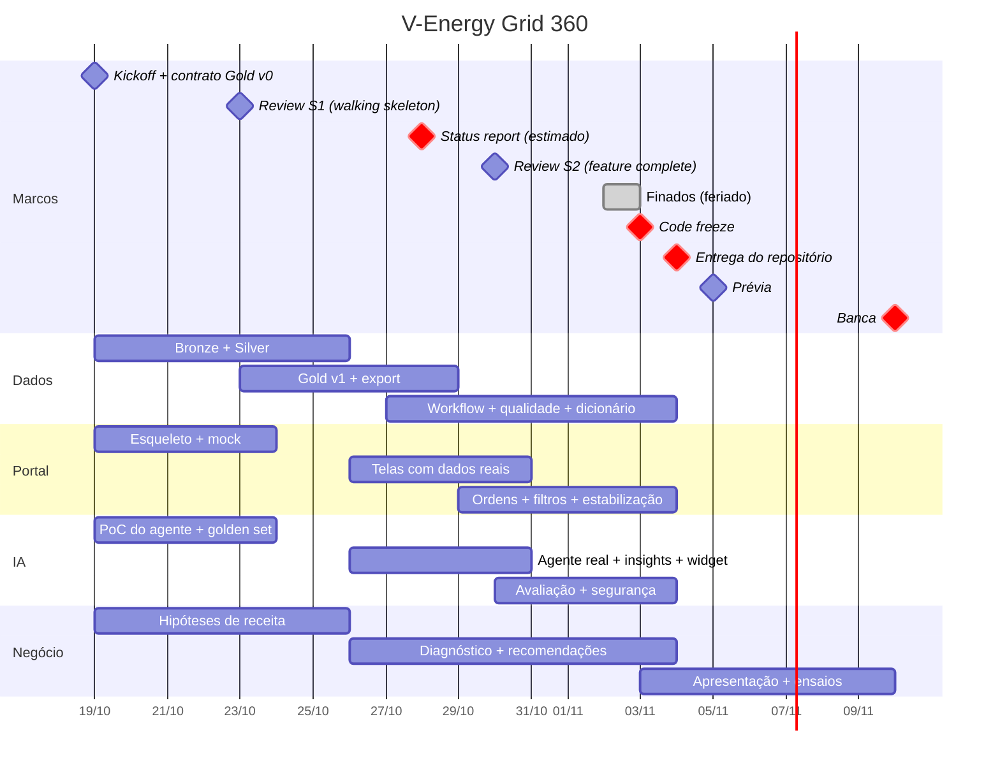
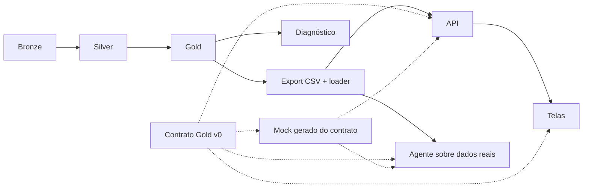

# Planejamento

Organização do time, cronograma, processo de trabalho e riscos do V-Energy Grid 360. O modelo de domínio está em [Arquitetura](arquitetura.md); as histórias, em [Backlog](backlog.md).

**Janela do projeto:** 19/10/2026 a 04/11/2026 (entrega do repositório). Prévia em 05/11 e banca em 10/11 (tarde).

## 1. Time

### 1.1 Códigos de responsável

O backlog e os documentos usam códigos por posição no time. A tabela abaixo liga cada código a uma frente e a um integrante.

| Código | Frente | Foco | Integrante |
|---|---|---|---|
| D1 | Engenharia de Dados | Plataforma de dados (Bronze/Silver, Workflow, qualidade) | Alisson, Arthur e Gabriel (cada um faz a sua cópia de Silver → Gold, comparadas entre si; DEC-011) |
| D2 | Engenharia de Dados | Continuidade (DEC/FEC) e Relacionamento (UC 360) | Alisson, Arthur e Gabriel (cada um faz a sua cópia de Silver → Gold, comparadas entre si; DEC-011) |
| D3 | Engenharia de Dados | Receita, Perdas e diagnóstico | Alisson, Arthur e Gabriel (cada um faz a sua cópia de Silver → Gold, comparadas entre si; DEC-011) |
| V1 | Portal Web | Backend e ordens de inspeção (API, banco, carga da Gold, telas de Perdas e OIs) | Felipe Matias |
| V2 | Portal Web | Frontend, integração e DevOps (contrato OpenAPI, `docker-compose`, CI e hooks) | João Euclides |
| G1 | Inteligência Artificial | Agente Text-to-SQL e segurança da IA | A definir |
| G2 | Inteligência Artificial | Insights, avaliação e apresentação | A definir |

Integrantes por frente (ver [README](../README.md#time)): Engenharia de Dados — Arthur Oliveira, Alysson, Gabriel; Portal Web — Felipe Matias, João Euclides; Inteligência Artificial — Luis Felipe Perylo, Lucas Mendes.

### 1.2 Papéis transversais

| Papel | Código | Responsabilidade |
|---|---|---|
| Product Owner / dono do diagnóstico | D3 | Prioriza o backlog pelo valor para a diretoria; responde pela narrativa da receita |
| Scrum Master (rotativo por sprint) | S1: V1 · S2: G1 · S3: D1 | Conduz as cerimônias, acompanha bloqueios, mantém o board atualizado |
| Tech lead de integração | V2 | Responsável pelo contrato entre API e frontend (OpenAPI), pelo `docker-compose`, pelo CI e pelos hooks de qualidade; garante que o projeto roda em todas as máquinas |
| Guardião da qualidade de dados | D1 | Mantém o log de problemas de qualidade e as decisões de limpeza, que alimentam o dicionário |
| Guardião de segurança da IA | G1 | Acesso somente leitura, defesa contra prompt injection, auditabilidade |
| Responsável pela apresentação | G2 | Roteiro de 15 min, slides, ensaios e banco de perguntas da banca |

### 1.3 Alocação por sprint

| Código | Sprint 1 (19–23/10) | Sprint 2 (26–30/10) | Sprint 3 (03–04/11) |
|---|---|---|---|
| D1 | Bronze dos 8 arquivos; Silver de UC, leituras e faturas; Job esqueleto com amostra | Integridade referencial; Workflow ponta a ponta | Testes de qualidade; print do Job; estratégia de agendamento; dicionário (Receita/Perdas) |
| D2 | Profiling e Silver de ocorrências, atendimentos (JSON), inspeções (XLSX), medidores e GD | DEC/FEC por alimentador; Golds da UC 360 e atendimento | Dicionário (Rede/Relacionamento); correções |
| D3 | Contrato Gold v0; Gold de receita v0 (walking skeleton); EDA de receita; quadro de hipóteses | Gold de receita PVM; score de suspeita v1; export CSV; status report | Diagnóstico; recomendações com ordem de grandeza do impacto |
| V1 | Esqueleto FastAPI, schemas `gold`/`app`, loader e mock, endpoint do walking skeleton | Endpoints de todos os contextos; backend das OIs; tela da fila de Perdas | Tela das OIs; export da fila; testes do backend; perfis (opcional) |
| V2 | Repositório, CI e hooks, `docker-compose`, contrato OpenAPI e client da API; frontend (TanStack Start SPA), layout, design system, tela de KPIs | Telas de Receita (drill-down), UC 360 e DEC/FEC; comparação de períodos | Filtros globais; acabamento visual |
| G1 | Camada semântica; PoC do agente no mock (PydanticAI); guardrails de SQL | Agente sobre dados reais; trilha de auditoria; "não sei"; endpoint `/ai` | Follow-up com memória; proteção contra prompt injection |
| G2 | Golden set com 40+ perguntas; glossário de sinônimos; EDA local de apoio | Insight embutido (Receita e/ou UC 360); widget de chat | Avaliação automatizada; roteiro da apresentação |

Na Sprint 1 o gargalo é Engenharia de Dados. Portal e IA trabalham contra o contrato e o mock, e G2 faz EDA local (pandas) para antecipar problemas de qualidade.

## 2. Cronograma

### 2.1 Linha do tempo



### 2.2 Sprint 1 — Fundação e walking skeleton (19/10 a 23/10)

**Objetivo:** um KPI real percorrendo o caminho inteiro: Databricks → CSV → banco → API → tela, e o agente respondendo sobre ele.

| Entrega | Critério de aceite |
|---|---|
| Repositório público com a estrutura do case e README esqueleto | `docker compose up` sobe banco, backend e frontend |
| 8 tabelas Bronze em Delta | Contagens iguais às dos arquivos de origem |
| Log de problemas de qualidade por tabela | Cada problema tem decisão proposta (tratar, descartar ou sinalizar) |
| Contrato Gold v0 (`contracts/gold_schema.yaml`) | Revisado por V1, G1 e D3 até 20/10 |
| Walking skeleton de um KPI (receita mensal) | O valor aparece na tela e o agente responde "qual a receita de 03/2025?" |
| Golden set v0 do agente (≥ 40 perguntas) | Inclui perguntas sem resposta (o agente deve dizer "não sei") e tentativas de injection |
| Quadro de hipóteses de receita | Cada hipótese tem a métrica que a confirma ou refuta |

### 2.3 Sprint 2 — Dados reais e status report (26/10 a 30/10)

**Objetivo:** todas as histórias obrigatórias funcionando com dados reais, ainda que sem acabamento. Status report com as primeiras hipóteses validadas.

| Entrega | Critério de aceite |
|---|---|
| Silver completa com integridade referencial | Nenhum registro órfão em leitura/fatura × UC, ou órfãos isolados e documentados |
| Gold v1 completa, export CSV e loader idempotente | O reload não altera o schema `app` |
| DEC/FEC por alimentador ao longo do tempo | Fórmula documentada no dicionário |
| Telas: KPIs, Receita (PVM + drill-down), UC 360, DEC/FEC, fila de Perdas | Cada tela atende à necessidade de uma das lideranças do case |
| Agente sobre dados reais, com trilha de auditoria e acesso somente leitura | Mostra o SQL e as linhas usadas; recusa DML/DDL |
| Insight de IA embutido em pelo menos uma tela | Gerado apenas a partir de números já calculados |
| Status report (data a confirmar com a Visagio) | 3 a 5 hipóteses com evidência e próximos passos |

### 2.4 Sprint 3 — Estabilização e entrega (03/11 a 04/11)

Sprint curta por causa do feriado de 02/11. **Objetivo:** nenhuma funcionalidade nova; tudo o que foi construído funciona e está documentado.

| Entrega | Critério de aceite |
|---|---|
| Ciclo completo das OIs (gerar, mudar status, registrar resultado, cancelar) | Fluxo executado ao vivo em menos de 1 min |
| Filtros globais (período, município, bairro, classe) | Funcionam em todas as telas analíticas |
| Workflow reexecutável no Databricks e print no README | Execução ponta a ponta sem intervenção manual |
| [Dicionário de dados](dicionario-de-dados.md) da Gold | Toda métrica com definição e as decisões de limpeza que a afetam |
| [Diagnóstico da receita](diagnostico-receita.md) | Causas com evidência, recomendações e ordem de grandeza do impacto em R$ |
| README completo | Uma pessoa de fora consegue executar tudo seguindo o passo a passo |
| **Code freeze em 03/11, 20h** | Em 04/11 entram apenas correções de bug e documentação |

### 2.5 Após a entrega (05/11 a 10/11)

- 05/11: prévia; feedback registrado por escrito.
- 06/11 a 09/11: ajustes de narrativa, dois ensaios cronometrados de 15 min e simulação de perguntas da banca para cada integrante.
- Se commits posteriores a 04/11 não contarem para a avaliação, a demonstração usa a tag `v1.0-entrega`.

### 2.6 Caminho crítico



- O contrato elimina a espera: Portal e IA começam no primeiro dia contra o mock.
- A Gold é publicada de forma incremental, uma tabela por vez, começando pela receita (Core).
- Mudanças no contrato seguem a regra de [Arquitetura §4.1](arquitetura.md#41-contratos-entre-contextos).

## 3. Diagnóstico da receita: método e hipóteses

**Pergunta do case:** a tarifa residencial subiu 10,5% e a base de clientes cresceu, mas a energia faturada caiu ~4% e a receita subiu apenas 8% (últimos 12 meses vs primeiro ano). Por quê?

**Método:** decomposição PVM (preço × volume × mix) → drill-down até onde está a queda de volume → teste de cada hipótese com dados → recomendações com impacto em R$.

Hipóteses iniciais (nenhuma confirmada):

| ID | Hipótese | Métrica que confirma ou refuta | Contexto |
|---|---|---|---|
| H1 | O crescimento da GD (solar) está reduzindo o volume faturado | Variação de kWh das UCs com GD antes e depois da conexão; parcela da queda explicada | BC5, BC2 |
| H2 | Perdas não técnicas aumentaram em bairros específicos | UCs com queda brusca sem GD; taxa de irregularidade das inspeções por bairro | BC3 |
| H3 | Mudança de mix: classes de tarifa maior (ex.: A4, B3) perderam participação | Efeito mix na PVM | BC2 |
| H4 | O período base teve bandeiras mais caras que o atual | Receita de bandeira por período | BC2 |
| H5 | Erros de leitura ou medição (leituras estimadas, medidores antigos ou sem manutenção) | Consumo zero ou estimado por idade do medidor | BC1, BC5 |
| H6 | UCs ativas no cadastro sem faturamento, ou o inverso | Integridade cadastro × fatura | BC1 |
| H7 | Interrupções reduzem o consumo faturado em alimentadores críticos | Correlação entre DEC e queda de kWh por alimentador | BC4 |

A review de cada sexta-feira atualiza o status das hipóteses (aberta, confirmada ou refutada, com evidência). O status report usa esse quadro.

O resultado final, em [`diagnostico-receita.md`](diagnostico-receita.md), contém:

1. a ponte (waterfall) da receita do período base para o atual;
2. as causas ranqueadas por impacto em R$;
3. 3 a 5 recomendações acionáveis com ordem de grandeza do impacto (ex.: "inspecionar o top-N da fila recupera ~X MWh/mês ≈ R$ Y/ano").

## 4. Processo de trabalho

### 4.1 Cerimônias

| Cerimônia | Quando | Formato | Duração | Resultado |
|---|---|---|---|---|
| Daily assíncrona | Dias úteis, até 9h30 | Mensagem no grupo geral (modelo abaixo) | — | Bloqueios visíveis cedo |
| Standup síncrono | Dias úteis, 18h | Chamada de voz | 15 min | Bloqueios e integrações resolvidos ou com responsável |
| Planning | Segunda, 9h30 | Chamada de vídeo | 45 min | Sprint backlog no board, cada item com responsável |
| Refinamento | Quarta, 18h15 | Leads (D3, V2, G1) e quem tiver item em pauta | 20 min | Itens da próxima sprint em `Ready` |
| Review | Sexta, 16h | Chamada com tela compartilhada; quem demonstra não é quem construiu | 30 min | Incremento aceito ou devolvido |
| Retrospectiva | Sexta, após a review | Chamada | 15 min | 1 ou 2 ações concretas para a sprint seguinte |

Modelo da daily:

```
DD/MM · Nome · Frente
Ontem: …
Hoje: …
Bloqueio: … (ou "nenhum")
Dependo de / entrego para: @pessoa …
```

### 4.2 Comunicação

- **O WhatsApp é para conversa; o GitHub é a fonte de verdade.** Decisão tomada em conversa é registrada em [`decisoes.md`](decisoes.md) ou em issue em até 24h.
- Grupo geral para dailys e avisos; grupos por frente (Dados, Portal, IA) para discussão técnica.
- Bloqueio sem resposta por mais de 2h: mencionar o lead da frente no grupo geral.

### 4.3 Board

GitHub Projects com as colunas `Backlog → Ready → Doing → Review → Done`. Limite de dois itens em `Doing` por pessoa.

Labels: `bc:dados`, `bc:receita`, `bc:perdas`, `bc:rede`, `bc:relacionamento`, `bc:ia`, `bc:portal`, `must`, `should`, `could`, `contrato`, `bloqueado`, `sprint:S1`, `sprint:S2`, `sprint:S3`.

Cada história do [backlog](backlog.md) corresponde a uma issue.

### 4.4 Priorização (MoSCoW)

| Prioridade | Itens |
|---|---|
| Must | Todos os requisitos não diferenciais das seções 5.1 a 5.4 do case, README, dicionário e diagnóstico |
| Should | Diferenciais de baixo custo: testes de qualidade no pipeline, testes automatizados do backend, avaliação automatizada do agente, follow-up com memória, export da fila em CSV |
| Could | Upload da planilha de campo, login com perfis por cargo |
| Won't | Streaming/tempo real, deploy em nuvem, multi-tenant |

Nenhum item Should começa antes de todos os Must da mesma frente estarem em `Done`.

### 4.5 Definition of Ready

- História com persona e critério de aceite escritos.
- Dependências de contrato identificadas (tabela, endpoint ou campo).
- Cabe em até 2 dias de trabalho.

### 4.6 Definition of Done

- Código em `main` via PR com pelo menos uma revisão; quando toca o contrato, a revisão é de outra frente.
- Executa via `docker compose up` ou pelo Job do Databricks.
- Nomes de colunas, variáveis e rótulos seguem a [linguagem ubíqua](arquitetura.md#5-linguagem-ubíqua).
- Documentado no README da pasta e/ou no dicionário de dados.
- IA: o golden set não regrediu.
- Dados: contagens e chaves validadas; decisões de limpeza registradas no log de qualidade.

### 4.7 Convenções de engenharia

- Trunk-based: branches curtas `feat/<contexto>-<tema>`, PRs pequenos, Conventional Commits.
- Decisões registradas em [`decisoes.md`](decisoes.md) com ID `DEC-NNN`.
- Seeds e mocks gerados a partir do contrato, para Portal e IA trabalharem sem o Databricks.

## 5. Riscos

| Risco | Probabilidade | Impacto | Mitigação | Responsável |
|---|---|---|---|---|
| Atraso da Gold bloqueia Portal e IA | Alta | Alto | Contrato e mock no primeiro dia; Gold publicada tabela a tabela | D3 |
| Feriado de 02/11 encurta a última sprint | Certa | Médio | Sprint 2 termina com todas as funcionalidades; Sprint 3 só estabiliza | Scrum Master |
| Limites do workspace Databricks | Média | Alto | Testar o Job inteiro na S1 com amostra; leituras particionadas por ano | D1 |
| Agente alucina ou é manipulado | Média | Crítico | ADR-03, golden set com perguntas sem resposta e de injection, role somente leitura | G1 |
| Frontend com uma pessoa vira gargalo (5 telas) | Alta | Alto | Componentes reutilizáveis; V1 assume as telas de Perdas e das OIs e o export da fila; G2 faz o widget de chat | V2 |
| Integração deixada para o fim | Média | Alto | Walking skeleton obrigatório na review da S1; contrato OpenAPI checado no CI | V2 |
| Reload da Gold apaga as OIs | Média | Alto | Schema `app` separado; loader altera apenas `gold.*` | V1 |
| Pergunta da banca que só uma pessoa sabe responder | Alta | Médio | Demonstração rotativa nas reviews | G2 |
| Quota ou chave do LLM indisponível | Baixa | Alto | Modelo e fallback configuráveis por variável de ambiente (OpenRouter) | G1 |

## 6. Pendências

Pontos ainda sem decisão registrada. Ao fechar cada um, registre em [`decisoes.md`](decisoes.md) e atualize este documento.

| Tema | Opções | Impacto |
|---|---|---|
| Integrante de cada código (§1.1) | — | Responsáveis no backlog e no board |
| Responsável pelo score de suspeita (D3-07) | D3, ou G2 como modelo de ML (D3 revisa o backtest) | Carga de D3 na S2 (18 → 13 pts) |
| Responsável pelos endpoints de DEC/FEC e da fila (V1-07) | V1, ou G1 (já trabalha no router `/ai`) | Carga de V1 e G1 na S2 |
| Estados da OI | Lista atual (§5 da arquitetura) ou variação | Máquina de estados do backend (V1-08) |
| Fins de semana | Buffer apenas para quem está no caminho crítico, ou descanso | Capacidade das sprints |

Perguntas para a Visagio:

- Data e formato do status report intermediário.
- Commits posteriores a 04/11 contam para a avaliação?
- Workspace Databricks: Community/Free ou provido? Quais os limites de cluster?
- A chave do LLM é fornecida?
