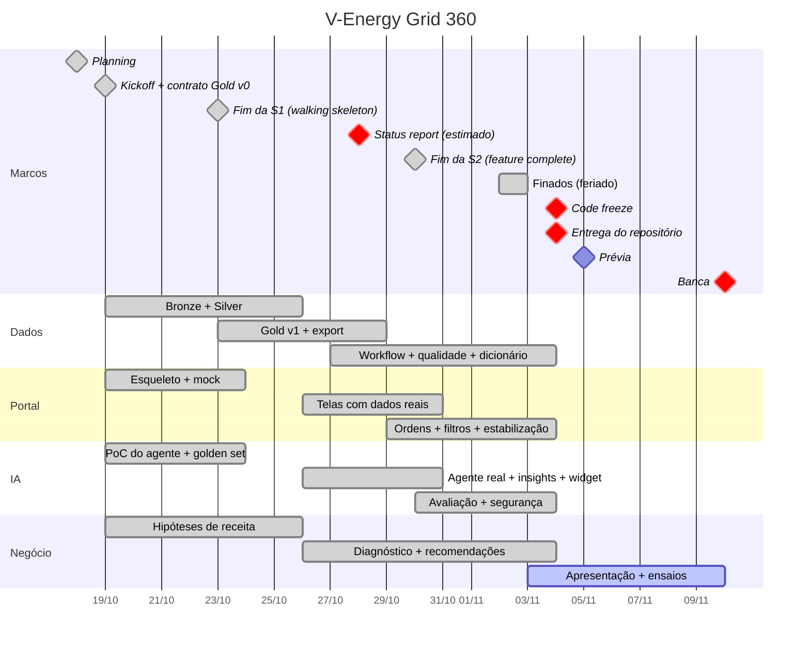
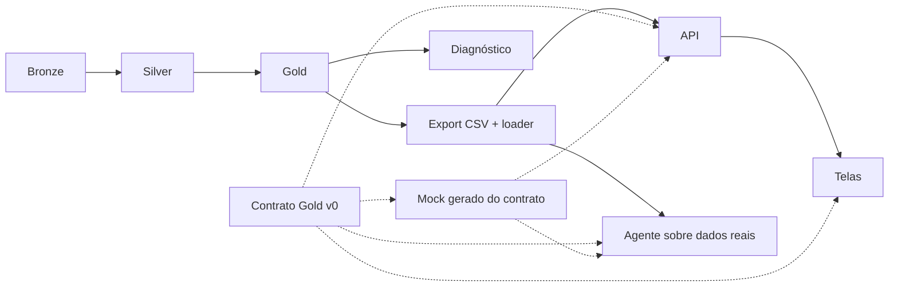

# Planejamento

Organização do time, cronograma, processo de trabalho e riscos do V-Energy Grid 360. O modelo de domínio está em [Arquitetura](arquitetura.md); as histórias, em [Backlog](backlog.md).

**Janela do projeto:** 19/10/2026 a 04/11/2026 (entrega do repositório). Prévia em 05/11 e banca em 10/11 (tarde).

## Estado em 04/11/2026

Dia do code freeze e da entrega. Todas as entregas obrigatórias das três sprints estão na `main`, em 123 PRs mergeados desde 19/10, contando o #139 (README e documentação reorganizados). A versão entregue é a tag `v1.0-entrega`. Cada tabela abaixo ganhou a coluna **Estado**, com os PRs que entregaram o item.

- **Feito além do plano:** ordens de inspeção em tempo real ([DEC-063](decisoes.md#dec-063--ordens-de-inspeção-em-tempo-real-aviso-no-commit-e-sse)), rastreamento com OpenTelemetry ([DEC-068](decisoes.md#dec-068--rastreamento-das-requisições-com-opentelemetry)), etapas do agente por SSE ([DEC-055](decisoes.md#dec-055--etapas-do-agente-por-sse-em-post-aiaskstream)), conversas do agente salvas no banco ([DEC-053](decisoes.md#dec-053--conversas-do-agente-por-usuário-no-banco)) e limite de tentativas de login ([DEC-065](decisoes.md#dec-065--limite-de-tentativas-de-login-por-login-e-endereço)).
- **Em aberto depois da entrega:** as issues #133 (DEC/FEC inflado em alimentador com mês faltando) e #100 (percentuais numéricos na fila). Os PRs #136 (indicadores e mapa de Perdas), #137 (pipeline do Databricks do zero), #138 (documentação do agente) e #141 (insights nas telas) entraram em 03/11, e as correções #140 (planilha de campo) e #142 (busca de UC e mapa de Perdas) e o #139 em 04/11, antes do freeze.
- **Processo:** a daily aconteceu em todos os dias úteis desde 19/10, às 19h. Todas as conversas do time, técnicas inclusive, ficaram no grupo e na daily, e os pedidos de revisão de PR saíam no grupo ([§4.1](#41-cerimônias)).
- **Fora do repositório:** status report, slides e ensaios não têm registro aqui; o estado deles está com o time.

## 1. Time

### 1.1 Códigos de responsável

O backlog e os documentos usam códigos por posição no time. A tabela abaixo liga cada código a uma frente e a um integrante.

| Código | Frente | Foco | Integrante |
|---|---|---|---|
| D1 | Engenharia de Dados | Plataforma de dados (Bronze/Silver, Workflow, qualidade) | Alisson, Arthur e Gabriel (cada um faz a sua cópia de Silver → Gold, comparadas entre si; DEC-011) |
| D2 | Engenharia de Dados | Continuidade (DEC/FEC) e Relacionamento (UC 360) | Alisson, Arthur e Gabriel (cada um faz a sua cópia de Silver → Gold, comparadas entre si; DEC-011) |
| D3 | Engenharia de Dados | Receita, Perdas e diagnóstico | Alisson, Arthur e Gabriel (cada um faz a sua cópia de Silver → Gold, comparadas entre si; DEC-011) |
| V1 | Portal Web | Backend e ordens de inspeção (API, banco, carga da Gold, telas de Perdas e OIs) | Felipe Matias |
| V2 | Portal Web | Frontend, integração e DevOps (contrato OpenAPI, `docker-compose`, CI e hooks) | João Euclides |
| G1 | Inteligência Artificial | Agente Text-to-SQL e segurança da IA | Luis Felipe Perylo e Lucas Mendes |
| G2 | Inteligência Artificial | Insights, avaliação e apresentação | Luis Felipe Perylo e Lucas Mendes |

Integrantes por frente (ver [README](../README.md#time)): Engenharia de Dados — Arthur Oliveira, Alisson Ramos, Gabriel Marinho; Portal Web — Felipe Matias, João Euclides; Inteligência Artificial — Luis Felipe Perylo, Lucas Mendes.

### 1.2 Papéis transversais

| Papel | Código | Responsabilidade |
|---|---|---|
| Product Owner / dono do diagnóstico | D3 | Prioriza o backlog pelo valor para a diretoria; responde pela narrativa da receita |
| Scrum Master (rotativo por sprint) | S1: V1 · S2: G1 · S3: D1 | Conduz as cerimônias, acompanha bloqueios, mantém o board atualizado |
| Tech lead de integração | V2 | Responsável pelo contrato entre API e frontend (OpenAPI), pelo `docker-compose`, pelo CI e pelos hooks de qualidade; garante que o projeto roda em todas as máquinas |
| Guardião da qualidade de dados | D1 | Mantém o log de problemas de qualidade e as decisões de limpeza, que alimentam o dicionário |
| Guardião de segurança da IA | G1 | Acesso somente leitura, defesa contra prompt injection, auditabilidade |
| Responsável pela apresentação | G2 | Roteiro de 15 min, slides, ensaios e banco de perguntas da banca |

### 1.3 Alocação por sprint

| Código | Sprint 1 (19–23/10) | Sprint 2 (26–30/10) | Sprint 3 (03–04/11) |
|---|---|---|---|
| D1 | Bronze dos 8 arquivos; Silver de UC, leituras e faturas; Job esqueleto com amostra | Integridade referencial; Workflow ponta a ponta | Testes de qualidade; print do Job; estratégia de agendamento; dicionário (Receita/Perdas) |
| D2 | Profiling e Silver de ocorrências, atendimentos (JSON), inspeções (XLSX), medidores e GD | DEC/FEC por alimentador; Golds da UC 360 e atendimento | Dicionário (Rede/Relacionamento); correções |
| D3 | Contrato Gold v0; Gold de receita v0 (walking skeleton); EDA de receita; quadro de hipóteses | Gold de receita PVM; score de suspeita v1; export CSV; status report | Diagnóstico; recomendações com ordem de grandeza do impacto |
| V1 | Esqueleto FastAPI, schemas `gold`/`app`, loader e mock, endpoint do walking skeleton | Endpoints de todos os contextos; backend das OIs; tela da fila de Perdas | Tela das OIs; export da fila; testes do backend; perfis (opcional) |
| V2 | Repositório, CI e hooks, `docker-compose`, contrato OpenAPI e client da API; frontend (TanStack Start SPA), layout, design system, tela de KPIs | Telas de Receita (drill-down), UC 360 e DEC/FEC; comparação de períodos | Filtros globais; acabamento visual |
| G1 | Camada semântica; PoC do agente no mock (PydanticAI); guardrails de SQL | Agente sobre dados reais; trilha de auditoria; "não sei"; endpoint `/ai` | Follow-up com memória; proteção contra prompt injection |
| G2 | Golden set com 40+ perguntas; glossário de sinônimos; EDA local de apoio | Insight embutido (Receita e/ou UC 360); widget de chat | Avaliação automatizada; roteiro da apresentação |

Na Sprint 1 o gargalo é Engenharia de Dados. Portal e IA trabalham contra o contrato e o mock, e G2 faz EDA local (pandas) para antecipar problemas de qualidade.

## 2. Cronograma

### 2.1 Linha do tempo



### 2.2 Sprint 1 — Fundação e walking skeleton (19/10 a 23/10)

**Objetivo:** um KPI real percorrendo o caminho inteiro: Databricks → CSV → banco → API → tela, e o agente respondendo sobre ele.

| Entrega | Critério de aceite | Estado |
|---|---|---|
| Repositório público com a estrutura do case e README esqueleto | `docker compose up` sobe banco, backend e frontend | Feito em 19/10 (#1 a #4) |
| 8 tabelas Bronze em Delta | Contagens iguais às dos arquivos de origem | Feito (#6) |
| Log de problemas de qualidade por tabela | Cada problema tem decisão proposta (tratar, descartar ou sinalizar) | Feito: [qualidade dos dados](qualidade-dados.md) (#12) |
| Contrato Gold v0 (`contracts/gold_schema.yaml`) | Revisado por V1, G1 e D3 até 20/10 | Feito com um dia de atraso: v0.1.0 em 21/10 (#10). Hoje na v0.3.0 (#43) |
| Walking skeleton de um KPI (receita mensal) | O valor aparece na tela e o agente responde "qual a receita de 03/2025?" | Feito (#3, #22, #24, #30) |
| Golden set v0 do agente (≥ 40 perguntas) | Inclui perguntas sem resposta (o agente deve dizer "não sei") e tentativas de injection | Feito: 64 perguntas em 23/10 (#32). Hoje são 105 itens, todos revisados por Dados, e 17 ataques de red team |
| Quadro de hipóteses de receita | Cada hipótese tem a métrica que a confirma ou refuta | Feito no [diagnóstico](diagnostico-receita.md) (#19) |

### 2.3 Sprint 2 — Dados reais e status report (26/10 a 30/10)

**Objetivo:** todas as histórias obrigatórias funcionando com dados reais, ainda que sem acabamento. Status report com as primeiras hipóteses validadas.

| Entrega | Critério de aceite | Estado |
|---|---|---|
| Silver completa com integridade referencial | Nenhum registro órfão em leitura/fatura × UC, ou órfãos isolados e documentados | Feito (#12): órfãos documentados, como as faturas de UCs fora do cadastro (FAT-05) |
| Gold v1 completa, export CSV e loader idempotente | O reload não altera o schema `app` | Feito (#49, #60): carga em lotes, tudo ou nada, sem tocar no `app` ([DEC-038](decisoes.md#dec-038--carga-da-gold-em-lotes-com-uma-rodada-de-conferência-antes-de-gravar), [DEC-050](decisoes.md#dec-050--autoria-nos-eventos-das-ordens-de-inspeção)) |
| DEC/FEC por alimentador ao longo do tempo | Fórmula documentada no dicionário | Feito (#45, [DEC-033](decisoes.md#dec-033--dec-e-fec-por-período-e-recorte-e-a-fila-de-suspeitas-paginada)) |
| Telas: KPIs, Receita (PVM + drill-down), UC 360, DEC/FEC, fila de Perdas | Cada tela atende à necessidade de uma das lideranças do case | Feito: Visão geral (#59, #68), Receita (#27, #51), UC 360 (#55, #81), Rede (#82, #131) e Perdas (#27, #96). Tour no [guia do portal](portal.md) |
| Agente sobre dados reais, com trilha de auditoria e acesso somente leitura | Mostra o SQL e as linhas usadas; recusa DML/DDL | Feito (#52, #65): na rodada final na Gold real (03/11, #135), 94,1% de SQL certo, contra a meta de 80% ([agente de IA](agente-ia.md)) |
| Insight de IA embutido em pelo menos uma tela | Gerado apenas a partir de números já calculados | Feito na Receita (#58), gerado sob pedido (#128), e estendido à Visão geral, à Rede, a Perdas e à UC, com a IA escolhendo entre as leituras do backend (#141, [DEC-077](decisoes.md#dec-077--insights-de-ia-nas-telas-do-dia-a-dia-com-a-ia-escolhendo-a-leitura)) |
| Status report (data a confirmar com a Visagio) | 3 a 5 hipóteses com evidência e próximos passos | Sem registro no repositório |

### 2.4 Sprint 3 — Estabilização e entrega (03/11 a 04/11)

Sprint curta por causa do feriado de 02/11. **Objetivo:** nenhuma funcionalidade nova; tudo o que foi construído funciona e está documentado.

| Entrega | Critério de aceite | Estado |
|---|---|---|
| Ciclo completo das OIs (gerar, mudar status, registrar resultado, cancelar) | Fluxo executado ao vivo em menos de 1 min | Feito (#9, #34, #79, #96, #115, #122) |
| Filtros globais (período, município, bairro, classe) | Funcionam em todas as telas analíticas | Feito (#107, [DEC-060](decisoes.md#dec-060--filtros-compartilhados-entre-as-telas-do-portal)) |
| Workflow reexecutável no Databricks e print no README | Execução ponta a ponta sem intervenção manual | Feito (#61, #72), com a task de testes de qualidade (#134). Print no [README](../README.md#trazendo-os-arquivos-brutos) e em [dos arquivos brutos ao portal](dados-brutos.md) |
| [Dicionário de dados](dicionario-de-dados.md) da Gold | Toda métrica com definição e as decisões de limpeza que a afetam | Feito (#23, #126) |
| [Diagnóstico da receita](diagnostico-receita.md) | Causas com evidência, recomendações e ordem de grandeza do impacto em R$ | Feito (#19, #80) |
| README completo | Uma pessoa de fora consegue executar tudo seguindo o passo a passo | Feito (#78, #137); reorganizado com os guias em [`docs/`](README.md) no #139 |
| **Code freeze em 04/11** | Depois do freeze, só correções de bug e documentação | Oficializado em 04/11, dia da entrega. O #136, o #137, o #138 e o #141 entraram em 03/11; as correções #140 e #142 e o #139 (documentação), em 04/11. A versão entregue é a tag `v1.0-entrega` |

### 2.5 Após a entrega (05/11 a 10/11)

- 05/11: prévia; feedback registrado por escrito.
- 06/11 a 09/11: ajustes de narrativa, dois ensaios cronometrados de 15 min e simulação de perguntas da banca para cada integrante.
- Se commits posteriores a 04/11 não contarem para a avaliação, a demonstração usa a tag `v1.0-entrega`.

### 2.6 Caminho crítico



- O contrato elimina a espera: Portal e IA começam no primeiro dia contra o mock.
- A Gold é publicada de forma incremental, uma tabela por vez, começando pela receita (Core).
- Mudanças no contrato seguem a regra de [Arquitetura §4.1](arquitetura.md#41-contratos-entre-contextos).

## 3. Diagnóstico da receita: método e hipóteses

**Pergunta do case:** a tarifa residencial subiu 10,5% e a base de clientes cresceu, mas a energia faturada caiu ~4% e a receita subiu apenas 8% (últimos 12 meses vs primeiro ano). Por quê?

**Método:** decomposição PVM (preço × volume × mix) → drill-down até onde está a queda de volume → teste de cada hipótese com dados → recomendações com impacto em R$.

Hipóteses iniciais e o resultado de cada uma no [diagnóstico](diagnostico-receita.md#3-quadro-consolidado-de-hipóteses). A H8 surgiu na exploração dos dados.

| ID | Hipótese | Métrica que confirma ou refuta | Contexto | Resultado |
|---|---|---|---|---|
| H1 | O crescimento da GD (solar) está reduzindo o volume faturado | Variação de kWh das UCs com GD antes e depois da conexão; parcela da queda explicada | BC5, BC2 | Confirmada: −11,2 GWh/ano nas 3.510 UCs com GD |
| H2 | Perdas não técnicas aumentaram em bairros específicos | UCs com queda brusca sem GD; taxa de irregularidade das inspeções por bairro | BC3 | Confirmada: 4 bairros com −15,7% de volume; ~R$ 1,9M/ano recuperáveis |
| H3 | Mudança de mix: classes de tarifa maior (ex.: A4, B3) perderam participação | Efeito mix na PVM | BC2 | Confirmada no volume, com impacto moderado: −R$ 337 mil |
| H4 | O período base teve bandeiras mais caras que o atual | Receita de bandeira por período | BC2 | Refutada, com efeito inverso: as bandeiras somaram +R$ 5,57M no período atual |
| H5 | Erros de leitura ou medição (leituras estimadas, medidores antigos ou sem manutenção) | Consumo zero ou estimado por idade do medidor | BC1, BC5 | Parcialmente confirmada: 95,4% das irregularidades em medidores eletromecânicos |
| H6 | UCs ativas no cadastro sem faturamento, ou o inverso | Integridade cadastro × fatura | BC1 | Parcialmente confirmada: só as faturas órfãs; as 200 UCs sem fatura são cadastro de teste |
| H7 | Interrupções reduzem o consumo faturado em alimentadores críticos | Correlação entre DEC e queda de kWh por alimentador | BC4 | Refutada como causa de receita: < R$ 30 mil/ano |
| H8 | A tarifa do subgrupo industrial (A4) caiu enquanto a residencial subiu | Tarifa base e tarifa média por classe | BC2 | Confirmada: A4 terminou 1,1% abaixo de 2022 |

O plano previa atualizar o status das hipóteses na review de sexta-feira. Sem review formal, o andamento da semana era debatido na daily mais longa do fim da semana. O status report usaria esse quadro.

O resultado final, em [`diagnostico-receita.md`](diagnostico-receita.md), contém:

1. a ponte (waterfall) da receita do período base para o atual;
2. as causas ranqueadas por impacto em R$;
3. 3 a 5 recomendações acionáveis com ordem de grandeza do impacto (ex.: "inspecionar o top-N da fila recupera ~X MWh/mês ≈ R$ Y/ano").

## 4. Processo de trabalho

### 4.1 Cerimônias

| Cerimônia | Quando | Formato | Duração | Resultado | Como foi |
|---|---|---|---|---|---|
| Daily assíncrona | Dias úteis, até 9h30 | Mensagem no grupo geral (modelo abaixo) | — | Bloqueios visíveis cedo | Aconteceu em todos os dias úteis desde 19/10, às 19h |
| Standup síncrono | Dias úteis, 18h | Chamada de voz | 15 min | Bloqueios e integrações resolvidos ou com responsável | Não aconteceu: a daily das 19h cobriu os bloqueios e as integrações |
| Planning | Segunda, 9h30 | Chamada de vídeo | 45 min | Sprint backlog no board, cada item com responsável | Uma única, no domingo 18/10, às 20h, véspera do início do projeto, e não na segunda às 9h30. Ao longo do projeto, escopo e prioridades continuaram sendo definidos na daily e no grupo |
| Refinamento | Quarta, 18h15 | Leads (D3, V2, G1) e quem tiver item em pauta | 20 min | Itens da próxima sprint em `Ready` | Não foi semanal. Acontece agora, em 03/11, com todas as entregas concluídas: o time debate diferenciais, o que mais vale acrescentar e o que aprimorar para o trabalho chamar mais atenção |
| Review | Sexta, 16h | Chamada com tela compartilhada; quem demonstra não é quem construiu | 30 min | Incremento aceito ou devolvido | Sem review formal: a última daily da semana durava mais, para debater o que tinha sido feito e explicar como foi construído |
| Retrospectiva | Sexta, após a review | Chamada | 15 min | 1 ou 2 ações concretas para a sprint seguinte | Ainda não aconteceu |

Modelo da daily:

```
DD/MM · Nome · Frente
Ontem: …
Hoje: …
Bloqueio: … (ou "nenhum")
Dependo de / entrego para: @pessoa …
```

**Como foi:** o planning foi uma sessão no domingo 18/10, às 20h, véspera do início, e o escopo continuou sendo ajustado ao longo do projeto. A daily aconteceu em todos os dias úteis desde 19/10, às 19h, e não de manhã como no plano. Não houve standup nem review formal: na última daily da semana, o time ia mais longe, debatendo o que tinha sido feito e explicando como cada parte foi construída. O refinamento ficou para o fim: depois de concluídas as entregas, o time passou a debater diferenciais e melhorias que destaquem o trabalho. A retrospectiva ainda não aconteceu.

### 4.2 Comunicação

- **O WhatsApp é para conversa; o GitHub é a fonte de verdade.** Decisão tomada em conversa é registrada em [`decisoes.md`](decisoes.md) ou em issue em até 24h.
- As conversas do time aconteceram no grupo geral e na daily, inclusive as discussões técnicas e os pedidos de revisão de PR. O pedido de revisão sai no grupo, e a revisão e o aceite ficam registrados no PR.
- Bloqueio sem resposta por mais de 2h: mencionar o lead da frente no grupo geral.

### 4.3 Board

Planejado: GitHub Projects com as colunas `Backlog → Ready → Doing → Review → Done`. Limite de dois itens em `Doing` por pessoa.

Labels: `bc:dados`, `bc:receita`, `bc:perdas`, `bc:rede`, `bc:relacionamento`, `bc:ia`, `bc:portal`, `must`, `should`, `could`, `contrato`, `bloqueado`, `sprint:S1`, `sprint:S2`, `sprint:S3`.

Cada história do [backlog](backlog.md) corresponde a uma issue.

**Como foi:** o board ficou no Trello, e não no GitHub Projects. Cada tarefa virava um card, e o card avançava pelas colunas conforme o desenvolvimento acontecia.

### 4.4 Priorização (MoSCoW)

| Prioridade | Itens | Estado |
|---|---|---|
| Must | Todos os requisitos não diferenciais das seções 5.1 a 5.4 do case, README, dicionário e diagnóstico | Feito |
| Should | Diferenciais de baixo custo: testes de qualidade no pipeline, testes automatizados do backend, avaliação automatizada do agente, follow-up com memória, export da fila em CSV | Feito: testes de qualidade (#134), testes do backend e do agente no CI, avaliação com golden set, red team e juiz (#41, #85), memória (#86). O export da fila virou a planilha das ordens em campo ([DEC-062](decisoes.md#dec-062--planilha-de-campo-exportar-as-ordens-em-campo-e-subir-o-resultado)) |
| Could | Upload da planilha de campo, login com perfis por cargo | Feito (#115, #91) |
| Won't | Streaming/tempo real, deploy em nuvem, multi-tenant | Deploy e multi-tenant ficaram fora. O tempo real entrou onde era barato: ordens por SSE (#122) e etapas do agente (#110) |

Nenhum item Should começa antes de todos os Must da mesma frente estarem em `Done`.

### 4.5 Definition of Ready

- História com persona e critério de aceite escritos.
- Dependências de contrato identificadas (tabela, endpoint ou campo).
- Cabe em até 2 dias de trabalho.

### 4.6 Definition of Done

- Código em `main` via PR com pelo menos uma revisão; quando toca o contrato, a revisão é de outra frente.
- Executa via `docker compose up` ou pelo Job do Databricks.
- Nomes de colunas, variáveis e rótulos seguem a [linguagem ubíqua](arquitetura.md#5-linguagem-ubíqua).
- Documentado no README da pasta e/ou no dicionário de dados.
- IA: o golden set não regrediu.
- Dados: contagens e chaves validadas; decisões de limpeza registradas no log de qualidade.

### 4.7 Convenções de engenharia

- Trunk-based: branches curtas `feat/<contexto>-<tema>`, PRs pequenos, Conventional Commits.
- Decisões registradas em [`decisoes.md`](decisoes.md) com ID `DEC-NNN`.
- Seeds e mocks gerados a partir do contrato, para Portal e IA trabalharem sem o Databricks.

## 5. Riscos

| Risco | Probabilidade | Impacto | Mitigação | Responsável | Desfecho |
|---|---|---|---|---|---|
| Atraso da Gold bloqueia Portal e IA | Alta | Alto | Contrato e mock no primeiro dia; Gold publicada tabela a tabela | D3 | Mitigado: portal e agente rodaram na amostra até a Gold oficial (#49, 27/10) |
| Feriado de 02/11 encurta a última sprint | Certa | Médio | Sprint 2 termina com todas as funcionalidades; Sprint 3 só estabiliza | Scrum Master | Ocorreu: diferenciais seguiram até 03/11 (#131, #134, #136, #141), e o freeze oficial ficou para 04/11, dia da entrega |
| Limites do workspace Databricks | Média | Alto | Testar o Job inteiro na S1 com amostra; leituras particionadas por ano | D1 | Não ocorreu: Job serverless completo em ~15 min |
| Agente alucina ou é manipulado | Média | Crítico | ADR-03, golden set com perguntas sem resposta e de injection, role somente leitura | G1 | Mitigado: red team com 0 escritas aceitas e 0 vazamentos de prompt; números da resposta conferidos com as linhas ([DEC-019](decisoes.md#dec-019--verificação-numérica-da-narrativa)) |
| Frontend com uma pessoa vira gargalo (5 telas) | Alta | Alto | Componentes reutilizáveis; V1 assume as telas de Perdas e das OIs e o export da fila; G2 faz o widget de chat | V2 | Mitigado com outra divisão: V2 fez as telas, inclusive a fila de Perdas (#96) e o chat (#99); V1 ficou com o backend das ordens |
| Integração deixada para o fim | Média | Alto | Walking skeleton obrigatório na review da S1; contrato OpenAPI checado no CI | V2 | Não ocorreu: integração ponta a ponta desde 19/10 |
| Reload da Gold apaga as OIs | Média | Alto | Schema `app` separado; loader altera apenas `gold.*` | V1 | Não ocorreu ([DEC-050](decisoes.md#dec-050--autoria-nos-eventos-das-ordens-de-inspeção)) |
| Pergunta da banca que só uma pessoa sabe responder | Alta | Médio | Demonstração rotativa nas reviews | G2 | Mitigado em parte: sem reviews formais, a daily mais longa do fim da semana explicou ao time como cada parte foi construída. Ensaios de 06 a 09/11 |
| Quota ou chave do LLM indisponível | Baixa | Alto | Modelo e fallback configuráveis por variável de ambiente (OpenRouter) | G1 | Ocorreu (cota por modelo no plano gratuito): cadeia de modelos reserva (#92, #93) e prazo por pergunta ([DEC-061](decisoes.md#dec-061--queda-do-provedor-não-pode-prender-a-resposta-do-agente)) |

## 6. Pendências

Pontos que estavam sem decisão no início do projeto, e como cada um terminou.

| Tema | Opções | Impacto | Desfecho |
|---|---|---|---|
| Integrante de cada código (§1.1) | — | Responsáveis no backlog e no board | Fechada: tabela da §1.1 |
| Responsável pelo score de suspeita (D3-07) | D3, ou G2 como modelo de ML (D3 revisa o backtest) | Carga de D3 na S2 (18 → 13 pts) | Fechada: Dados, só com regras e sem ML ([DEC-030](decisoes.md#dec-030--regras-aplicadas-na-gold-ucs-ocorrências-gd-e-fila-de-suspeitas), #49, #54) |
| Responsável pelos endpoints de DEC/FEC e da fila (V1-07) | V1, ou G1 (já trabalha no router `/ai`) | Carga de V1 e G1 na S2 | Fechada: V1 (#45) |
| Estados da OI | Lista atual (§5 da arquitetura) ou variação | Máquina de estados do backend (V1-08) | Fechada: [DEC-009](decisoes.md#dec-009--modelo-das-ordens-de-inspeção) e [DEC-048](decisoes.md#dec-048--ordem-em-campo-pode-voltar-para-gerada) |
| Fins de semana | Buffer apenas para quem está no caminho crítico, ou descanso | Capacidade das sprints | Sem registro |

Perguntas para a Visagio:

| Pergunta | Resposta |
|---|---|
| Data e formato do status report intermediário | Sem registro no repositório |
| Commits posteriores a 04/11 contam para a avaliação? | Sem registro; por garantia, a demonstração usa a tag `v1.0-entrega` (§2.5) |
| Workspace Databricks: Community/Free ou provido? Quais os limites de cluster? | Workspace com compute serverless; o Job roda inteiro em ~15 min |
| A chave do LLM é fornecida? | Sem registro de chave fornecida; o projeto usa a chave do Gemini de cada integrante, no plano gratuito ([DEC-015](decisoes.md#dec-015--gold-real-e-plano-gratuito-do-gemini-aceita)) |
